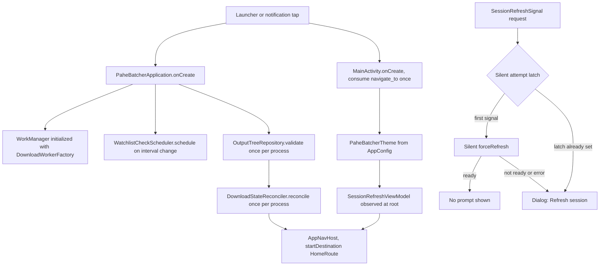
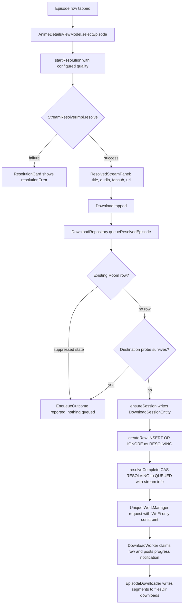
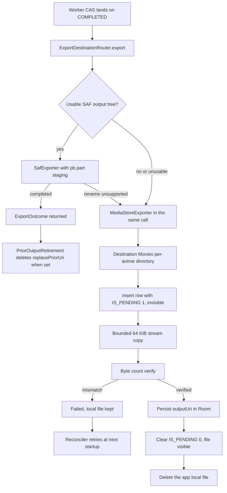
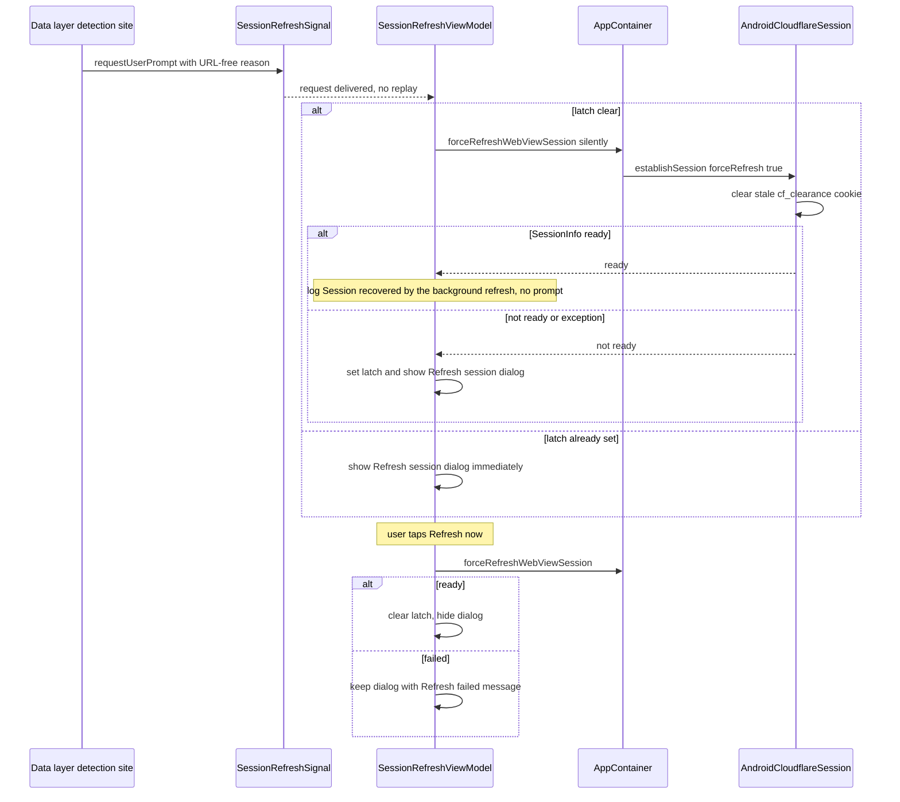
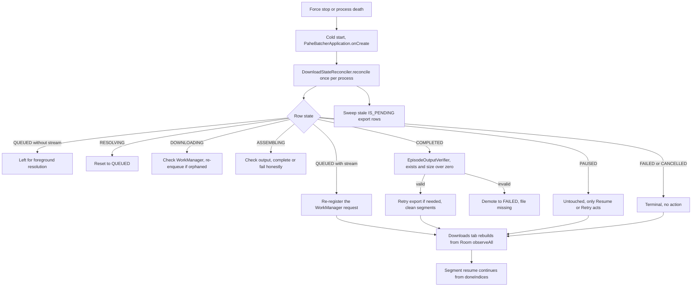

# PaheBatcher Android — User Flows

**Last verified: 2026-10-18 (source inspection + live device journey)**

Scope: the native Android application only. Every flow below is described from the
current production sources under
`pahebatcher/src/main/java/com/pahebatcher/app/` (package root `com.pahebatcher.app`).
Class names, strings and constants quoted here are the real ones in those files.

Reading markers:

* **live 2026-10-18** — behaviour observed on a device during the verification journey.
* Everything else is asserted from source and is traceable to the named file.

Companion documents (read together, not instead):

* [ANDROID_ARCHITECTURE.md](ANDROID_ARCHITECTURE.md)
* [ANDROID_DATA_AND_STATE.md](ANDROID_DATA_AND_STATE.md)
* [ANDROID_TESTING_AND_RELEASE.md](ANDROID_TESTING_AND_RELEASE.md)
* [ANDROID_FEATURE_CATALOG.md](ANDROID_FEATURE_CATALOG.md)
* [ANDROID_AI_HANDOFF.md](ANDROID_AI_HANDOFF.md)

---

## Flow index

1. Application startup
2. Search and result selection
3. Anime details loading
4. Lazy episode pagination
5. Episode-range selection
6. Audio selection
7. Individual download
8. Batch download
9. Stream resolution
10. Download execution and resume
11. Assembly and output verification
12. MediaStore export
13. Duplicate and already-downloaded detection
14. Re-download behaviour
15. Notifications and failure reasons
16. Session refresh
17. Watchlist checks
18. Settings
19. Playback
20. Process-death recovery and reconciliation

---

## 1. Application startup

**User action** — launch from the launcher, or tap a notification that carries the
`navigate_to` extra.

**Entry points** — `PaheBatcherApplication.onCreate` runs first (process scope), then
`MainActivity.onCreate`.

**Components and order**

1. `PaheBatcherApplication.onCreate`:
   * `AppLog.setBufferingEnabled` is driven by the persisted `showConsole` setting
     (in-memory log retention exists only while that switch is ON).
   * Explicit `WorkManager.initialize(...)` with `DownloadWorkerFactory` (Room,
     `DownloadNotificationManager`, `DownloadConfig`, `AppConfigDownloadConfigSource`,
     `AppContainer.episodeExporter`, `AppContainer.watchlistChecker`, fresh
     Wi-Fi-only / notification-preference / auto-resume providers, and the one shared
     `HlsHostConcurrencyLimiter`). `workManagerConfiguration` builds the same factory
     as a fallback.
   * `WatchlistCheckScheduler.schedule` is re-issued whenever
     `watchlistCheckIntervalMinutes` emits a new value (`distinctUntilChanged`, policy
     `ExistingPeriodicWorkPolicy.UPDATE`).
   * Once per process (guarded by an `AtomicBoolean`): `outputTreeRepository.validate()`
     re-validates the persisted SAF output tree, then `DownloadStateReconciler.reconcile()`
     repairs download state (flow 20). Neither ever blocks the UI.
2. `MainActivity.onCreate`: `enableEdgeToEdge()`, consume-once read of
   `EXTRA_NAVIGATE_TO` (rotation cannot re-navigate), then `setContent`.
3. Inside `setContent`: `AppContainer.appConfig.themeSettings` → `PaheBatcherTheme`,
   then the root `SessionRefreshViewModel` prompt, then `AppNavHost`
   (`startDestination = HomeRoute`).

**Session validity presence-check** — there is no eager probe at cold start. The first
page request runs `AndroidWebViewRequestBridge` →
`AndroidCloudflareSession.establishSession(forceRefresh = false)` (restore from
`AndroidSessionPersistence`), and validity is the presence check in
`AndroidCloudflareSession.isSessionValid()`: state `ESTABLISHED`, age within
`SESSION_FRESHNESS_MS` (20 minutes) and a `cf_clearance` cookie present for
`animepahe.com` / `animepahe.pw`. A failed check leads to flow 16.

**Prompt surface** — `MainActivity` observes `SessionRefreshViewModel.state`
(Activity-scoped, built by `AppViewModelFactory` with
`AppContainer.forceRefreshWebViewSession`) and renders an `AlertDialog` above every
route: title **"Refresh session"**, confirm **"Refresh now"** /
"Refreshing…", dismiss **"Not now"**, `testTag = session_refresh_prompt`.

**State changes** — WorkManager configured; one-time reconciliation; theme applied;
navigation created; possibly `SessionRefreshPromptState(visible = true)`.

**Failure branches** — reconciliation or tree-validation errors are logged and swallowed
(`AppLog.e`) and never delay launch; a blank/unknown `navigate_to` is discarded without
navigating.

**Persistence boundary** — DataStore settings and Room are read; nothing is written by
the startup UI. The refresh prompt is deliberately **not** persisted (it dies with the
Activity).

**Observable outcome** — the Home tab with the search field and the bottom bar
(Home / Downloads).

---

## 2. Search and result selection

**User action** — type in the search field, or press the IME Search key.

**Entry point** — `HomeScreen` (`testTag search_field`) → `HomeViewModel.onQueryChange`
/ `submitSearch`.

**Components** — `HomeViewModel` (debounce `DEBOUNCE_MS = 350`, one in-flight
`searchJob`) → `AnimeRepository.searchWithOutcome(AnimeRepository.currentHost, query)` →
`WebViewHttpClient` → `AndroidWebViewRequestBridge` (serialized by `webViewPageLock`) →
`AnimePaheParser` → `SearchOutcome` → `SearchResultMapper` → `SearchUiState.results`.

**State changes** — typing rebuilds `SearchUiState` (stale results dropped,
`loading = true` while debouncing or executing); blank input clears without a request;
IME submit cancels the pending debounce and executes immediately.

**Failure branches** — `SearchOutcome.Unreachable` → "Couldn't reach animepahe. Check
your connection."; an exception → its message (or "Search failed."); OFFLINE →
"You're offline — search needs a connection." with no request issued
(`NetworkMonitor` guards `executeSearch`). Retry re-runs the same call.

**Persistence boundary** — none: query and results live only in the ViewModel; nothing
is written to Room or DataStore.

**Observable outcome** — `LazyColumn` of `search_result_row` rows; tapping a row
navigates to `AnimeDetailsRoute(session)` (`launchSingleTop`), which starts flow 3.

---

## 3. Anime details loading

**User action** — tap a search result (or a Sessions row's Resume).

**Entry point** — `composable<AnimeDetailsRoute>` →
`LaunchedEffect(session) { viewModel.load(session) }` in `AppNavHost`.

**Components** — `AnimeDetailsViewModel.load`:
* idempotence guard (an already loading/loaded session is not re-seeded; a **failed**
  session always retries);
* cancels `scanJob`, `pageJob`, `resolveJob`, `batchJob`, `probeJob`;
* one settings read for the scan cache TTL (`configuredCacheTtlMinutes`, fallback 60);
* `episodeRepository.openListing(host, session, cacheTtlMinutes) { progress -> ... }` —
  variant/session discovery plus the first API page of each merged session;
* `ensureWindows(...)` opens the API windows that app page 1 spans;
* `audioOptionRepository.ensureProbed(opened)` runs the bounded audio probe **after** the
  scan (never during a batch or a background check).

**Progress surface** — every progress tick goes through
`AnimeDetailsViewModel.publishScanProgress` (gated on "same session AND still loading")
into `AnimeDetailsUiState.scanProgress`, rendered by `ScanProgress.describe()` as
`Scanning episodes · session 1 of N · page X of Y` (**live 2026-10-18**). A cache hit
emits no progress at all.

**State changes** — `loading = true` (seeded before any network) → on success one atomic
replacement with `title`, `episodes`, `apiTotal`, `perPage`, `apiLastPage`,
`currentPage = 1`, `pageRows`, `audioOptions`, `selectedAudio`.

**Failure branches** — blank session or OFFLINE → immediate honest error
(`ERROR_SCAN_FAILED` / `ERROR_OFFLINE`); an incomplete first page (`anime.completed ==
false`) → `ERROR_SCAN_FAILED` and `loadedAnime` stays unset; any exception → its message
or "Couldn't load episodes."; `Retry` re-runs the identical call. An empty but completed
scan shows "No episodes found." — never an error.

**Persistence boundary** — results are cached in Room through `ScanCacheRepository`
(TTL-scanned, audio probe stored in the same cache row); the screen state itself is
ViewModel state only.

**Observable outcome** — title, episode rows, `BatchPanel`, `PageBar`, audio chips.

---

## 4. Lazy episode pagination

**User action** — tap `Prev` / a page number / `Next`, or type a page into
`Go to page` + `Go`.

**Entry point** — `PageBar` in `AnimeDetailsScreen` (`testTag anime_details_page_bar`)
→ `AnimeDetailsViewModel.goToPage(page)`.

**Policy** — `domain/util/EpisodePaging` (pure, no I/O):

* API windows are the server's own `per_page` (30 rows) and stay the fetch unit;
* `appPageSize` = **100** when `total > 100`, **30** when `total <= 100`, the API window
  when the total is unknown, `null` (paging off) when unusable;
* an app page is built from the API windows its ordinals span
  (`apiPagesForAppPage`), with the boundary window shared, so reopening a cached window
  costs zero requests; the page cache is LRU-bounded (`MAX_CACHED_PAGES = 16`);
* rows are assembled **while** each window is read (`ensureWindows`), never re-read from
  the bounded cache afterwards, so a page is either whole or honestly failed.

**State changes** — `goToPage` commits `currentPage` **before** the fetch, clears
`pageRows`, sets `pageLoading`; on success `pageRows` is filled from the fetched windows
(`appPageRows`); a failure leaves an **empty** window plus `pageError`, never the previous
page's rows under the new number.

**Failure branches** — `pageError = "Couldn't load those episodes."` (or the underlying
message) scoped to the page only — the rest of the listing stays usable; offline →
`ERROR_OFFLINE`. Out-of-range or malformed `Go to page` input never navigates and is
reported under the field ("Enter a whole page number", "Enter a page between 1 and N").

**Persistence boundary** — fetched API windows live in the Room scan cache; `currentPage`
is in-memory.

**Observable outcome** — `PageBar` shows `Prev`, a responsive number window (floor of 4
buttons, ellipses when collapsed) and `Next`, plus the indicator
`Page 1 of 3 · 291 episodes` (or `… · total unknown`). **live 2026-10-18**: page
boundaries fell exactly at episodes 101 and 201 for a 291-episode title.

---

## 5. Episode-range selection

**User action** — in the `BatchPanel`, use `Select all`, `Clear`, `From`/`To` + `Range`,
or `Latest N` + `Latest`.

**Entry point** — `BatchPanel` (`testTag anime_details_batch_panel`) →
`selectAllEpisodes` / `clearBatchSelection` / `requestEpisodeRange` /
`selectEpisodeRange` / `selectLatestEpisodes`.

**Components and rules**

* The count line renders `"$selected of $total episode numbers selected"`
  (`testTag anime_details_batch_count`) where `total = eligibleOrdinalEnd(state)` =
  `min(total, 100)` — **live 2026-10-18**: `101–200` produced
  `100 of 100 episode numbers selected`.
* `Range` with a known `apiTotal` → `EpisodePaging.validateRange(start, end, apiTotal,
  ordinalCountBound(...))`; the rejection order is fixed: `UnknownTotal` → `Empty` →
  `Reversed` → `TooLarge` → `OutOfBounds(min(available, total))`.
  * `1–999` → "A range may cover at most 100 episodes (this one covers 999)."
  * `250–349` → "That range reaches past the last episode (291)." (**live 2026-10-18**,
    both rejections observed; text is `EpisodePaging.RangeRejection`'s own message).
* An accepted range fetches only the pages it spans (`pagesForRange` → `fetchPages` →
  `rowsInOrdinalWindow`), so unloaded pages are pulled on demand; zero matches →
  "No episodes matched that selection."
* `apiTotal == null` falls back to `selectEpisodeRange("$from-$to")`, the loaded-catalogue
  number parser (`EpisodeRangeParser`), and the helper line changes to
  "Episode numbers, e.g. 1-12 · selects from loaded pages".
* `Select all` fills `1..min(total, 100)` (fetching the windows first); `Latest N` uses
  `EpisodeRangeParser.selectEpisodes(..., "latest", latestN = n)` and refuses `n < 1`.
* Every bulk action writes `selectedNumbers` only — audio context and explicit overrides
  are untouched.

**Ceiling at execution** — `EpisodePaging.validateBatch` (called inside `beginBatch`,
i.e. in the execution path, not just the UI) refuses more than
`MAX_BATCH_EPISODES = 100` **distinct** numbers and, for page-scoped batches, any number
outside the page: "A batch may contain at most 100 episodes (this one has N)." Nothing is
ever silently truncated.

**State changes** — `selectedNumbers` replaced; rejections land in `batchError` without
touching the selection or fetching anything.

**Persistence boundary** — selection is ViewModel state (survives paging, dies with the
ViewModel); only fetched pages reach the Room scan cache.

**Observable outcome** — the summary line `Selected: 1–3, 5`-style text
(`anime_details_batch_selection_summary`) and an enabled `Download selected (N)` button.

---

## 6. Audio selection

**User action** — tap a `FilterChip` in the screen-level audio row, or use a row's
`Change audio` menu.

**Entry point** — chip → `AnimeDetailsViewModel.setSelectedAudio(audio)`; menu →
`setEpisodeAudio(number, audio)`.

**Components**

* The chip set is `AnimeDetailsUiState.audioOptions` — the open union discovered by
  `AudioOptionRepository.ensureProbed` (a bounded pass over representative play pages,
  serialized by the shared page lock, persisted with the scan cache), falling back to the
  release-listing values. Labels are `audio.uppercase()` → **JPN / ENG / …** with
  content description `Audio <value>`.
* `setSelectedAudio` is one coherent assignment: adopt the value (must be in the option
  set), clear **all** explicit overrides, keep **all** selected numbers, clear
  `batchError`. Refused while `batchRunning`.
* Rows are re-derived by `visibleEpisodeRows` → `variantOrCarrier`, so switching the
  context relabels **every** episode row at once (**live 2026-10-18**); multi-variant
  numbers additionally show `Audio: JPN` (or `… · override`).

**Failure branches** — a failed probe leaves the previous option set with
`audioProbeState = FAILED` and an explanatory line; availability of a requested audio is
decided only when it resolves — a missing audio fails with `AudioSelector.unavailableMessage`,
never a substitute.

**Persistence boundary** — the probe result persists in the scan-cache row; the chosen
context and overrides are ViewModel state.

**Observable outcome** — every row, resolution request and batch entry point agrees on the
same effective audio.

---

## 7. Individual download

**User action** — tap an episode row (batch mode off), then `Download` on the resolved
panel.

**Entry point / components**

* Row tap → `selectEpisode` → `startResolution` (single in-flight `resolveJob`, offline
  guarded) → the resolution panel (`testTag anime_details_resolution_panel`, a `Card` in
  the details screen — not a modal sheet) showing `Stream resolved`, `Episode N`,
  `stream.title`, `audio · fansub`, the playlist URL, then **Download** and **Stream**.
* `Download` → `downloadResolvedEpisode()` → `DownloadRepository.queueResolvedEpisode`
  (the admission gate): classify before mutating (`suppressedOutcome`), probe the
  destination when no row exists (`destinationSurvives`), `ensureSession` (parent session
  row — a foreign key prerequisite), `createRow` (`INSERT OR IGNORE`, inserted straight
  as `RESOLVING`), `resolveComplete` (persists `m3u8Url`/`userAgent`/`referer`, CAS
  `RESOLVING → QUEUED`) and finally the unique WorkManager request.

**State changes** — `enqueuing`, then `enqueueOutcome` (rendered verbatim via
`enqueueNotice`) or `enqueueError`; `POST_NOTIFICATIONS` one-time prompt may be requested
on the first non-failing hand-off.

**Failure branches** — a suppressed request reports `AlreadyActive`, `AlreadyPaused`,
`AlreadyDownloaded`, `OutputMissing` or `Refused` instead of a fake success; a lost CAS
derives the truth from the row; a thrown exception shows the message with a
**Retry download** button.

**Persistence boundary** — Room `download_sessions` + `episode_downloads` rows and the
per-episode segment directory `filesDir/downloads/<episodeId>` are written by the
repository, never by the UI. Expiring stream URLs are stored only in the row, only for
the run that needs them.

**Observable outcome** — a new row appears on the Downloads tab (flow 10) and the
foreground progress notification starts.

---

## 8. Batch download

**User action** — `Download selected (N)` or `Download this page (N episodes)`.

**Entry point** — `startBatchDownload()` / `startPageBatchDownload()` → the single
boundary `beginBatch(...)`.

**Components** — `EpisodePaging.validateBatch` (≤ 100 distinct numbers, optional page
scope) → offline refusal → the number → requested-audio map is derived **once** and
frozen (`override ?: context`) → `runBatch` loop:
1. `variantOrCarrier` — a missing *number* fails with `NO_VARIANT_AVAILABLE`
   (`EPISODE_NOT_IN_LISTING`), never a substitution;
2. `downloadQueue.isEpisodeAlreadyHandled` → counted as **skipped** before any
   resolver round-trip;
3. `ResolveAheadGate.awaitCapacity(resolveAhead + maxParallel)` bounds how far resolution
   may run ahead; a budget expiry aborts the batch with an explicit `batchError`;
4. `StreamResolutionRetry.resolveWithRetry` (`autoRetry + 1` attempts);
5. `queueResolvedEpisode` — the exact same admission gate as flow 7; only
   `Accepted`/`OutputMissing` count as **queued**;
6. failed numbers are re-run for `autoRetry + 1` passes with
   `BATCH_RETRY_DELAY_BASE_MS * pass` backoff.

**Bounded parallelism** — `DownloadWorker.runWork` defers while
`dao.countActive() >= config.maxParallel` (the row stays `QUEUED`, `Result.success()`);
every completion path triggers `triggerNextDeferredEpisode()` under `NonCancellable`.

**State changes** — `batchRunning`, `batchQueued/batchSkipped/batchFailed/batchTotal`,
then `batchFinished` + `batchFailures` (typed `FailureCategory` per episode) or
`batchError`; live line `Queued n · Skipped n · Failed n of N`, **Stop batch**.

**Failure branches** — per-episode failures never stop the loop; a capacity abort, an
empty selection or an offline start surfaces as `batchError`; leaving the screen during a
run opens the `leaveBatchWarning` confirmation (submitted vs pending counts) and stopping
keeps everything already handed to WorkManager.

**Persistence boundary** — accepted episodes are durable Room rows + WorkManager from the
moment they are queued; the batch counters are UI state and do **not** survive the
ViewModel (resolution-stage failures have no row by definition).

**Observable outcome** — the summary `Done: queued … · skipped … · failed … of …` plus
per-episode failure lines, and independent rows on the Downloads tab.

---

## 9. Stream resolution

**User action** — select an episode (single) or let a batch entry resolve.

**Components** — `StreamResolverImpl.resolve(playUrl, quality, audio)` executed under the
shared `webViewPageLock`: play-page fetch through the Cloudflare session → parse the
resolution entries → `QualitySelector.select(entries, quality, audio)` (exact requested
audio, best quality ≤ requested) → `KwikResolver` → `M3u8Extractor` → `StreamInfo`
(`url`, `title`, `audio`, `fansub`, `userAgent`, `referer`).

**Inputs** — quality is the persisted setting read once per resolution
(`configuredQuality()`, fallback `RESOLUTION_QUALITY = 1080`); audio is the effective
audio of the row (`override ?: context`).

**Failure branches** — a thrown `StreamResolutionException` becomes
`AnimeDetailsUiState.resolutionError` (its message, else
"Couldn't resolve this episode's stream.") and the panel offers a retry; offline is
refused before any request. A missing audio/quality never falls back to another entry.

**Persistence boundary** — nothing is persisted by resolution alone; the URL only enters
Room when a submission passes the admission gate (flow 7).

**Observable outcome** — the resolved panel with **Download** / **Stream**. Round-trip
observed at roughly **17 s live 2026-10-18**.

---

## 10. Download execution and resume

**Entry point** — `DownloadWorker.doWork` → `runWork` (one fresh settings snapshot via
`refreshConfig()`).

**Sequence** — read the row → maxParallel deferral → atomic `claimEntryState`
(`QUEUED|DOWNLOADING|ASSEMBLING → DOWNLOADING`) → `setForeground` with the progress
notification → `EpisodeDownloader.download(...)`:

* existing, non-empty output short-circuits the run;
* playlist fetch: **5 attempts** (`RETRY_ATTEMPTS = 5`, 500 ms exponential backoff) →
  "M3U8 fetch failed after 5 attempts"; the AES-key fetch uses the same budget;
* **resume**: `SegmentFileStore.doneIndices()` is read before writing, so existing
  segments are skipped and byte accounting starts from the directory on disk;
* segment writes run under `Semaphore(hlsWorkers)` — bounded concurrency per episode,
  with the whole app additionally capped per host by `HlsHostConcurrencyLimiter`;
* each segment is fetched by `fetchSegmentWithRetry`, also 5 attempts;
* episode-level retry: `autoRetry + 1` attempts with `1500 ms × 2^n` backoff for
  non-permanent errors;
* progress flows through `ProgressTracker` (throttled) into Room
  (`completedSegments`, `downloadedBytes`, `speed`, `etaSeconds`) and into the
  notification; `onManifestResolved` writes `totalSegments` once.

**State changes** — `DOWNLOADING` for the run; `onAssemblyStart` CAS-es to `ASSEMBLING`
(flow 11); terminal states are always CAS-guarded so a newer state wins.

**Failure branches** — `reportTerminalFailure` writes `FAILED` with the real message (e.g.
`M3U8 fetch failed after 5 attempts`) only from a state this run owns; a transport failure
with `autoResume` ON parks the row back to `QUEUED` and returns `Result.retry()`; a
`CancellationException` persists `CANCELLED` under `NonCancellable` and is rethrown —
cancellation is never reported as failure.

**Observable outcome** — the Downloads row shows `failed` chip + message + **Retry**,
and metrics `segments · bytes · % · speed · ETA · retries: N` (the `retries: N` clause
comes from `row.retryCount > 0`).

---

## 11. Assembly and output verification

**Entry point** — `EpisodeDownloader` → `FfmpegEpisodeAssembler` (via
`EpisodeAssembler.assemble`).

**Components** — remux with `-c copy` into a `.tmp` output: the contiguous-input run is
primary, the concat-demuxer run is the fallback; temp files are cleaned on success.

**State changes** — exactly one production writer of `STATE_ASSEMBLING`
(`onAssemblyStart`, CAS from `DOWNLOADING`); on success the worker CAS-es to
`COMPLETED` via `updateCompletedIfState` (or `finishReplacement` for a replacement) and
only then exports.

**Verification** — `EpisodeOutputVerifier` owns the single output rule: a non-blank
`outputUri` must resolve through `ContentResolver`, otherwise `outputPath` must exist —
always with size > 0. The same verifier backs the submission gate (flow 13) and startup
reconciliation, so they can never disagree about a row.

**Failure branches** — an assembly error (including `DISK_FULL`) → `reportTerminalFailure`
with a typed `FailureCategory`; a completion CAS that loses means another actor owns the
row, so export is skipped and no notification claims success.

**Persistence boundary** — the local MP4 under the app-private download directory is the
source of truth until a verified export completes.

**Observable outcome** — row concept `completed`, the row gains a **Play** action and the
**Replace file** affordance.

---

## 12. MediaStore export

**Routing** — `AppContainer.episodeExporter` is an `ExportDestinationRouter`: a configured
**and** validated SAF tree goes to `SafExporter`; otherwise (unset, revoked, moved, or
rename unsupported) the `MediaStoreExporter` default runs for the same call. The
destination probe of flow 13 mirrors this routing and only queries the MediaStore default.

**MediaStore sequence** — deterministic lookup in `Movies/<sanitized anime title>/`
(the per-anime directory derives from `DownloadSessionEntity.title`; the legacy flat
`Movies/PaheBatcher/` is reused only when size-verified) → `IS_PENDING = 1` → bounded
64 KiB copy → byte-count verify → `outputUri` persisted in Room → `IS_PENDING = 0`
(visible) → local file deleted. At every instant either the store row is invisible or
Room holds the pointer.

**Names** — `ExportFileNames.exportedName("001", "Title", "jpn")` →
`Ep_001_-_Title_[jpn].mp4` (audio suffix per variant); the legacy unsuffixed name is
still recognised as an alias and never renamed.

**Replace file** — `DownloadsViewModel.requestReplacement` → confirm dialog →
`DownloadRepository.confirmReplacement` sets `replaceRequested`; the worker stages under
`<segmentDir>/replace/`, `commitReplacementOutput` validates and renames the new file
onto the previous path **first**, and only then `finishReplacement` flips the row; the
old export is retired afterwards via the persisted `replacePriorUri` +
`PriorOutputRetirement`. A failure or cancellation at any point leaves the previous file
byte-for-byte in place (**live 2026-10-18**).

**Failure branches** — `ExportOutcome.Failed` never deletes the local file and never
demotes `COMPLETED`; startup reconciliation retries it (flow 20) and sweeps stale
`IS_PENDING` rows (`sweepStalePending`).

**Persistence boundary** — Room `outputUri`/`outputPath`, MediaStore rows, and the SAF
document tree; all export/sweep work is serialised by `ExportOperationLock`.

**Observable outcome** — the video appears in the library under
`Movies/<anime title>/…[jpn].mp4` and is playable from the system gallery.

---

## 13. Duplicate and already-downloaded detection

**Entry point** — `DownloadRepository.queueResolvedEpisode`, before any mutation.

**Path A — row present**: `suppressedOutcome(existing)` → a `COMPLETED` row whose output
passes `EpisodeOutputVerifier` returns `EnqueueOutcome.AlreadyDownloaded`, rendered as
**"Already downloaded — delete the existing file to download it again"** — no session
write, no resolver round-trip, no bytes moved (**live 2026-10-18**).

**Path B — row absent, destination survives**: with no row, `destinationSurvives(...)`
asks `EpisodeExporter.destinationPresent` (MediaStore default only; a valid SAF tree
returns `false` by design). A live file at this episode's exact destination
(per-anime directory + audio-suffixed leaf name) logs
`Suppressed re-submission of <id> (destination survives)` and returns
`AlreadyDownloaded` with the same message (**live 2026-10-18**).

**Other outcomes** — `DOWNLOADING`/`ASSEMBLING` → `AlreadyActive`; `PAUSED` →
`AlreadyPaused`; `COMPLETED` with a vanished output **and** no surviving destination →
`OutputMissing` ("Previous download is missing — starting it again"); a terminal row
claimed by someone else → `Refused`.

**Persistence boundary** — read-only: no row is written until the gate admits.

**Observable outcome** — the panel shows the outcome sentence instead of a Download
button; nothing is queued.

---

## 14. Re-download behaviour

**The one documented policy: explicit reject.** While a verified output exists — either
in the row or at the destination — a re-submission is refused; the app never enqueues a
"re-download" it is then forced to throw away.

* Deleting the **session** (Sessions → Delete): `SessionActions.prepareSessionDelete`
  runs export-first through the byte-verified exporter, then the confirmation dialog
  states **"Exported videos in your library are never touched."** and lists only local
  files that were never exported. Confirming removes the temporary cache and app-local
  files plus the Room rows — never a MediaStore/SAF export (**live 2026-10-18**).
* After the export is gone **and** the row is gone or demoted, the same gate reports the
  destination missing, and the legitimate re-queue runs (`OutputMissing` or a fresh
  `Accepted`).
* **Replace file** is the only explicit overwrite path: request → dialog →
  `confirmReplacement` → staged download → commit → retire prior output (flow 12).

**Observable outcome** — repeated taps on Download of a finished episode change nothing;
the honest sentence tells the user which action really re-downloads it.

---

## 15. Notifications and failure reasons

**Channels** — `NotificationChannels.ensure` creates all four together: `download_progress`
(LOW, silent), `download_complete` (DEFAULT), `download_failure` (DEFAULT),
`watchlist_new_episodes` (DEFAULT); badges off, importance sticky after creation.

**Progress** — `DownloadWorker` posts `buildProgressNotification` as the foreground
notification and updates it through `ProgressTracker`; text is
`progressText(episodeTitle, audio, percent)` built on
`DownloadNotificationManager.episodeLine` →
`DownloadRowMapper.audioLabelFor` (`jpn → Japanese`, `eng → English`, other codes as
themselves) → e.g. **"Downloading … · Japanese — 42%"** (**live 2026-10-18**).

**Terminal** — `notifyTerminal` posts `Download completed` /
`completionText(...)` → **"Download completed … · Japanese"** and **"… · English"**, or
`Download failed` / `failureText(episode, audio, category)` →
**"Download failed … · Segment download failed"** (`FailureCategory.label`).
Both are gated by fresh reads of `notifyCompletion` / `notifyFailure`, so a Settings flip
applies to the very next post. Batch runs additionally post the aggregated
`Batch download failed` summary with label→count reasons (never raw error text).

**Language threading** — the audio label travels from the row's own persisted `audio`
column into both the notification and the Downloads row, so they always agree.

**Row presentation** — a failed row shows the concept chip `failed`, the persisted
`errorMessage` (e.g. `M3U8 fetch failed after 5 attempts`) and a **Retry** action
(**live 2026-10-18**: chip + message + Retry on one row).

**Permission** — the one-time `POST_NOTIFICATIONS` prompt is requested after the first
real enqueue (`NotificationPermissionRepository`, asked-once latch, never re-asked on
denial); the Settings permission row is the manual path.

---

## 16. Session refresh

**Detection sites** — `AndroidWebViewRequestBridge` (session not ready before/after its
own automatic retry) and `AndroidCloudflareSession.fetchPage` (not ready, or main-frame
`401`/`403` via `SessionRefreshSignal.reportMainFrameStatus`). Reasons are URL-free labels
only (`HTTP 403`, `Session not ready: EXPIRED`).

**Signal** — `SessionRefreshSignal.requests` is a `SharedFlow` with **no replay** (buffer
4, drop-oldest): a request raised while no UI collects is simply dropped, and the next
failing operation raises again.

**Quiet-first latch** — the first signal after recovery is needed makes **one** silent
`AppContainer.forceRefreshWebViewSession()` attempt; success logs `Session recovered by
the background refresh` and shows nothing; failure (or a thrown exception) sets
`silentAttemptFailed` so every later requirement shows the dialog at once. An
`silentAttemptInFlight` guard coalesces concurrent signals into one attempt.

**Forced re-establishment** — with `forceRefresh = true`,
`AndroidCloudflareSession` first **resets the WebView cookie store**
(`removeAllCookies`), logging **"Cleared stale cf_clearance before forced re-establishment"**,
then re-runs the challenge. Targeted per-cookie expiry was proven insufficient
on device (2026-10-19): a cookie CREATED BY THE WEBVIEW — the real
challenge-issued `cf_clearance` — is visible to `getCookie` yet matches no
`setCookie` deletion tuple (host-only, `Domain=`-scoped, or
`Secure`/`SameSite`-attributed), so any survivor keeps re-arming the
presence-only success check; the store-wide reset cannot miss, and the fresh
challenge run re-establishes every cookie the flow needs. A healthy run logs
**"Session established successfully:
host=…"** (**the clearing line observed live 2026-10-18**, followed by the
quiet-attempt success log).

**User actions** — **Refresh now** re-runs the real force refresh (double-tap blocked by
`refreshing`); success hides the dialog and clears the latch, failure keeps it open with
"Refresh failed: …" (URL-bearing messages fall back to the exception type, never a URL).
**Not now** hides it; a later failure re-raises it.

**Persistence boundary** — none: the prompt and latch are Activity-scoped and die with
it.

---

## 17. Watchlist checks

**Cadence** — the persisted `watchlistCheckIntervalMinutes` (Settings → Background
checks: 15 default / 30 / 60 / 240 / 720 minutes, all ≥ WorkManager's 15-minute minimum)
is collected in `PaheBatcherApplication.onCreate` and applied with
`WatchlistCheckScheduler.schedule` using `ExistingPeriodicWorkPolicy.UPDATE`, so the one
periodic request is never duplicated and an interval change is applied to it.

**Execution** — `WatchlistCheckWorker.doWork` → `AppContainer.watchlistChecker.checkAll()`
(same app-scoped WebView transport as the screens, serialized by `webViewPageLock`).
Per-entry outcomes are isolated and persisted by `WatchlistChecker`.

**Notification** — at most ONE aggregated post per run, only when the summed
`newEpisodes > 0`, only if the fresh `notifyWatchlist` preference is ON, on a fixed id so
it replaces the previous one; posting is best-effort. The foreground **Check now** action
posts nothing (enforced at the `WatchlistViewModel`).

**Failure branches** — a thrown check logs and returns `Result.retry()`; an empty
watchlist logs and succeeds; a cancelled run propagates cancellation instead of
returning a `Result`.

**Persistence boundary** — Room `watchlist` table; detection state never lives in the UI.

**Observable outcome** — "New watchlist episodes" notification; the Watchlist screen
shows the per-entry status line.

---

## 18. Settings

| Section | Rows | Consumed by |
|---|---|---|
| Appearance | Theme (`System` / `Dark` / `Light`), Dynamic color | `PaheBatcherTheme` at composition |
| Download engine | Quality (`360p` / `720p` / `1080p`), Max parallel downloads (radio over `AppContext.MIN_PARALLEL..MAX_PARALLEL`), HLS workers (slider), Scan cache TTL (0–240 min), Keep temp files, Auto retry (None/Once/Twice), Wi-Fi-only, Auto-resume | quality → resolution; max parallel → `DownloadWorker` gate; HLS workers → `EpisodeDownloader` semaphore + `HlsHostConcurrencyLimiter`; TTL → `EpisodeRepository` scan cache; keep temp → post-mux cleanup; auto retry → episode retry budget; Wi-Fi-only → `WifiOnlyConstraint` at each enqueue; auto-resume → transport-failure decision |
| Storage | `OutputLocationRow` — pick a tree (`output_tree_uri`) or use default | `OutputTreeRepository` → `ExportDestinationRouter` (default `Movies/<anime title>/` while unset or unusable) |
| Notifications | permission row, Completion / Failure / New watchlist episodes switches | read **fresh** at each post site |
| Background checks | Check frequency | `WatchlistCheckScheduler` |
| Diagnostics | Show Console, Open console | `AppLog` buffering + `ConsoleScreen` |

**State changes** — every value is DataStore-backed (`AppConfig`); a change applies at the
next point of use (the next enqueue, the next resolution, the next post), never by
rewriting already-queued work.

**Failure branches** — a settings read failure logs and falls back to the shipped
defaults; configuration can never block a scan, resolution, batch or download.

**Observable outcome** — the row's control reflects the persisted value immediately and
survives restart.

---

## 19. Playback

**User action** — **Play** on a completed Downloads row (the action matrix only enables
it for `COMPLETED`), or **Stream** on the resolved details panel.

**Entry point** — `onPlay` → `navController.navigateToPlayer(episodeId)` →
`PlayerRoute(episodeId, mode = DOWNLOAD)`; `Stream` navigates with
`AnimeDetailsViewModel.streamEpisodeId()` (id only — no URL, headers or `StreamInfo`
travel through navigation).

**Components** — `PlayerViewModel.load(routeEpisodeId, mode)` seeds once per
`(episodeId, mode)`:
* `DOWNLOAD` mode reads the completed playlist from Room (`getCompletedPlaylist`) and the
  saved position from `PlaybackPositionRepository`;
* `STREAM` mode re-resolves just-in-time through the production `StreamResolver` and
  builds the source via `HlsPlaybackSourceFactory`, restoring the saved position after
  the source swap.

**UI** — `PlayerScreen` hosts the Media3 `Player` surface: position readout
(`positionMs` / `durationMs`), seek slider, centre transport controls
(play/pause, seek back/forward), previous/next across the in-VM playlist, subtitle
selection, and an error overlay with **Retry**.

**MediaSession** — `AppContainer.mediaSessionHost.onPlayerCreated` binds the single
ExoPlayer into the app-scoped `MediaSession` and starts `PaheMediaSessionService`; the
session activity `PendingIntent` routes back to `player:<episodeId>`. The system /
lock-screen surface therefore reflects the real playback state, including `PLAYING`
(**live 2026-10-18**).

**Persistence boundary** — playback position is written per `episodeId` into Room
(`PlaybackPositionEntity`) on item transitions, detach and pause; it survives process
death.

**Failure branches** — resolution or source failure renders the error overlay with a
bounded, user-driven Retry (nothing retries by itself).

---

## 20. Process-death recovery and reconciliation

**Entry point** — `PaheBatcherApplication.onCreate`, guarded once per process by an
`AtomicBoolean`, running after `OutputTreeRepository.validate()`.

**What runs** — `DownloadStateReconciler.reconcile()` iterates
`getEpisodesForReconciliation()` and applies the state table above; every repair is
CAS-guarded so a newer state always wins, and each row is handled independently (one
failure never aborts the pass). Export outcomes are logged only — reconciliation never
flips a state because of them; the local file remains the source of truth.

**Re-adoption** — WorkManager survives process death; a re-enqueued request builds a
**fresh** `WorkRequest` that reads the current Wi-Fi-only and auto-resume settings, and
the worker's `claimEntryState` prevents a stale worker from touching a row that a newer
terminal write already claimed.

**Failure branches** — per-row errors are caught and logged (`Error reconciling …`) and
the pass continues; a reconciliation crash is caught at the call site and logged.

**Persistence boundary** — Room is authoritative. The Downloads tab renders from
`DownloadRepository.observeAll()` (a `Flow` over `episode_downloads`), so rows are
restored exactly as they were (**live 2026-10-18**: after a force-stop and cold start the
rows, states, progress metrics and error messages reappeared without any user action).

**Observable outcome** — interrupted rows resume or are reported honestly; a `PAUSED`
row stays paused; a completed-but-unexported row gets its export on the next start; stale
`IS_PENDING` rows from a killed run are swept.

---

## Appendix — quick class map

| Concern | Classes |
|---|---|
| Composition root | `PaheBatcherApplication`, `AppContainer`, `AppViewModelFactory` |
| Shell / navigation | `MainActivity`, `AppNavHost`, `AppRoutes` |
| Search | `HomeScreen`, `HomeViewModel`, `AnimeRepository` |
| Details / batch | `AnimeDetailsScreen`, `AnimeDetailsViewModel`, `EpisodePaging`, `EpisodeRangeParser` |
| Session | `AndroidCloudflareSession`, `AndroidWebViewRequestBridge`, `SessionRefreshSignal`, `SessionRefreshViewModel` |
| Downloads | `DownloadRepository`, `DownloadWorker`, `EpisodeDownloader`, `DownloadStateReconciler` |
| Export | `ExportDestinationRouter`, `MediaStoreExporter`, `SafExporter`, `PriorOutputRetirement`, `EpisodeOutputVerifier` |
| Notifications | `NotificationChannels`, `DownloadNotificationManager`, `WatchlistNotificationManager` |
| Playback | `PlayerViewModel`, `PlayerScreen`, `MediaSessionHost`, `PaheMediaSessionService` |
| Watchlist | `WatchlistChecker`, `WatchlistCheckWorker`, `WatchlistCheckScheduler` |
| Settings | `SettingsScreen`, `SettingsViewModel`, `AppConfig` |
