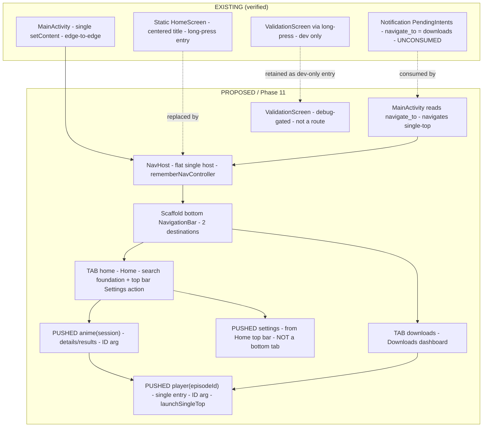
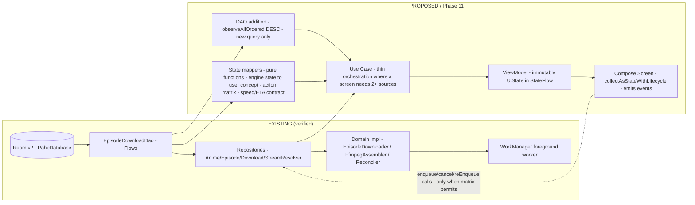
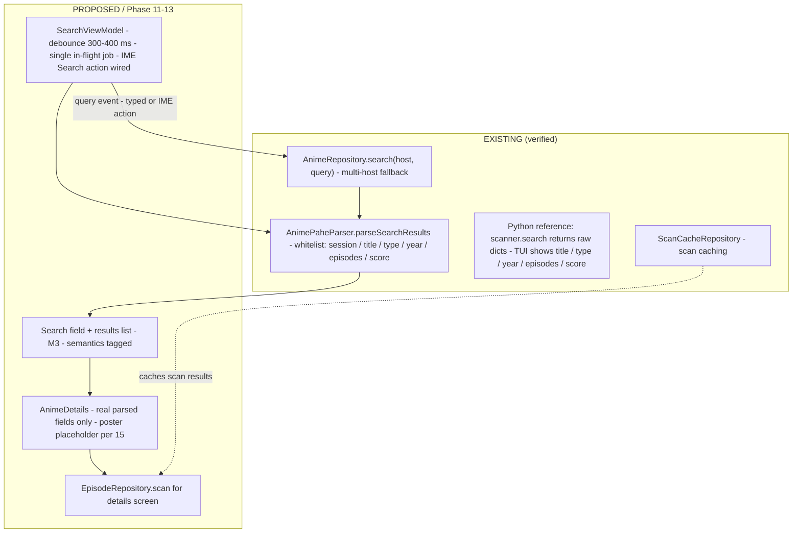
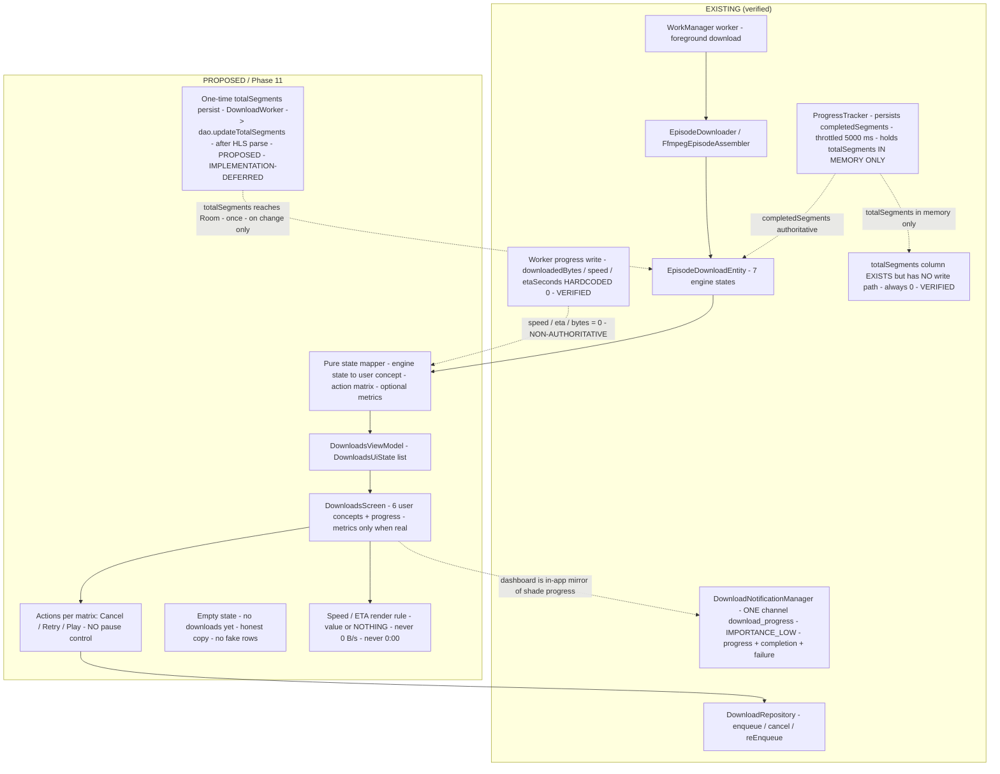
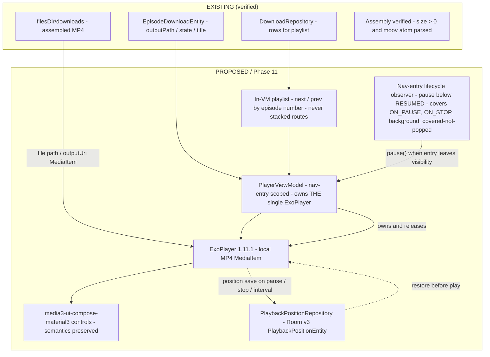
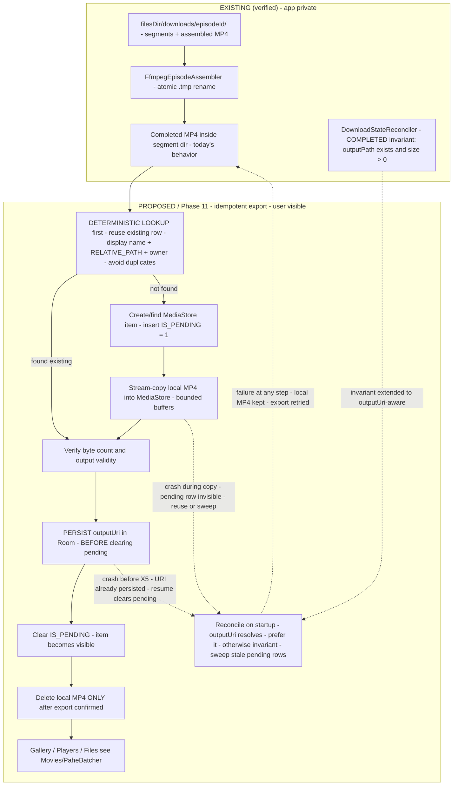
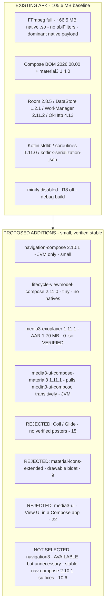

# PHASE11_ARCHITECTURE_V2.md — Material 3 UI Foundation, Navigation, Playback & Storage Architecture

**Phase**: 11 — Media3 Playback & UI Foundation
**Status**: **IMPLEMENTED + VERIFIED — Phase 11 COMPLETE (final independent tester gate PASS, Phase 11K, 2026-09-25)**; this document remains the authoritative *architecture* record. Implementation status of record lives in `PARITY.md` (Phase 11 Completion Status) and `ROADMAP.md`. *(Original header at architecture time: "ARCHITECTURE / READY FOR IMPLEMENTATION — design document only; no production, Gradle, test, manifest, or resource code had been changed for Phase 11 yet.")*
**Date**: 2026-09-23
**Version**: V2 — **corrected, authoritative**; supersedes `PHASE11_ARCHITECTURE_V1.md` (retained as a superseded historical draft)
**Authority**: `SPEC.md` · `AGENTS.md` (§17 dependency verification, §12 download engine, §13 lifecycle, §16 blockers) · `DECISIONS.md` Decisions 41–60 · `ROADMAP.md` Phase 11 · `LIMITATIONS.md` · `PARITY.md` · Python reference `<python-ref-3.7.0>` (behavioral truth; the `<python-ref-3.5.2>` path cited when this document was authored no longer exists — the local reference is 3.7.0 as of 2026-10-12; the intermediate 3.6.0 reference is superseded)

> **Document discipline.** Every claim is labelled **EXISTING** (verified in this repository), **VERIFIED** (verified against external/official sources), **PROPOSED** (architecture awaiting implementation), **IMPLEMENTATION-DEFERRED** (designed, explicitly out of Phase 11), or **EXTERNAL BLOCKER** (verification blocked outside this repository). During the pre-implementation pass nothing in this document claimed Phase 11 functionality works; post-implementation verification results live in `PARITY.md`/`ROADMAP.md`, not here. *(Implementation status labels frozen at architecture time are historical snapshots — see the Status header above.)*
>
> **Correction pass record (2026-09-23).** V2 resolves review findings **F-01 … F-09** (blocking) and **F-10 … F-18** (documentation) from the Phase 11 architecture review (verdict: CHANGES REQUIRED). The full resolution index is §40. Version pins and factual claims were re-verified against official sources during the correction pass; verifications performed this pass are cited inline with the date.

---

## Table of Contents

1. Purpose and Scope
2. Current State (Verified Inventory)
3. Design Principles
4. Material 3 Theme Foundation
5. Complete Material 3 Color Role Mapping (F-09)
6. Theme Persistence
7. Dynamic Color Recommendation
8. Light-Mode First-Frame Tradeoff (F-17)
9. Typography, Shapes, Icons
10. Navigation Architecture and Information Architecture (F-02, F-07)
11. Screen Inventory
12. Home First-Use Composition (F-03)
13. UI State Architecture
14. Search Architecture — including IME/Keyboard Behavior (F-16)
15. Poster Strategy — Four-State Contract (F-15)
16. Downloads User-Concept UI — Speed/ETA Data Contract (F-01)
17. Download State Mapping and Action Availability Matrix (F-04)
18. Downloads Entry-Point Gap
19. Notification Deep-Link Contract (F-18)
20. Notification Permission Architecture (F-11)
21. Accessibility (F-08)
22. Media3 Version and Module Policy (F-10, F-14)
23. Player Architecture
24. Player Route Lifecycle, Pause Semantics, Orientation/Fullscreen (F-05, F-13)
25. Playback Sources
26. Quality and Audio Selection
27. Completed-Video Storage Architecture
28. Private Working Data
29. Room Schema Evolution (v2 → v3) — including Playback-Position Retention (F-12)
30. Export Lifecycle — Idempotent Design and Reconciliation (F-06)
31. ValidationScreen Policy
32. Dependency Plan and APK Size (F-07, F-10, F-14)
33. Future App-Size Phase Design
34. DI and Composition Wiring
35. Loading, Empty, and Error States
36. Validation Requirements for Phase 11 Implementation
37. Risks and Open Items
38. Non-Goals
39. Decision Records
40. Review Findings Resolution Index (F-01 … F-18)

---

## 1. Purpose and Scope

This document defines the architecture for Phase 11 and the UI foundation layers that Phases 12–13 build upon:

* Material 3 "outer-space" design system (dark default; Dark / Light / System modes; persistence; **complete ColorScheme role mapping** §5).
* Navigation information architecture: **persistent bottom navigation (Home, Downloads), Settings from the Home top app bar, pushed detail/player routes**, flat single-`NavHost`, defined restoration semantics (§10).
* **Home first-use composition** (§12), **search IME behavior** (§14), **poster four-state contract** (§15).
* Downloads dashboard with a **non-misleading speed/ETA data contract** (§16) and an **explicit state × action availability matrix** (§17).
* **Notification deep-link consumption** (§19) and notification-permission design (§20).
* **Accessibility rules and validation** (§21).
* Media3 player with **route-visibility-based pause semantics, single player route, and defined orientation/fullscreen behavior** (§23, §24).
* Completed-video storage outside `Android/data` with an **idempotent MediaStore export transaction** (§27, §30) and app-private working data.
* A size-aware dependency plan with corrected native-binary facts (§32).

**Scope boundary:** design and version verification only. Phase 12–16 work, all production code, all Gradle changes, all manifest/resource changes, and all test changes are excluded from this document's authority. Phase 11 implementation status is tracked in `PARITY.md`/`ROADMAP.md` (**COMPLETE — final independent tester gate PASS, 2026-09-25**); the correction pass that produced V2 modified documentation only (five supporting documents plus `PHASE11_ARCHITECTURE_V2.md` itself — six Markdown files total).

---

## 2. Current State (Verified Inventory)

**EXISTING (verified in this repository; re-verified 2026-09-23):**

| Area | Verified fact |
|---|---|
| Entry | `MainActivity` hosts a static `HomeScreen` (centered title text); long-press opens `ValidationScreen` (KDoc: dev-only). `enableEdgeToEdge()` already called. **`navigate_to` intent extra is NOT read anywhere** (F-18) |
| Home | `HomeScreen` composable: single `Text("PaheBatcher")` in a `Box` with long-click — no search field, no storage hint, no downloads guidance (F-03 baseline) |
| Theme | `ui/theme/Theme.kt`: `dynamicColor = true` default, blue Material3 schemes; **only a subset of ColorScheme roles is set explicitly** (M3 defaults fill the rest) — **no dark-default outer-space theme exists** (F-09 baseline) |
| XML theme | `values/themes.xml` uses parent `android:Theme.Material.Light.NoActionBar`; **no `values-night/` directory exists** → pre-Compose first frame is Light (F-17 baseline) |
| Nav | No `navigation-compose` / `navigation3` dependency; no `NavHost`; no bottom navigation; no route restoration |
| ViewModels | **None exist.** No production caller of `AnimeRepository`, `EpisodeRepository`, `ScanCacheRepository`, `StreamResolverImpl`, `DownloadRepository` |
| Media3 | No `media3-*` dependency; no player classes; no `PlaybackPositionEntity` |
| Image libs | No Coil/Glide/Picasso; `res/drawable` = 4 vector drawables |
| Room | `PaheDatabase` **v2**, 4 entities (`EpisodeDownloadEntity` has `outputPath`, `speed`, `etaSeconds`, `downloadedBytes` columns; **no `outputUri`**); schemas 1+2 exported |
| DataStore | `AppConfig`: `preferencesDataStore("pahebatcher_settings")`, `appContextFlow`, `KEY_*` list — **no theme key** (10 keys: quality, audio_lang, max_parallel, hls_workers, output_dir, keep_temp, resolve_ahead, cache_ttl, cookie_string, auto_retry) |
| Download engine | Full stack exists: `DownloadRepository` (`enqueue`/`resolveComplete`/`cancel`/`reEnqueue`/`enqueueWorker`/`cancelWorker`), WorkManager foreground worker, `EpisodeDownloader`, `FfmpegEpisodeAssembler`, `DownloadStateReconciler`, `DownloadNotificationManager` |
| Progress writes | **`DownloadWorker` hardcodes `downloadedBytes = 0`, `speed = 0`, `etaSeconds = 0` in every progress write** (`DownloadWorker.kt` lines 168–174, VERIFIED); `ProgressTracker` persists `completedSegments` only (throttled ≥ 5000 ms); **`totalSegments` has NO write path — column exists but is never updated (always 0)** (VERIFIED; one-time persistence path PROPOSED in §16.2). `progressPercent()` = `completedSegments / totalSegments` (0 when `totalSegments <= 0`). **There is no `totalBytes` field** (F-01 baseline) |
| Repository guards | `cancel()` writes CANCELLED from **any** state with no state guard; `reEnqueue()` is **terminal-only** (guarded by `isTerminal()`); `canResume()` = FAILED \| QUEUED (F-04 baseline) |
| States | `QUEUED / RESOLVING / DOWNLOADING / ASSEMBLING / COMPLETED / FAILED / CANCELLED`; `STATE_PAUSED` removed (no pause); **`ASSEMBLING` is never written by production code** (LIMITATIONS §15) |
| Notifications | **One channel only**: `download_progress`, `IMPORTANCE_LOW`, used by **progress, completion, AND failure** notifications (VERIFIED). All three builders attach `navigate_to = "downloads"` intent extras (F-11/F-18 baseline) |
| Permissions | Manifest: `INTERNET`, `FOREGROUND_SERVICE(_DATA_SYNC)`, `POST_NOTIFICATIONS` — **never requested at runtime** |
| Toolchain | AGP 9.4.1 · Kotlin 2.4.20 · Gradle 9.7.1 · JDK 25 · compileSdk/targetSdk 37 · minSdk 32 · Compose BOM 2026.08.00 · material3 1.4.0 · Room 2.8.5 · DataStore 1.2.1 · WorkManager 2.11.2 · OkHttp 4.12 · ffmpegkit 8.1.7 **full** · `isMinifyEnabled = false` · no `abiFilters` · serialization plugin applied |
| Baselines | Unit 393/393 · lint 0 errors / 12 warnings · instrumentation **96 total / 93 pass** (3 pre-existing FFmpeg filename failures) · debug APK **105,607,965 bytes** (2026-09-23) · x86_64 API 36 emulator validated · arm64 runtime deferred (**EXTERNAL/availability**) · Kwik externally blocked (**EXTERNAL BLOCKER**) |

**VERIFIED (external sources, 2026-09-23, correction pass):**

| Claim | Result |
|---|---|
| `androidx.navigation3` group on Google Maven | **HTTP 200** — `navigation3-runtime` / `navigation3-ui` with stable versions through **1.1.7** (plus `1.2.0-rc01` RC). Navigation 3 **exists and is available**; the V1 "artifact 404" rationale was **false** (F-07) |
| `androidx.navigation:navigation-compose` | Google Maven `<release>2.10.1</release>` — stable line confirmed |
| `androidx.media3:media3-exoplayer` 1.11.1 AAR | **1,703,377 bytes, 173 entries, 0 `.so` files** — the chosen module packages **no native binaries** (F-10) |
| `media3-ui-compose-material3` 1.11.1 POM | Declares compile dependency on **`media3-ui-compose`** (plus media3-common, media3-common-ktx, foundation, material3) — direct declaration of `media3-ui-compose` is redundant (F-14) |
| Media3 / navigation line releases | `media3-exoplayer` and `media3-ui-compose-material3` `<release>1.11.1</release>` (lastUpdated 20260911) |

---

## 3. Design Principles

1. **Material 3 is mandatory** (SPEC): all screens use Material 3 components and `MaterialTheme` color/typography/shape systems. No custom framework, no Material 2.
2. **Outer-space identity**: a deliberate dark "deep-space" palette is the brand default; light mode is a first-class "moonlight" counterpart, not an afterthing. Restrained: blue → indigo → violet → magenta family; **no neon, no gradients, no glow, no starfield wallpaper, no cheesy space clip-art**.
3. **Dark by default**: the app opens dark regardless of a light system setting unless the user selects **System**.
4. **User concepts, not engine states**: UI speaks *queued / downloading / assembling / completed / failed / cancelled* — never `RESOLVING`, never "pause".
5. **No fake anything** (`AGENTS.md` §5): screens render only real parsed/Room data; empty states say so honestly; poster art only from verified sources; **no metric is ever rendered as a plausible-looking value it does not have** (F-01: no fake `0 B/s`, no fake `0:00`).
6. **Size-aware dependencies** (`AGENTS.md` §17): every addition justified with rationale, size impact, native-binary impact (**stated from measured AAR facts, not assumptions**), and an avoidability assessment.
7. **Lifecycle realism** (`AGENTS.md` §13): nothing assumes the Activity or process survives; player and UI state are reconstructible from persistence; a covered screen is never an audible screen (F-05).
8. **Explicit contracts over implicit choices**: navigation chrome, action availability, color roles, export ordering, IME behavior, accessibility, and restoration semantics are all specified here so the implementer invents no user-visible behavior.

---

## 4. Material 3 Theme Foundation

**PROPOSED.**

* `Theme.kt` becomes `PaheBatcherTheme(themeMode, dynamicColor, content)` driven by an explicit mode enum `ThemeMode { SYSTEM, DARK, LIGHT }`, **default = DARK** (replacing `isSystemInDarkTheme()` as the default source of truth).
* **Dark (default) — outer-space palette**: anchor values (design target; full role mapping in §5):
  * Surfaces: near-black void `#05070D`; raised surfaces `#0B1020` / `#121A31` (layered like orbital depth).
  * Primary: nebula violet `#8B7CF6`; Secondary: restrained cyan `#4FD6E0`; Tertiary: restrained amber `#FFB65C`.
  * On-surface text: starlight `#E8ECF8`; muted text: `#97A0BE`; outline: `#6672AC` (§5.4); hairline dividers: `outlineVariant` `#1A2138`.
* **Light — moonlight palette**: paper-white `#F6F7FC` surfaces, violet/cyan/amber accents **darkened for contrast**, ink `#111527` text. Light mode is *off by default* but fully supported.
* **System bars**: edge-to-edge with `enableEdgeToEdge` (EXISTING call retained); bar/icon colors derive from the selected scheme so the "space" background is continuous.
* Component mapping: `Scaffold`, `TopAppBar`, `NavigationBar`, `Card`, `FilterChip`, `LinearProgressIndicator`, `AlertDialog` — Material 3 defaults, restyled only via color scheme.
* `values/themes.xml` gains a `values-night/` counterpart and a dark window background so the pre-Compose window matches the dark default (first-frame behavior and its residual tradeoff: §8).
* **Dynamic color OFF by default** (§7).

**Why dark default:** the SPEC's outer-space theme is dark-native; a light-default window then dark-content swap produces a flash on every cold start. System mode remains available for users who want OS-following behavior.

---

## 5. Complete Material 3 Color Role Mapping (F-09)

**PROPOSED — this section is the implementation contract for `ColorScheme`.** V1 specified only anchors; V2 maps **every** role so the implementer does not invent on-colors or leave M3 defaults (which are blue-based) leaking into the identity.

### 5.1 Rules

1. Every role below is set **explicitly** in both schemes — no reliance on M3 template defaults (the current EXISTING `Theme.kt` blue defaults must not survive).
2. **On-colors are derived, not guessed**: for every `(container, onContainer)` and `(background, onBackground)` pair, contrast must be **≥ 4.5:1** (normal text). Large text (≥ 18.66 sp bold / 24 sp) and applicable UI/non-text boundaries (icons, progress, outlines against their surfaces) must be **≥ 3:1**.
3. If a candidate pair fails, adjust **lightness within the same hue family** until it passes — never swap in an arbitrary neutral and never ship a failing pair.
4. **Error colors are explicit and NOT derived from the brand palette** — standard Material error reds are used in both schemes so "error" reads as error everywhere.
5. Gradients, glows, and wallpaper-style decoration are prohibited (§3.2).

### 5.2 Dark scheme (default) — role table

| Role(s) | Dark value | Treatment / pairing |
|---|---|---|
| `primary` | `#8B7CF6` nebula violet | Brand accent (buttons, active tab indicator) |
| `onPrimary` | `#150F2E` deep space ink | ≥4.5:1 on violet (dark ink on lightened violet) |
| `primaryContainer` | `#2A2266` deep indigo container | Elevated brand surfaces (selected chips, FAB) |
| `onPrimaryContainer` | `#E9E4FF` pale violet | ≥4.5:1 on container |
| `secondary` | `#4FD6E0` restrained cyan | Supporting accent (progress tint, secondary icon) |
| `onSecondary` | `#04252A` cyan-black | ≥4.5:1 on cyan |
| `secondaryContainer` | `#103840` teal container | Quiet supporting surfaces |
| `onSecondaryContainer` | `#C8F4FA` pale cyan | ≥4.5:1 on container |
| `tertiary` | `#FFB65C` restrained amber | Sparse highlight (retry/attention, never large fills) |
| `onTertiary` | `#3A2405` brown-black | ≥4.5:1 on amber |
| `tertiaryContainer` | `#4A3210` amber-brown container | Attention surfaces (warning chips) |
| `onTertiaryContainer` | `#FFE6C4` pale amber | ≥4.5:1 on container |
| `background` | `#05070D` void | Root background |
| `onBackground` | `#E8ECF8` starlight | ≥4.5:1 on background |
| `surface` | `#05070D` void | Root surface |
| `onSurface` | `#E8ECF8` starlight | ≥4.5:1 on surface |
| `surfaceVariant` | `#121A31` raised panel | Cards, input backgrounds |
| `onSurfaceVariant` | `#97A0BE` muted starlight | ≥4.5:1 on surfaceVariant (metadata text) |
| `surfaceContainerLowest` | `#03050A` | Deepest layer (scaffold under sheets) |
| `surfaceContainerLow` | `#0B1020` | Cards on void |
| `surfaceContainer` | `#0F1528` | Standard container (top bar, nav bar) |
| `surfaceContainerHigh` | `#161F3A` | Elevated container (dialogs, menus) |
| `surfaceContainerHighest` | `#1D284A` | Highest layer (popovers, snackbars) |
| `outline` | `#6672AC` (corrected — see §5.4) | Borders — ≥3:1 vs `surface` (**4.38:1 VERIFIED**) and ≥3:1 vs every `surfaceContainer*` role where borders appear (min **3.14:1** vs `surfaceContainerHighest` — VERIFIED) |
| `outlineVariant` | `#1A2138` | Hairlines/dividers (decorative, exempt from 3:1) |
| `inverseSurface` | `#E8ECF8` | Snackbar inverse background |
| `inverseOnSurface` | `#0B1020` | ≥4.5:1 on inverseSurface |
| `inversePrimary` | `#6250D4` (corrected — see §5.4) | ≥4.5:1 vs `inverseSurface` (**4.92:1 VERIFIED**); accent on inverse background |
| `error` | `#FF6E6E` explicit error red | Failed chips, error text — **not brand-derived** |
| `onError` | `#410000` | ≥4.5:1 on error |
| `errorContainer` | `#5C1515` | Error surfaces |
| `onErrorContainer` | `#FFDAD6` | ≥4.5:1 on errorContainer |
| `surfaceTint` | = `primary` | M3 elevation tint (kept subtle; elevation by container role) |
| `scrim` / `outline` use | `#000000` scrim | Dialog/modal dimming (M3 convention) |

### 5.3 Light scheme (moonlight) — role table

| Role(s) | Light value | Treatment / pairing |
|---|---|---|
| `primary` | `#5646D6` deep violet | ≥4.5:1 with white text on it |
| `onPrimary` | `#FFFFFF` | White on deep violet |
| `primaryContainer` | `#E6E1FF` pale violet | Selected light surfaces |
| `onPrimaryContainer` | `#1E1666` | ≥4.5:1 on container |
| `secondary` | `#0F6E7A` deep cyan | ≥4.5:1 with white text |
| `onSecondary` | `#FFFFFF` | |
| `secondaryContainer` | `#CCEEF3` pale teal | |
| `onSecondaryContainer` | `#06333A` | ≥4.5:1 |
| `tertiary` | `#8A5200` deep amber | ≥4.5:1 with white text |
| `onTertiary` | `#FFFFFF` | |
| `tertiaryContainer` | `#FFE3BE` pale amber | |
| `onTertiaryContainer` | `#2C1800` | ≥4.5:1 |
| `background` | `#F6F7FC` paper | |
| `onBackground` | `#111527` ink | ≥4.5:1 |
| `surface` | `#F6F7FC` paper | |
| `onSurface` | `#111527` ink | ≥4.5:1 |
| `surfaceVariant` | `#E9ECF7` light panel | |
| `onSurfaceVariant` | `#464E6B` slate | ≥4.5:1 on surfaceVariant |
| `surfaceContainerLowest` … `surfaceContainerHighest` | `#FFFFFF` → `#E9ECF7` ladder | White cards over paper; subtle layering without borders |
| `outline` | `#767DA0` | ≥3:1 vs surface (**3.77:1 VERIFIED**) |
| `outlineVariant` | `#C6CADD` | Dividers (decorative) |
| `inverseSurface` | `#111527` | |
| `inverseOnSurface` | `#F6F7FC` | ≥4.5:1 |
| `inversePrimary` | `#B8AEFF` | Accent on inverse surface — ≥4.5:1 (**9.08:1 VERIFIED**) |
| `error` | `#B3261E` explicit error red | **Standard M3 error — not brand-derived** |
| `onError` | `#FFFFFF` | |
| `errorContainer` | `#F9DEDC` | |
| `onErrorContainer` | `#410E0B` | ≥4.5:1 |

> Hex values are the **design contract**; §36 requires a programmatic contrast check over all mandated pairs at implementation time, and any failing pair is corrected within its hue family before the phase is claimed done. This is how "do not hard-code arbitrary on-colors without checking contrast" is operationalized.

### 5.4 Correction note (V2 re-review FND-B): two dark values recomputed

The first V2 draft specified two dark-scheme values whose stated ratios did not hold (both verified against WCAG 2.1 relative-luminance math during the re-review):

| Role | Old value | Stated claim | Actual ratio | Corrected value | Verified ratio |
|---|---|---|---|---|---|
| `outline` | `#232B45` | ≥3:1 vs `surface` | **1.44:1 — FAIL** | **`#6672AC`** | **4.38:1** vs `surface` `#05070D`; ≥3:1 against **every** dark surface role a border can sit on (min **3.14:1** vs `surfaceContainerHighest` `#1D284A`) |
| `inversePrimary` | `#6C5CE0` | ≥4.5:1 vs `inverseSurface` | **4.19:1 — FAIL** | **`#6250D4`** | **4.92:1** vs `inverseSurface` `#E8ECF8` |

Both corrections stay inside the blue/indigo/violet identity family (same hue neighborhoods as the old values — indigo-blue outline, violet inverse accent); no role outside these two changed. All other §5.2/§5.3 pairs were recomputed and hold their stated claims (spot-verified: `onPrimary` 5.54:1, `onPrimaryContainer` 11.19:1, `onSecondary` 9.23:1, `onSurfaceVariant` 6.64:1, light `outline` 3.77:1, light `inversePrimary` 9.08:1). The §36-8 programmatic test remains normative and must validate these corrected values at implementation time.

---

## 6. Theme Persistence

**PROPOSED — extends the EXISTING DataStore, no new storage mechanism.**

* New keys on the existing `AppConfig` preferences DataStore (`pahebatcher_settings`):
  * `KEY_THEME_MODE` — `stringPreferencesKey`, values `system | dark | light`, **default `dark`**.
  * `KEY_DYNAMIC_COLOR` — `booleanPreferencesKey`, **default `false`** (§7).
* Exposed as `themeSettings: Flow<ThemeSettings>` alongside the existing `appContextFlow`; `MainActivity` collects it (lifecycle-aware) and passes values into `PaheBatcherTheme`.
* Defaults are code defaults — a fresh install is dark with zero reads/writes required; migration from pre-existing installs is a no-op (absent keys → defaults).
* **No second persistence system** (no separate SharedPreferences, no EncryptedSharedPreferences): one DataStore file, consistent with Decision 9 and explicitly re-affirmed by §8 (the XML first frame cannot read this store — that limitation is accepted, not worked around with a second store).

---

## 7. Dynamic Color Recommendation

**Recommendation: OFF by default; user-toggleable (toggle ships with the Phase 11 Settings slice, §11).**

| Option | Verdict | Reasoning |
|---|---|---|
| Dynamic color ON everywhere | Rejected | Material You extracts wallpaper hues and replaces the curated palette — the app would stop being "outer-space" (often becoming beige/olive), violating the SPEC theme identity |
| Dynamic color OFF, fixed palettes | **Recommended (default)** | Guarantees the SPEC-mandated look; deterministic screenshots for review; zero wallpaper-dependent variance in tests |
| OFF by default + Settings toggle | **Recommended end-state** | Respects user choice; toggle persisted in `KEY_DYNAMIC_COLOR`; available minSdk 32 ≥ Android 12 |

This deliberately **inverts the current `dynamicColor = true` default** in `Theme.kt` (EXISTING) at implementation time. When dynamic color is ON, §5 does not apply (the system scheme replaces it) — the toggle must state this honestly in its Settings label.

---

## 8. Light-Mode First-Frame Tradeoff (F-17)

**PROPOSED behavior — explicitly accepted tradeoff, documented so no implementer "fixes" it with a second persistence mechanism:**

* **Fact:** XML theme resources (`values/themes.xml`, `values-night/`) are resolved by the platform **before Compose starts**; they cannot read the DataStore theme preference (`AGENTS.md` architecture: DataStore requires coroutine reads).
* **Design:** the XML window theme defaults to **dark** (matching the DARK-by-default product default): `values-night/` + base dark window background (§4). Cold start with default or DARK preference → correct dark first frame, no flash.
* **Consequence:** if the user's **persisted** preference is **LIGHT**, a cold start briefly renders the dark XML theme until Compose collects `themeSettings` and applies the light scheme — a single dark first frame for light-mode users.
* **Decision:** this is an **accepted v1 tradeoff**. Do **not** introduce a second theme persistence mechanism (e.g., duplicating the mode into `SharedPreferences` purely so `themes.xml`'s limited `Activity`-style theming could read it, or splash-screen API overrides) solely to eliminate it. The cost (one frame) does not justify a second source of truth for theme state.
* Revisit only if a future Android mechanism allows the window theme to be derived from the same DataStore at process start; record any such change in `DECISIONS.md`.
* **Validation:** §36 test — dark default cold start renders dark; LIGHT-persisted cold start settles to light after first composition (documented behavior).

---

## 9. Typography, Shapes, Icons

**PROPOSED.**

* **Typography**: Material 3 default type scale with minor overrides (display for screen titles; body/label unchanged for readability). **Scalable**: all text uses `MaterialTheme.typography` styles — no fixed sp values baked into containers, no `maxLines = 1` clipping on essential text without ellipsis handling (accessibility §21.4). No custom font files in v1 (APK-size cost, no functional gain).
* **Shapes**: medium corner radius family (12–16 dp cards, 24 dp sheets) — soft, modern, consistent with Material 3.
* **Icons**: reuse the Material 3 built-in icon set (ships inside `compose-material3`/`material-icons-core` already in the graph — **no new dependency**). Existing 4 vector drawables remain. **No `material-icons-extended`** (§32). Vector-first: no raster assets for simple iconography.
* **Posters/placeholders**: vector/title-initial placeholder art from existing drawables — no bitmap assets (§15).

---

## 10. Navigation Architecture and Information Architecture (F-02, F-07)

**PROPOSED — flat single `NavHost` on the EXISTING single-Activity shell, with an explicit information architecture.** The implementer does not choose the chrome; it is specified here.



### 10.1 Destination classes

| Class | Destinations | Chrome | Back / Up behavior |
|---|---|---|---|
| **Top-level (persistent)** | `home`, `downloads` | Persistent bottom `NavigationBar` (2 items: **Home**, **Downloads**) + per-screen `TopAppBar` | Switching tabs: `saveState`/`restoreState` — each tab keeps its own back stack and scroll/list state; system back from a top-level destination follows standard behavior (predictive-back exits app when at root) |
| **Pushed (stack)** | `anime(session)`, `player(episodeId)`, `settings` | Bottom bar **hidden** on `player` (immersive viewing); visible or hidden per M3 convention on `anime`/`settings` — player definitely hidden | Standard popBackStack; Up icon in `TopAppBar` mirrors system back; back from player returns to the origin screen (V1 behavior retained) |

### 10.2 Chrome decisions (explicit)

* **Bottom navigation contains exactly two destinations: Home and Downloads.** Material 3 `NavigationBar`.
* **Settings is NOT a bottom-navigation destination.** It is reached from the **Home top app bar** (gear icon, `IconButton` with content description — §21.1) as a **pushed** route. Rationale: settings is a low-frequency destination; reserving a bottom slot for it wastes the primary nav surface (M3 guidance: bottom nav for top-level, sibling destinations).
* **Settings route registration and content (corrected phasing):** the `settings` route is registered in Phase 11 and its Phase 11 content is **only real, functional settings: theme mode (Dark/Light/System) and dynamic-color toggle** — both DataStore-backed and consumed by §4/§7, so no dead control exists (AGENTS §5). Engine settings (quality, HLS workers, output, etc.) arrive with Phase 13. **A Settings entry is never shipped pointing at an empty screen.**

### 10.3 Routes and arguments

* **One `NavHost`, flat route list, type-safe routes** via the already-applied Kotlin serialization plugin: `home`, `downloads`, `anime(session: String)`, `player(episodeId: String)`, `settings`.
* **ID-only route arguments** — screens re-read full state from Room/repositories (no object passing; survives process death; args themselves are restored via SavedStateHandle).
* `ValidationScreen` is **not** a route: entry remains the existing long-press, additionally gated by `BuildConfig.DEBUG` at implementation (§31).

### 10.4 Navigation semantics (explicit — F-02)

* **Library:** stable `androidx.navigation:navigation-compose` **2.10.1** via `rememberNavController()` — **Navigation 3 is not used** (corrected rationale §10.6).
* **NavController host state:** created with `rememberNavController()` inside `setContent`; the back stack and currently-selected bottom tab are retained across configuration changes and **restored after process death** by the SavedState mechanism Navigation Compose provides (routes + args are serializable, which is why type-safe routes are required — they make restoration lossless).
* **Single-top behavior:** every programmatic navigation to `player` uses `launchSingleTop = true`; tab switches use `navigate(tabRoute) { launchSingleTop = true; popUpTo(home) { saveState = true }; restoreState = true }` so duplicate tab taps never stack destinations.
* **Player re-entry:** requesting `player(episodeId)` for the episode already loaded in the existing player entry → `launchSingleTop` reuses that entry (no second player destination ever exists). Requesting a **different** `episodeId` while a player entry exists → **replace in place** (`popUpTo(player) { inclusive = false }` semantics): at most one player entry exists at any time; episode switching **within** the player (next/prev) happens inside the `PlayerViewModel`, never by stacking routes (§24).
* **Route argument restoration:** arguments live in the entry's SavedStateHandle; after process death the graph, args, selected tab, and per-tab back stacks are reconstructed, and each screen rebuilds its UiState from Room (§13).
* **Predictive back:** system back and predictive-back gestures are handled by Navigation Compose; deep-linked/notification-driven navigations participate in the same stack (§19).
* **Up vs back:** identical effect for pushed routes (popBackStack); the top app bar Up affordance appears only on pushed routes.

### 10.5 What the implementer must NOT do

* No second `NavHost`, no nested graph per tab beyond what Navigation Compose needs internally for `restoreState`, no dialog routes duplicating screens, no object-typed route args, no manual backstack, no `AndroidView`-based fragments.

### 10.6 Navigation 3 rejection — corrected rationale (F-07)

**VERIFIED 2026-09-23:** the `androidx.navigation3` group **exists on Google Maven and resolves with HTTP 200**, listing `navigation3-runtime` and `navigation3-ui` with stable versions through **1.1.7** (plus RC `1.2.0-rc01`). The V1/Decision-48 claim that artifact lookup "returned 404" was **false** and is retracted (see also §39, Decision 48 correction).

Navigation Compose remains selected on **factual** grounds:

1. Stable **`navigation-compose` 2.10.1 is sufficient** for this flat, single-Activity, five-route navigation architecture — including predictive back, type-safe args, and state restoration.
2. The application has **no requirement that needs Navigation 3** (no multi-graph/adaptive-nav need exists in Phases 11–13 scope).
3. Navigation 3 is a **newer, rapidly evolving API surface** (its stable line only reached 1.x recently, with active RC churn).
4. The project **prioritizes stable, predictable APIs** and ecosystem maturity (documentation, `rememberNavController`-equivalent patterns, tested restoration behavior).
5. `AGENTS.md` §17 requires **verified stable** dependencies and does not favor adopting the newest API merely because it exists.

Availability is **not** the reason; sufficiency and stability are. Do not reintroduce the 404 claim anywhere (repository audit §40).

---

## 11. Screen Inventory

**PROPOSED** (phasing per `ROADMAP.md`):

| Screen | Route | Navigation class | Content source | Phase |
|---|---|---|---|---|
| Home (first-use + search foundation) | `home` | Top-level tab | §12 composition; `AnimeRepository.search()` results (§14) | 11 (foundation), 13 (full flow) |
| Anime details + episode selection | `anime(session)` | Pushed | `EpisodeRepository.scan()`, `EpisodeRangeParser`, `QualitySelector`/`AudioSelector` | 13 |
| Downloads dashboard | `downloads` | Top-level tab | `EpisodeDownloadDao` Flows (§16/§17) | 11 |
| Player | `player(episodeId)` | Pushed (single entry) | Room + Media3 (§23/§24) | 11 |
| Settings | `settings` | Pushed (from Home top bar) | `AppConfig` DataStore — **Phase 11 content: theme mode + dynamic color only** (both real, §10.2); engine settings in 13 | 11 (theme slice) / 13 (full) |
| Validation (dev) | *(debug-gated entry, not a route)* | — | existing dev screen | 11 (gate only) |

Each screen: `Screen` composable (stateless, takes UiState + callbacks) + `ViewModel` (produces UiState) — testable without Android plumbing.

---

## 12. Home First-Use Composition (F-03)

**PROPOSED — the exact first-use Home composition.** It must remain simple; this is a contract, not a suggestion. The implementer does not add dashboard cards, recommendations, or invented data.

**Required content, in order:**

1. **One concise line explaining what the app does** — e.g. "Search animepahe, pick episodes, download and watch them." (single sentence; honest; no feature list).
2. **Search field with a clear hint** — M3 search input, hint text such as "Search anime titles…" — wired to the §14 search foundation (typing works; results appear only when the real repository returns them; until Phase 13 the field performs **real searches** but the download continuation is Phase 13 — §18).
3. **Clear indication of where completed videos are saved** — one quiet line: videos are saved to `Movies/PaheBatcher/` (the real §27 target). Never `Android/data`.
4. **Honest empty-Downloads guidance** — a single subdued line/link: "No downloads yet — downloads you start will appear here." Tapping it navigates to the `downloads` tab (which shows its own honest empty state, §16 U5).
5. **No fake recommendations.** No "trending", no carousel, no suggested titles.
6. **No invented anime data.** No sample rows, no placeholder posters with fake titles, no hard-coded lists (AGENTS §5).
7. **No unnecessary dashboard cards.** No stat tiles (download counts, cache size) — those numbers are either zero-meaningful at first use or belong to a later phase's real dashboards.

**Visual design:** consistent with the restrained dark outer-space identity (§3.2, §5) — void background, starlight text, a single violet accent on the search field; vector-only ornament, at most one subtle vector motif (existing drawables); no gradients/glow/starfields.

**Validation (§36):** Compose semantics test asserting the first-use semantics tree contains exactly the required elements (tagline, search field with hint, storage-location text, empty-downloads guidance) and contains **no** list items/rows beyond real search results.

---

## 13. UI State Architecture

**PROPOSED ViewModels/UI over EXISTING Room/Repository layers** (AGENTS §4 layering: UI → ViewModel → Use Case → Repository → Domain → engine):



* **Immutable UiState**: one `data class` per screen (`HomeUiState`, `SearchUiState`, `DownloadsUiState`, `SettingsUiState`, `PlayerUiState`), exposed as `StateFlow`, collected with `lifecycle-runtime-compose`'s `collectAsStateWithLifecycle`.
* **Pure mapper layer (F-01/F-04):** engine entity → user-concept row is a **pure, table-tested function** (state → chip; state → action availability; optional-field speed/ETA handling). Mappers live outside composables so §36 tests exercise them directly.
* ViewModels are **stateless wrt persistence**: they call repositories; Room remains the source of truth (`AGENTS.md` §9). Process death → rebuild UiState from Room.
* **New DAO query (query-only, no schema change)**: ordered observe-all for the dashboard (e.g. `ORDER BY updatedAt DESC, id DESC`).
* No polling: DAO `Flow`s push updates; the engine's 5000 ms `ProgressTracker` throttle bounds update rate naturally.

---

## 14. Search Architecture — including IME/Keyboard Behavior (F-16)

**PROPOSED UI over EXISTING repository/parser:**



* Flow: user input → ViewModel (**debounce ~300–400 ms**, single in-flight job, cancels superseded queries) → `AnimeRepository.search()` → parse whitelist → `SearchUiState { query, loading, results, error }`.
* **Fields rendered = fields actually parsed** (session/title/type/year/episodes/score) — identical to the Python TUI (Python truth). **No poster field is parsed today** (§15).
* Multi-host fallback and session establishment reuse the EXISTING repository + `CloudflareSessionProvider` — the UI never performs HTTP directly (AGENTS §4).
* Errors surface honestly: network failure / Cloudflare / empty query → distinct UiState branches with retry affordance (§35).
* Search's *download-enqueue* continuation is **Phase 13** (§18).

### 14.1 IME / keyboard behavior (F-16 — explicit contract)

| Situation | Required behavior |
|---|---|
| Keyboard **Search** action | Triggers **the same search submission path** as any other submission (identical ViewModel event — one code path, not a second one) |
| While typing | **Debounce stays active** — IME action on an already-settled query executes immediately (it flushes/awaits the pending query rather than double-firing) |
| Superseded queries | **Cancelled** — one in-flight job; a new query cancels the previous request (existing §14 rule, applies to IME-submitted queries too) |
| While editing | **Focus remains in the field** (no focus steal while typing/editing) |
| Tapping a result | **Keyboard dismisses** (`focusManager.clearFocus()` / hideSoftInput on result click) |
| Navigating to a result/next screen | **IME never remains visible over the next screen** — the keyboard is hidden as part of the navigation; pushed screens start with no IME showing |
| Back with IME open | System back **first closes the keyboard** (standard platform behavior), then navigates — do not override this ordering |

**Validation (§36):** Compose UI tests — IME action invokes the same search event as programmatic submission; debounce/coalescing preserved (fake-clock test in ViewModel); result tap clears focus and hides IME; navigating to details leaves no IME window visible (assert `Ime` visibility via instrumentation).

---

## 15. Poster Strategy — Four-State Contract (F-15)

**Facts (VERIFIED):** `parseSearchResults` whitelists **no poster/image field**; Python's search table renders **no poster column**; the live API could not be reached (network-blocked) — poster availability is **unverified (EXTERNAL BLOCKER)**.

**Poster state contract — every poster slot in the UI is exactly one of four states:**

| # | State | Rendering | Entered when |
|---|---|---|---|
| 1 | **Real poster available** | Actual image from a verified, parsed poster URL | A poster field is verified in a real API response AND round-tripped through an extended parser whitelist (not before) |
| 2 | **Poster loading** | Vector placeholder + subtle loading indication (no shimmer theater) | A verified URL has been requested by a future image loader |
| 3 | **Poster failed** | Vector placeholder + honest failed state (no crash, no infinite spinner) | Load error for a verified URL |
| 4 | **Vector/title-initial placeholder** | Title-initial monogram over existing vector art | **The state for ALL poster slots in Phase 11** (no verified source exists) |

**Rules (PROPOSED):**

1. **Posters only from real parsed data. Never invent, construct, or guess poster URLs** (no URL-pattern guessing, no `session`-derived paths, no placeholder domains). A poster URL may enter state 1 only after a real API response shows the field, the parser whitelist is extended deliberately, and the value round-trips in a test.
2. Until verified: **state 4 everywhere** — honest empty-state design, not fake content; it does not imply data exists.
3. **No general-purpose image library in Phase 11** — Coil/Glide remain rejected (§32). **If a future image loader is introduced, it must support all four states above with lifecycle-safe loading and bounded caching** (no leaks into recomposed/composable-scoped requests; AGENTS §12).
4. Four-state rendering must be **modeled explicitly** in UiState (sealed subtype or enum + payload) — not inferred ad hoc in composables — so §36 can test all four transitions.

---

## 16. Downloads User-Concept UI — Speed/ETA Data Contract (F-01, HIGH)

**PROPOSED dashboard over EXISTING engine** — the UI speaks **user concepts only**, and **never invents a metric**:



* **Vocabulary (mandatory):** `queued`, `downloading`, `assembling`, `completed`, `failed`, `cancelled` — six chips/labels, Material 3 styled.
* Row content: episode title, episode number, user-concept chip, progress (contract below), retry count (when > 0), `errorMessage` (when failed), **metrics only under the contract below**.
* **No pause control anywhere** — `STATE_PAUSED` was deliberately removed in Phase 10; offering one would be a fake/disabled control (AGENTS §5).
* Actions: strictly per the §17 matrix. Enqueue/start stays Phase 13 (§18).
* Updates arrive via DAO `Flow` (§13) — no polling, no view-model timers.

### 16.1 Speed/ETA/progress data contract (F-01 — blocking finding, resolved)

**VERIFIED facts:** `DownloadWorker` writes `downloadedBytes = 0`, `speed = 0`, `etaSeconds = 0` on **every** progress write (lines 168–174); `ProgressTracker` persists only `completedSegments` (there is **no write path for `totalSegments`** — the column exists but no DAO statement ever updates it, so it stays at its `0` default); `ProgressTracker` holds the manifest-resolved total **in memory only**; there is **no `totalBytes` field** anywhere in the schema. The one-time persistence of `totalSegments` is **PROPOSED — IMPLEMENTATION-DEFERRED** (§16.2).

**Field-by-field contract:**

| Field | Provenance | Authoritative? | UI rule |
|---|---|---|---|
| `completedSegments` | EXISTING — `EpisodeDownloader` per-segment callback → `ProgressTracker.flush()` (throttled ≥ 5000 ms) → Room | **YES — authoritative** | Drives percentage and segment text |
| `totalSegments` | **PROPOSED — IMPLEMENTATION-DEFERRED:** HLS manifest/playlist parse resolves the segment count → **persisted once** (§16.2) at manifest resolution; before that the column reads `0` (unknown). No write path exists today (VERIFIED). | **YES — authoritative denominator once persisted (§16.2); `0` = not yet known** | Denominator from the **persisted Room value only**; `0` means "unknown" (pre-manifest or persistence path not yet implemented) — never a fabricated total |
| Percentage | `progressPercent()` = `completedSegments / totalSegments`, both read from the **persisted Room row** (denominator arrives via the §16.2 one-time persistence path) | **YES — derived from the two persisted authoritative fields** | Shown when the persisted `totalSegments > 0`. **When the persisted `totalSegments == 0` (unknown total): show NO numeric percentage** — render the chip plus indeterminate/preparing styling; "0%" falsely implies a known total at zero |
| `downloadedBytes` | EXISTING column, but **always written 0** by the worker | **NO — non-authoritative** | If `0`/unavailable → **do not render a bytes value**. (Rows may show `completedSegments/totalSegments` instead — real values under the §16.1 percentage rule; a bare persisted `completedSegments` count with no denominator may always be shown since it is real.) |
| `totalBytes` | **Does not exist in the schema** | n/a | Never rendered; percentage is segment-based by design (mirrors the Python dashboard's segment percentage) |
| `speed` | EXISTING column, **always written 0** | **NO — non-authoritative** | Display **only if `speed > 0`**. Otherwise **omit the field entirely** (preferred) or show an explicitly neutral `—`. **Never render `0 B/s`** — a zero-speed reading would falsely claim the downloader is transferring at zero bytes/second |
| `etaSeconds` | EXISTING column, **always written 0** | **NO — non-authoritative** | Display **only if `etaSeconds > 0`**. Otherwise omit or show `—`. **Never render `0:00` / "0 sec"** |

**UiState modeling:** the mapper exposes `speedBps: Long?` and `etaSeconds: Long?` (**null = unavailable**), never raw zeros — so a composable *cannot* accidentally print `0 B/s`; null-handling is compile-enforced.

**Scope boundary:** Phase 11 does **NOT** add engine performance metrics. Computing real speed/ETA (bytes-delta over wall-clock in `ProgressTracker`, or deriving bytes from segment byte-counts) is a **separate future enhancement**, explicitly out of scope for Phase 11 — recorded as an open item (§37) because SPEC §25 lists speed/ETA as desired dashboard fields. The existing engine does not provide trustworthy values today; the UI is honest about that.

**Persisted progress remains authoritative:** the §16 dashboard is driven by Room values only — the UI never computes its own progress.

**Validation (§36):** state-mapper tests proving: (a) `speed = 0` / `etaSeconds = 0` → `null` → no `0 B/s` / `0:00` strings can be produced; (b) nonzero values render formatted; (c) persisted `totalSegments = 0` → no percentage (no fabricated denominator); (d) persisted `completedSegments` flows through unchanged; (e) a manifest-derived `totalSegments > 0` **reaches Room persistence** and the mapper then computes the expected percentage from `completedSegments`/`totalSegments` both read back from Room (full six-assertion contract: §36-2).

### 16.2 totalSegments persistence — one-time write after manifest resolution (PROPOSED — IMPLEMENTATION-DEFERRED)

**Problem (VERIFIED):** `EpisodeDownloadEntity.totalSegments` exists in the v2 schema but **no write path ever updates it** — `EpisodeDownloadDao` has no statement touching it, `DownloadWorker`'s progress writes pass only `completedSegments`, and `ProgressTracker` keeps the manifest-resolved total (`latestTotal`) in memory only. The column therefore always reads `0`, which makes the §16.1 percentage rule permanently render "no percentage". V1 and the first V2 draft described `totalSegments` as an EXISTING persisted/authoritative value — **that was wrong and is corrected here**.

**Normative flow (persistence path made explicit):**

```
HLS manifest/playlist parse (EpisodeDownloader, EXISTING)
  → totalSegments known (currently in-memory only in ProgressTracker)
  → ONE-TIME persist: DownloadWorker -> EpisodeDownloadDao.updateTotalSegments(episodeId, total)  [IMPLEMENTED — Phase 11; TotalSegmentsPersistenceTest 2/2]
  → segment processing continues (EXISTS)
  → persist completedSegments via throttled ProgressTracker write (EXISTS, ≥5000 ms)
  → Room Flow (EXISTS) → pure UI mapper → UiState → DownloadsScreen (IMPLEMENTED §13/§16 — Phase 11 downloads dashboard)
```

**Design rules:**

1. **Who writes:** `DownloadWorker` — the same component that already performs all progress writes — issues a **single** `updateTotalSegments` statement at the moment the manifest-resolved total first becomes known and differs from the persisted value. The DAO statement itself (`UPDATE episode_downloads SET totalSegments = :total …`) was **PROPOSED — IMPLEMENTATION-DEFERRED at architecture time**; it now exists in production (`EpisodeDownloadDao.updateTotalSegments`, called from `DownloadWorker`) — implemented and verified in Phase 11 (TotalSegmentsPersistenceTest 2/2).
2. **When:** once, at manifest resolution, **before or independent of** segment processing — never per-segment, never on every throttled flush. A later re-resolution that genuinely yields a *different* segment count (e.g., a retry re-parsing a changed playlist) may rewrite the value once more under the same rule: write only on change.
3. **How it reaches Room:** explicitly through a DAO statement executed by `DownloadWorker` (bounded, single-writer, on the worker's existing dispatcher) — **not** through a UI-layer write, **not** through `ProgressTracker.flush()` (that path stays `completedSegments`-only, keeping its throttling contract unchanged), and **not** by inventing a `totalBytes` field.
4. **Denominator integrity:** the UI percentage reads `totalSegments` **from the persisted Room row only**. While the value is `0` (pre-manifest), §16.1's no-percentage rule applies — **the denominator is never fabricated, estimated, or carried in view state.**
5. **No schema/migration impact:** the column already exists (v2 schema, default `0`); this is a write path only — no Room version bump, no migration, no new dependency.
6. **Status:** **IMPLEMENTED in Phase 11** (was PROPOSED — IMPLEMENTATION-DEFERRED at architecture time). The one-time write-on-change path exists and is verified (§36-2 / TotalSegmentsPersistenceTest 2/2); rows still legitimately show no percentage whenever `totalSegments` is `0` (honest current behavior, §16.1 rule (c)).

**Test contract:** §36-2 (six assertions, including that a manifest-derived total **reaches persistence** and that `totalSegments = 0`/unavailable is safely handled with **no fabricated denominator**).

---

## 17. Download State Mapping and Action Availability Matrix (F-04, blocking finding, resolved)

**PROPOSED mapping table (engine → user concept) — unchanged semantics from V1:**

| Room `state` (EXISTING) | User concept | UI notes |
|---|---|---|
| `QUEUED` | **queued** | Progress shown only per §16.1 rules |
| `RESOLVING` | **queued** (sub-label "preparing link") | Engine-internal pre-download; Python analog: dashboard **`resolving`** mark (folds into the queued concept, not its own user-facing state) |
| `DOWNLOADING` | **downloading** | percentage + (optional) speed/ETA **per §16.1 contract** — zeros are not rendered |
| `ASSEMBLING` | **assembling** | **Honesty:** production never writes this state today (LIMITATIONS §15); the mapper still handles it. **No animated fake assembly progress** — indeterminate styling only if the state genuinely appears |
| `COMPLETED` | **completed** | Play action enabled; export status reflected (§27/§30) |
| `FAILED` | **failed** | `errorMessage` + Retry |
| `CANCELLED` | **cancelled** | Retry available |

Python reference parity: Python's dashboard defines **eight** marks (`ui/dashboard.py`): **`resolving`, `waiting`, `queued`, `downloading`, `remuxing`, `done`, `retry`, `fail`**. Android mapping: `resolving` → folded into the **queued** concept as a "preparing link" sub-label (never a separate user-facing state); `waiting` and `queued` → **queued**; `downloading` → **downloading**; `remuxing` → **assembling**; `done` → **completed**; `fail` → **failed**; `retry` → the **Retry action + retry-count status** rather than a persistent download state. The remaining Python states map to the corresponding Android user concepts per this §17 table; Android's **cancelled** concept is an Android-native engine state (Phase 10) with no separate Python dashboard mark.

### 17.1 Action availability matrix (F-04 — normative)

**The UI must never expose a control whose repository operation is invalid for that state.** Normative matrix (7 engine states × 3 actions):

| Engine state | Cancel | Retry | Play |
|---|:---:|:---:|:---:|
| `QUEUED` | ✅ | ❌ | ❌ |
| `RESOLVING` | ✅ | ❌ | ❌ |
| `DOWNLOADING` | ✅ | ❌ | ❌ |
| `ASSEMBLING` | ✅ | ❌ | ❌ |
| `COMPLETED` | ❌ | ❌ | ✅ |
| `FAILED` | ❌ | ✅ | ❌ |
| `CANCELLED` | ❌ | ✅ | ❌ |

**Repository-behavior notes (VERIFIED in source — why the UI matrix is stricter than the repository):**

* `DownloadRepository.cancel()` currently performs **no state guard** — it will write `CANCELLED` over *any* state, including `COMPLETED`. Therefore the **UI must not offer Cancel on `COMPLETED`** (offering it would let a user destroy a completed row's state and break the §29 reconciler invariant expectations). The repository-level guard question is engine scope — Phase 11 does not modify the engine; the **matrix is the UI contract**.
* `DownloadRepository.reEnqueue()` is **terminal-only** (`isTerminal()` = COMPLETED/FAILED/CANCELLED). The repository would therefore accept Retry on `COMPLETED`; the **UI matrix does not** — re-downloading a completed episode via the dashboard is not a v1 concept (and would clobber a verified output; re-download flows belong to Phase 13's deliberate UX). Retry is exposed for `FAILED` and `CANCELLED` only.
* **Play** is exposed for `COMPLETED` only — it navigates to `player(episodeId)` (§10, §23).
* **`RESOLVING` cancellation** stays consistent with Phase 10 repository behavior: `cancel()` persists `CANCELLED` from the caller's scope **then** cancels the Worker (Phase 10 corrective — a cancelled worker coroutine cannot write Room reliably). `CANCELLED` is terminal, so startup reconciliation will not resurrect it (VERIFIED: reconciler treats FAILED/CANCELLED as terminal no-ops). The UI simply exposes Cancel on `RESOLVING` rows like any active row.
* **No pause action exists in any state** — `STATE_PAUSED` was removed in Phase 10 (§16).
* `enqueue` (starting downloads) has **no UI in Phase 11** — entry point is Phase 13 (§18); therefore no matrix row for it is needed yet (design: enqueue is available from search/details only, Phase 13).

**Validation (§36):** table-driven state-mapper test covering **all 7 states × 3 actions** (21 assertions): matrix conformance + "UI exposes no control outside the matrix" invariant.

---

## 18. Downloads Entry-Point Gap

**Scope note (accurately documented, unchanged):** the pipeline *search → details → select episodes → enqueue download* has **no production entry point** — no production code calls `DownloadRepository.enqueue` (§2). Therefore:

* Phases 11–12 establish the **UI foundation** (theme, navigation, dashboard observability, player) — a user can *see and manage* downloads but cannot yet *start* one from search.
* The **search → download entry point remains Phase 13** (ROADMAP scope note, unchanged).
* The downloads dashboard must handle the **empty state** gracefully with honest copy ("No downloads yet") — never seeded/fake rows (AGENTS §5); Home carries the first-use guidance (§12.4).
* No documentation may describe the APK as a fully usable downloader until Phase 13 lands the entry point.

---

## 19. Notification Deep-Link Contract (F-18)

**EXISTING:** all three `DownloadNotificationManager` builders attach `Intent(context, MainActivity::class.java)` with flags `FLAG_ACTIVITY_NEW_TASK | FLAG_ACTIVITY_CLEAR_TOP` and extra **`navigate_to = "downloads"`**. **No code reads this extra today** — taps merely open the app.

**PROPOSED consumption (Phase 11 navigation slice):**

1. **Notification tap → Downloads screen.** The `navigate_to` extra is the routing key; v1 recognizes the single known value `"downloads"` (unknown/absent values → plain app open, no crash, no navigation).
2. **`MainActivity` reads the extra** — in `onCreate(intent)` **and** in `onNewIntent(intent)` (both paths required: with `CLEAR_TOP` the existing instance may be recreated or reused depending on flags/launch mode — handling both makes the contract launch-mode-independent). The value is forwarded into the NavHost controller (via a remembered controller + a Launched-effect/entry handler keyed on the intent — no navigation from `Activity` code directly into composables' internals).
3. **NavHost performs the navigation** using the §10.4 top-level rule: `navigate("downloads") { launchSingleTop = true; popUpTo(home) { saveState = true }; restoreState = true }`.
4. **Safe when the Activity is already running** (warm tap): `onNewIntent` path → same single-top navigation; if the user is already ON `downloads`, **nothing is pushed** (`launchSingleTop` no-ops) — the current screen stays, no flicker.
5. **Duplicate taps never create duplicate destinations:** repeated notification taps (or taps on progress + completion + failure notifications in sequence) converge on exactly one `downloads` entry in the back stack (single-top + restoreState rules). Tapping while the Player is open unwinds to the top-level Downloads tab (player entry is popped by the `popUpTo(home)`-style restore — player is a pushed route, not part of tab state).
6. PendingIntents already use per-episode request codes with `FLAG_UPDATE_CURRENT | FLAG_IMMUTABLE` (EXISTING) — unchanged; no new intent flags are required for correctness (adding `FLAG_ACTIVITY_SINGLE_TOP` alongside CLEAR_TOP is permissible at implementation but not required, since both Activity paths are handled).

**Validation (§36):** intent/navigation instrumentation tests — cold-start tap opens Downloads; warm tap while on Home opens Downloads; tap while already on Downloads creates no second entry (assert back-stack size); tap while on Player returns to Downloads; unknown extra value → app opens at Home without error.

---

## 20. Notification Permission Architecture (F-11)

**EXISTING (VERIFIED — corrected claim):**

* Exactly **one** notification channel exists: `download_progress`, **`IMPORTANCE_LOW`** ("Silent — no sound/vibration", badge off).
* **Progress, completion, AND failure notifications all use this single LOW-importance channel today.** Any statement that completion/error notifications already use a *higher-importance* channel was inaccurate in V1 and is retracted.

**PROPOSED (designed, not implemented):**

* **FACT:** `POST_NOTIFICATIONS` is declared in the manifest (targetSdk 37) but **never requested at runtime**; Phase 10 instrumentation grants it explicitly via `Phase10TestSupport`. The runtime request applies **API 33+** (`Build.VERSION.SDK_INT >= 33` gate; minSdk 32 has no prompt).
* **Strategy — first-download enqueue (unchanged from V1):** rationale dialog → `RequestPermission` → asked-once flag in DataStore; **granted** → shade notifications as today; **denied** → downloads proceed identically, in-app dashboard is the guaranteed progress surface, Settings (Phase 13) offers re-request. No feature gated behind permission.
* **PROPOSED (future, NOT existing, Phase 14 scope):** a separate higher-importance channel for completion/failure events (e.g. `download_status`, `IMPORTANCE_DEFAULT`) so terminal outcomes are audible while progress stays silent. This is designed-here/labeled-PROPOSED only — **creating it is notification-phase work**, and until it exists, all three types remain on the single LOW channel.
* **Why enqueue-time, not launch-time:** requesting before demonstrated need produces denials (Android UX guidance).
* This document does **not** implement the request; tests must grant/deny explicitly as Phase 10 tests do.

---

## 21. Accessibility (F-08)

**PROPOSED — dedicated accessibility contract for Phase 11 screens.** (ROADMAP keeps "Accessibility compliant" as the Phase 13 exit criterion for *all* screens; the rules below are binding for every Phase 11 surface and become the template Phase 12/13 screens must follow.)

### 21.1 Semantics

* **Meaningful imagery**: poster/placeholder slots expose a content description built from real data (e.g., `"<title> poster"` for state 1/4) — decorative vector motifs expose **no** content description (`Modifier.clearAndSetSemantics`/absent semantics) so TalkBack never announces ornament.
* **Icon-only actions** (Settings gear, back, play/pause/seek, cancel/retry icons) always carry `contentDescription` from real strings ("Settings", "Back", "Play", "Pause", "Cancel download", "Retry download").
* **Notification-related icons**: small icons are non-content per platform convention, but any in-app notification UI (permission rationale dialog) uses labeled actions, not bare icons.
* **No redundant descriptions** on elements whose visible text already conveys the same information (text nodes are their own semantics).

### 21.2 Progress

* Progress rows expose **semantic progress** (`ProgressSemantics`/`progressbarRangeInfo` via Material 3 `LinearProgressIndicator`) so screen readers announce determinate progress properly.
* **Completion is announced appropriately** — the transition to `completed` is exposed as a meaningful state change (e.g., status text semantic announced on row update), not conveyed by color alone.
* **TalkBack users must NOT hear every 5-second progress persistence update**: progress semantics update coalesces with the existing 5000 ms `ProgressTracker` throttle (no faster than that), and row semantics are state-based, not event-per-write. Live-region announcements are reserved for **terminal transitions** (completed/failed) — never per-persist progress ticks.

### 21.3 State communication

* Download/export state must **never rely on color alone**: every chip has a **text label** (the six user concepts), and may add an icon — color is redundant coding. Failed rows additionally carry `errorMessage` text.
* Text remains readable against its container per §5 contrast pairs in **both** light and dark schemes.

### 21.4 Typography

* All text uses the scalable M3 type scale; **font scaling (up to at least 200%) must not clip**: no fixed-height containers wrapping text rows (use intrinsic/wrapped heights or minimum-height semantics); row and chip heights adapt or wrap; essential single-line labels use ellipsis only when a full-text semantics equivalent is preserved.

### 21.5 Touch targets

* Material 3 minimum interactive targets are preserved (48 dp touch minimums M3 components already enforce — icon buttons, nav items, chips).
* **Custom Media3 control slots must not reduce touch targets**: any custom/overridden control area keeps ≥ 48 dp hit regions; seek bar thumb/track hit slop preserved.

### 21.6 Player

* Custom `media3-ui-compose-material3` slot customizations **preserve accessible labels/actions**: if a stock control is re-skinned or replaced, the replacement must reproduce equivalent semantics (role, label, enabled state, click action). **Do not strip library semantics without reproducing them.**
* The video surface itself exposes an appropriate content description (e.g., episode title) rather than being focusable-dead.

### 21.7 Focus / navigation

* **Keyboard/focus navigation**: all interactive elements are focusable in a sensible order (Compose default), usable with external keyboard/D-pad on supported devices; IME actions defined in §14.1 do not strand focus.
* **TalkBack traversal order** follows visual order (title → chip → progress → actions); no focus traps.
* **Dialogs and error states return focus appropriately**: dismissing an `AlertDialog` (rationale, errors) returns focus to the invoking control; pushed-route back returns focus into the previous screen's list position where Compose restores it.

### 21.8 Validation (§36)

* Compose semantics tests: content descriptions present on poster slots and icon-only actions; absent on decorative elements; progress exposes `ProgressBarRangeInfo`; state chips expose text labels (not color-only).
* Font-scale test: render key screens at 2.0 font scale — no clipped/overlapped text assertions.
* Touch-target test: assert minimum sizes on custom player controls and nav items.
* A11y traversal-order test on Downloads rows; dialog-dismiss focus restoration test.

---

## 22. Media3 Version and Module Policy (F-10, F-14)

**VERIFIED 2026-09-23** (re-verified during correction pass) against official sources: Google Maven metadata for `media3-exoplayer` and `media3-ui-compose-material3` report `<release>1.11.1</release>` (lastUpdated 20260911); the official Android Media3 release notes list 1.11.1 as stable.

### 22.1 Direct dependency selection (F-14 — corrected)

**Phase 11 direct Media3 dependencies = exactly two:**

| Module | Version | Role |
|---|---|---|
| `androidx.media3:media3-exoplayer` | **1.11.1 stable** | Playback engine: `MediaItem`, position tracking, error/retry surface — required by SPEC playback |
| `androidx.media3:media3-ui-compose-material3` | **1.11.1 stable** | Material 3 Compose player controls matching §4/§5 |

**Dependency-relationship facts (VERIFIED from the `media3-ui-compose-material3:1.11.1` POM, 2026-09-23):** it declares compile dependencies on `media3-common`, `media3-common-ktx`, **`media3-ui-compose`**, `androidx.compose.foundation`, `androidx.compose.material3`. Therefore:

* **`media3-ui-compose` is transitively provided — do NOT declare it directly.** Declare it only if/when a concrete implementation requirement demonstrates a direct-API need; if that happens, document the specific API in `DECISIONS.md` at that time.
* **Do NOT add `media3-ui`** (the View-system player UI) — the application is Compose-first; adding it would ship an unused View widget stack.
* All Media3 modules remain at the **identical version 1.11.1** (Media3's same-version requirement).

### 22.2 Full module table

| Module | Version | Decision | Rationale |
|---|---|---|---|
| `androidx.media3:media3-exoplayer` | **1.11.1 stable** | **CHOSEN (v1, direct)** | ExoPlayer core — SPEC playback |
| `androidx.media3:media3-ui-compose-material3` | **1.11.1 stable** | **CHOSEN (v1, direct)** | M3 controls; pulls `media3-ui-compose` transitively (§22.1) |
| `androidx.media3:media3-ui-compose` | 1.11.1 stable | **TRANSITIVE (not declared)** | Provided by the M3 module's POM (VERIFIED); direct declaration only on demonstrated need |
| `androidx.media3:media3-ui` | 1.11.1 stable | **REJECTED** | View-based player UI — unused in a Compose-first app |
| `androidx.media3:media3-exoplayer-hls` | 1.11.1 stable | **IMPLEMENTATION-DEFERRED** | HLS input needs a reachable stream; Kwik/HLS source is **EXTERNAL BLOCKER** (LIMITATIONS §2B) — activating before a reachable source is unverifiable. Pinned at 1.11.1 for activation with identical version |
| `androidx.media3:media3-session` | 1.11.1 stable | **IMPLEMENTATION-DEFERRED** | v1 is foreground-only (§24): no background audio → session service unjustified. Activate at 1.11.1 if background playback is scoped later |

**Policies (`AGENTS.md` §17):** all Media3 modules identical version 1.11.1 · **stable only** (no alpha/beta/RC — the lifecycle `2.12.0-alpha03` metadata hit remains rejected in favor of 2.11.0) · no downgrade of any existing infrastructure component required · first real playback verification is against a **local completed MP4** (EXISTING Phase 9/10 pipeline) — genuinely testable today, unlike blocked Kwik HLS (§25).

### 22.3 Native binaries and size (F-10 — corrected claim)

**VERIFIED 2026-09-23 (correction pass):** the `media3-exoplayer-1.11.1.aar` is **1,703,377 bytes with 173 zip entries and 0 `.so` files**.

> **Corrected statement (normative):** *The selected Media3 modules (`media3-exoplayer`, `media3-ui-compose-material3`, and their transitive `media3-ui-compose`/`media3-common` dependencies) do not themselves package native decoder `.so` binaries. Native decoder extensions are separate optional artifacts (decoder/extension modules) and are **not** part of the Phase 11 dependency set.*

* V1's claim that `media3-exoplayer` "contains native codec `.so`s / Native binaries? Yes" was **inaccurate (conservative)** and is retracted.
* This does **not** imply Media3 has zero native footprint under all possible future configurations: activating native decoder extension artifacts later would add `.so` payload — re-measured at that time (§32).
* The APK's dominant native payload remains **`ffmpegkit-full` ≈ 66.5 MB** (EXISTING).
* **Measured APK regression methodology retained:** after the first Phase 11 build, the APK-analyzer delta vs the **105,607,965-byte** baseline is recorded per dependency in `DECISIONS.md`; unexpected deltas trigger an §17 re-review.

---

## 23. Player Architecture

**PROPOSED player over EXISTING storage/Room:**



* **One ExoPlayer per `PlayerViewModel`; the ViewModel owns it** — created lazily by the ViewModel, released in `onCleared()` (paired creation/release). **No `ExoPlayer`/`AndroidView` construction inside recomposing composables** (§24).
* **MediaItem source = local assembled MP4** (`outputPath`; prefer `outputUri` when present, §25) — post-assembly checks already guarantee playability (size > 0, `moov` atom — Phase 9 invariant).
* Controls (M3): play/pause, seek slider, position/duration, retry-on-error, back — with §21.6 semantics preserved. No fake buffering indicators for local data — indeterminate UI only during genuine prepare.
* **Playlist navigation happens inside the ViewModel**: sibling `COMPLETED` episodes of the same session ordered by episode number → next/prev (Python parity: `stream.py` playlist `n/p`) — implemented as in-VM episode switching (§24.2), **not** by stacking player routes.
* Position persistence: `PlaybackPositionRepository` (§29).
* UI never touches ExoPlayer directly from the composable — the ViewModel mediates (AGENTS §4).

---

## 24. Player Route Lifecycle, Pause Semantics, Orientation/Fullscreen (F-05, F-13 — blocking finding, resolved)

### 24.1 Player ownership (normative)

1. Exactly **one ExoPlayer instance per active `PlayerViewModel`**, created and owned by the ViewModel.
2. Released from the ViewModel lifecycle (`onCleared()`), which Navigation Compose triggers when the player nav entry is permanently popped (route exit).
3. **No player creation directly inside recomposing Composables** — the composable receives the player/controller from the ViewModel only.
4. Rotation/configuration change does NOT clear a nav-entry-scoped ViewModel → the player instance survives rotation without re-preparing (bounded: still released on route exit).

### 24.2 Route behavior (normative)

* **One Player route** exists in the graph: `player(episodeId)`.
* **Next/previous switching = in-ViewModel episode switching** on the same route/entry (playlist held in the VM; the route argument's episodeId is treated as the entry seed — subsequent switches update VM state, not the back stack). **Never stack multiple Player destinations** for sibling episode playback.
* **Re-entry, same episode:** requesting `player(episodeId)` while the existing entry already holds that episode → `launchSingleTop` semantics — the existing entry/VM is reused; no duplicate entry; playback state (paused position) preserved.
* **Re-entry, different episode** while a player entry exists → the existing player entry is **replaced in place** (pop-then-push with `popUpTo(player)` non-inclusive) so the back stack contains **at most one** player entry at all times.
* Cold re-entry (process death): player state is disposable; **position survives via Room** (§29) — restore saved position before `play()`.

### 24.3 Pause semantics (normative — replaces V1's ON_STOP-only rule)

**The player must not remain active/audible when its route is no longer the visible player route.**

* **Mechanism:** a **lifecycle-aware observer tied to the player `NavBackStackEntry`'s lifecycle** (e.g., `DisposableEffect` + `LifecycleEventObserver` on `entry.lifecycle`, or `repeatOnLifecycle` on that entry) — **not** only the Activity's `ON_STOP`.
* **Pause trigger:** when the player entry's lifecycle drops **below RESUMED** (i.e., on `ON_PAUSE` — RESUMED → STARTED — or `ON_STOP` of that entry), call `player.pause()` (+ persist position). This single rule covers **all** of:
  * **App backgrounded** — `ON_PAUSE` then `ON_STOP` (RESUMED → STARTED → CREATED): covered; the Activity-`ON_STOP`-only V1 case is a subset.
  * **`ON_PAUSE` only (multi-window / partial occlusion / dialog over the app)** — entry leaves RESUMED even though it stays STARTED: covered (this is why the threshold is RESUMED, not STARTED — an entry paused via `ON_PAUSE` never drops *below* STARTED).
  * **Covered-not-popped**: another route is pushed ON TOP of the player (e.g., Settings opened from player Up-stay flows, or any pushed route) — the covered entry is no longer RESUMED even though it is still on the back stack → playback pauses. (V1's Activity-ON_STOP rule missed this case — F-05.)
  * **Navigation away** — popping or replacing the player entry → the entry leaves RESUMED/destroyed → pause+release path via VM clear.
  * **Multi-window pause** — Activity paused → entry paused (below RESUMED).
* **No auto-resume:** returning to visibility does NOT auto-resume playback — the user taps Play (no surprise audio; simpler semantics). Documented behavior, tested.
* **Prevention guarantees (explicit):**
  * *Audio continuing after navigation away* → impossible: visibility loss always pauses (rule above).
  * *Multiple active player instances* → impossible: one VM owns one player; VM is nav-entry-scoped; composables never construct players.
  * *Stacked player destinations retaining active playback* → impossible: single-top + replace-in-place (§24.2) means one entry; and a covered entry is paused by §24.3 (below-RESUMED rule) regardless.
* **Release:** on route exit (entry popped → VM `onCleared`) → `player.release()`; no leaked player (§36 instrumentation asserts release).

### 24.4 Orientation / fullscreen (F-13 — explicit v1 behavior)

* **v1 respects system rotation** — no orientation lock, no `screenOrientation` manifest pinning, no `configChanges` tricks.
* **Video uses aspect-fit** (letterbox/pillarbox — M3/Media3 `ResizeMode.FIT` equivalent / `ContentScale.Fit`); no crop.
* **No manual fullscreen toggle in v1** — justified: the player route already hides the bottom bar and gives the video maximum height; a rotation-driven immersive toggle adds surface/permission complexity without functional gain for local playback. (If later justified, record the reason in `DECISIONS.md` — do not add casually.)
* **No forced orientation lock** — landscape and portrait both supported; rotation is handled by ViewModel-scoped player survival: **rotation preserves playback position and player state through the ViewModel lifecycle** (play/pause state and position survive; surface rebinds without re-preparing the media).

### 24.5 Validation (§36 — instrumentation)

* Play local MP4 → navigate away (push another route) → assert playback **paused** (covered-not-popped case).
* Play → background app (home) → assert paused.
* Rotate device → assert position + play/pause state preserved (no re-prepare flash beyond surface rebind).
* Next/prev → assert same back-stack depth (no stacked player entries) and VM-switched episode.
* Re-tap Play on the same episode → `launchSingleTop` reuse (stack depth unchanged).
* Pop player route → assert player released (no leaked instance — test hook on VM release).
* Cold start into `player(id)` with saved position → position restored before play.

---

## 25. Playback Sources

| Source | Status | Design |
|---|---|---|
| **Local assembled MP4** (`filesDir/downloads/...`) | **v1 primary — verified feasible today** | Phase 9/10 produce verified files on emulator; real end-to-end playback testable now |
| **Exported user-library MP4** (`content://` MediaStore URI, §27) | v1 secondary once the export slice lands | Player prefers `outputUri` when present (survives local export cleanup), falls back to `outputPath` |
| **HLS (Kwik) streaming** | **EXTERNAL BLOCKER** (LIMITATIONS §2B: kwik.cx Cloudflare WAF) | Architecture prepared: `media3-exoplayer-hls` pinned at 1.11.1 (§22); activation + live verification blocked externally, not by Android. ROADMAP's "HLS playback works" exit criterion **cannot be honestly verified** until a reachable source exists or local-HLS fixtures are used — open item (§37), not claimed complete |

No fabricated stream URLs ever reach the player (AGENTS §5, §10).

---

## 26. Quality and Audio Selection

**PROPOSED, mapped onto EXISTING selectors:**

* **Download-time selection** (already implemented): `QualitySelector` + `AudioSelector` operate on parsed play-page streams — where quality/audio is *decided* for downloads (Phase 13 entry point wires it to UI chips).
* **In-player selection (v1):** a local MP4 is a single fixed rendition — nothing to switch; the player shows metadata (quality label captured at enqueue) rather than a *disabled-looking* selector (AGENTS §5).
* **For future HLS (deferred §22):** Media3 `TrackSelectionParameters` will map to track-selection controls (PARITY §11 rows remain 🔄 until implemented).
* Python parity: `stream.py:run_stream` quality/audio prompts (`q`/`a`) — Android equivalent lands with Phase 13 UI (downloads) and HLS activation (streaming).

---

## 27. Completed-Video Storage Architecture

**Requirement:** completed videos must be user-visible **outside `Android/data`**; private working data stays app-private.

**Options evaluated (unchanged from V1 — decision stands):**

| Option | Verdict | Reasoning |
|---|---|---|
| A. `getExternalFilesDir()` (`Android/data/...`) | **REJECTED** | Violates the requirement: on Android 11+ other apps cannot access `Android/data` — videos would be invisible |
| B. `MediaStore.Downloads` → `Download/PaheBatcher/` | Viable, not chosen | Videos belong in the video library; players/gallery don't index `Download/` as media |
| C. **`MediaStore.Video` → `Movies/PaheBatcher/`** | **CHOSEN** | Android-native home for videos; appears in Gallery/Players/file managers; scoped-storage own-file insert needs **no runtime permission** at minSdk 32; stable `content://` URI; matches SPEC §13 |
| D. SAF user-chosen directory | **IMPLEMENTATION-DEFERRED** | Matches Python `output_dir`, but needs picker UX + persisted URI permissions → Settings phase (13); design keeps an `exportTarget` seam |



**Design decisions:**

1. **Working data stays EXACTLY where it is** — `filesDir/downloads/{episodeId}/` (segments, `.tmp`, concat state, local MP4) remains app-private until verified export; Decision 40's output-preserving cleanup untouched until after export (§28).
2. **Export = streaming copy** with bounded buffers (never whole file in memory — AGENTS §12; LIMITATIONS §7).
3. **`IS_PENDING = 1` for the entire write window** — the item is invisible to other apps until cleared.
4. **Normative ordering (F-06 correction — replaces V1's order):** lookup → create pending → copy → verify → **persist `outputUri` in Room → clear `IS_PENDING`** → delete local. The URI is persisted **before** the item becomes visible, so there is no window in which a *visible* MediaStore file exists that Room does not know about. (V1's "clear pending → persist URI" ordering created exactly that duplicate-prone window — retracted.)
5. **No runtime storage permission** (scoped-storage own-file insert; minSdk 32).
6. **Filename collisions:** display name = `FileNameGenerator.episodeFileName()`; MediaStore uniquifies on request; **duplicate-row reuse is governed by §30.2**, not by blind insertion.
7. **No claim of perfect cross-store atomicity:** MediaStore and Room cannot share a transaction — the design is **best-effort idempotent** (§30), recorded as a genuine limitation (LIMITATIONS).

---

## 28. Private Working Data

**UNCHANGED + extensions:**

* Segments, `.tmp`, concat inputs, resolution scratch: **app-private `filesDir`** — never exported, never user-visible (Python parity: cache vs output separation; Decision 34/40).
* Existing selective cleanup (`.ts`/`.tmp`/`conc*` removal, MP4 preservation) retained; the **only** deletion of the local MP4 is the post-confirmation step X6 (§27/§30).
* Crash mid-export → pending MediaStore rows may be orphaned: the export routine **sweeps its own stale pending rows** (our `RELATIVE_PATH`, our package, `IS_PENDING = 1`, older than the current run) **and first attempts deterministic reuse** (§30.2), preventing both phantom gallery entries and duplicate visible copies.
* No secrets/cookies/tokens written to any storage surface; nothing logs cookies or auth headers (AGENTS §10).

---

## 29. Room Schema Evolution (v2 → v3) — including Playback-Position Retention (F-12)

**PROPOSED migration (additive):**

| Change | Purpose |
|---|---|
| `EpisodeDownloadEntity.outputUri TEXT NULL` | Persist the MediaStore `content://` URI (§27/§30) |
| **New entity** `PlaybackPositionEntity (episodeId PK, positionMs, durationMs, updatedAt)` | Position persistence across rotation/process death (§24) — Android-native extension (Python has none; PARITY §11.2 📱) |
| Schema version **2 → 3**, exported `3.json` | `ALTER TABLE … ADD COLUMN outputUri NULL` + `CREATE TABLE playback_position …` — trivially additive, tested with `MigrationTestHelper` |

**Reconciler invariant extension (EXISTING `DownloadStateReconciler`):**

* Today: `COMPLETED` ⇔ `outputPath` exists && size > 0 (plus the ASSEMBLING branch via `computeExpectedOutput()`).
* After v3: validity = **(`outputUri` present ∧ URI resolves ∧ size > 0) ∨ (`outputUri` absent ∧ today's `outputPath` rule)**. Pre-export rows keep working unchanged. An exported-then-user-deleted video → reconciler marks the row **failed ("file missing")** — honest state with retry affordance (this matches the EXISTING behavior of flipping to FAILED when the file is missing).
* `outputPath` column **kept** (not dropped) as local/pre-export source-of-truth and reconciler fallback — no destructive migration.

### 29.1 `PlaybackPositionEntity` lifecycle/retention (F-12 — explicit)

* **Phase 11 v1: position rows persist indefinitely.** Primary key = `episodeId` (one row per episode, upserted on save) — storage cost is negligible (a few dozen bytes × number of ever-played episodes); there is **no TTL, no cleanup pass, and no eviction** in v1.
* **Future episode-deletion policy (designed now, NOT implemented now):** when a user-facing episode-deletion feature exists (not Phase 11), deleting an episode's download **must also remove its playback position**, via **either**:
  * (a) an FK cascade to `episode_downloads` added in a **later** migration, **or**
  * (b) an explicit `PlaybackPositionRepository.delete(episodeId)` call in the deletion path —
  with the choice recorded in `DECISIONS.md` at that time. Deleting media must never leave a stale position pointing at nothing harmful (worst case today is benign: an orphaned position row is restored for a re-downloaded episode — acceptable in v1, addressed by the future policy).
* PlaybackPositionEntity has **no FK today** (deliberate — avoids coupling the additive v3 migration to FK constraints; documented so the future deletion feature doesn't assume cascade exists).

---

## 30. Export Lifecycle — Idempotent Design and Reconciliation (F-06, blocking finding, resolved)

**PROPOSED presentation-level export state** derived around `COMPLETED` — `exportState ∈ {not_exported, exporting, exported, export_failed}` from `outputUri` + in-flight flags — **without** adding engine states (Phase 10's 7 states untouched).

### 30.1 Normative export sequence (idempotent)

1. **Deterministic lookup first** (§30.2) — if a prior export row is identifiable, **reuse it** (resume/verify) instead of inserting.
2. **Create** the MediaStore item with `IS_PENDING = 1` (`MediaStore.Video`, `RELATIVE_PATH = Movies/PaheBatcher/`, display name from `FileNameGenerator`).
3. **Stream-copy** the local MP4 into the item (bounded buffers; never whole-file in memory).
4. **Verify** byte count (`copied == local length()`) and output validity (non-zero, URI queryable).
5. **Persist `outputUri` in Room** (atomic single-row update).
6. **Clear `IS_PENDING = 0`** — only now does the file become visible to other apps.
7. **Delete the local MP4** only after export is confirmed (steps 4–6 succeeded) — Decision 40's forward-applied lesson.
8. **Reconcile on any intermediate failure** (§30.3): the invariant is *at every instant*: either the MediaStore item is still invisible (`IS_PENDING = 1`) or Room already knows its URI. No visible-but-unknown file is possible under this ordering.

**`ContentResolver` dependency:** the export/reconciliation component is a plain class taking **`ContentResolver` via constructor injection** from the `AppContainer` (§34) — reconciliation resolves `outputUri` through this injected resolver (`query`/`openInputStream`), never through static/context-lookup scattered in call sites. (This makes the export path unit/instrumentation-testable with a fake resolver where practical.)

### 30.2 Duplicate-row reuse (deterministic lookup)

Before any insert, query `MediaStore.Video` for rows matching **all** of:

* `RELATIVE_PATH = Movies/PaheBatcher/` (normalized trailing slash),
* `DISPLAY_NAME = <FileNameGenerator output>`,
* owner = our package (`IS_PENDING` rows of our own package are queryable by us).

If found → **reuse that row**: re-run byte verification against it; if valid → persist its URI (step 5–6 as applicable — e.g., a row already `IS_PENDING = 0` with valid bytes just needs Room to record it); if it's our stale pending row from a crash → resume the flow at verification.

**Caveats (documented, honest):**

* If the **user renames/moves** the file, `DISPLAY_NAME` lookup misses. Normal case: Room already holds the URI (rename-tolerant) → no insert needed, no duplicate. Pathological case (Room lost the URI **and** name changed) → lookup cannot identify the prior export → a new copy may be inserted; this residual duplicate risk is accepted and recorded (LIMITATIONS) — the deterministic key makes it narrow, not zero.
* MediaStore may append ` (1)` suffixes if `IS_PENDING`-uniquifying was requested; the lookup therefore also matches the base name **with any MediaStore uniquified suffix** (name equality or name-with-suffix pattern).

### 30.3 Reconciliation rules (startup / post-crash — via injected `ContentResolver`)

| Condition | Action |
|---|---|
| `outputUri` present **and resolves** (query succeeds, size > 0) | **Prefer it** — row is valid; clear any lingering local duplicate? (local MP4 cleanup allowed — see below) |
| `outputUri` present but **does not resolve** (deleted by user) | Mark per the **existing invariant extension** → **FAILED ("file missing")** (§29) — honest state, Retry affordance |
| `outputUri` absent, local MP4 remains | Pre-export state → export runs (or stays local; invariant accepts both, §29) |
| Local MP4 remains **after a successful export** (crash between X5 and X6) | **Cleanup allowed** — delete the local duplicate (URI verified valid first) |
| Visible export exists but Room lost the URI (defensive path) | **Deterministic lookup (§30.2) identifies it → persist its URI → do not insert a duplicate** |
| Stale `IS_PENDING = 1` row, our path, from a previous run | Reuse-if-resumable (verify + complete), else **delete the pending row** (sweep) so no invisible garbage accumulates |
| Byte-count mismatch | Failure → delete the (still pending) row → local kept → retry later; user never sees a partial file |

### 30.4 Failure table

| Failure | Handling |
|---|---|
| Insufficient storage at export | MediaStore write fails → local MP4 **kept**, `export_failed` with retry; never delete an unverified local copy |
| Process death mid-copy | Pending row invisible → sweep-or-resume next run (§30.3); local intact → export retried |
| Process death after verification, before Room persist | Pending row + valid bytes → next run verifies quickly and completes persist→clear |
| Process death after Room persist, before pending clear | Room already knows URI → next run clears pending (item becomes visible) — **no duplicate** |
| Process death after pending clear, before local delete | URI valid + local duplicate → cleanup deletes local |
| Byte-count mismatch | Treated as failure → pending row deleted → retry |
| User renames/moves file | Persisted `content://` URI (not path) keeps working (URI rename-tolerant for moves) |
| User deletes file | Reconciler → FAILED + "file missing" (§29); Retry re-downloads (`reEnqueue`) |
| Concurrent exports of different episodes | Bounded: sequential per-episode completion path under the existing worker; **no unbounded coroutines** (AGENTS §12) |
| Legacy pre-v3 row | `outputUri NULL` → export-on-demand or leave local (invariant handles both) |

**Validation (§36 — process-kill matrix):** instrumentation tests for **kill before MediaStore insert · kill during copy · kill after verification · kill after Room URI persistence · kill after `IS_PENDING = 0` · retry after each condition · duplicate-row prevention** (assert exactly one visible `Movies/PaheBatcher` row per episode after recovery).

---

## 31. ValidationScreen Policy

**EXISTING screen, PROPOSED gating:**

* Remains **development-only** (its KDoc already declares this): not registered as a NavHost route; reachable only via the existing long-press, **additionally gated by `BuildConfig.DEBUG`** so release builds cannot reach it (addresses LIMITATIONS §16 release-readiness note).
* No user-facing entry, no deep link, no settings row.
* Phase 11 does not modify its contents (validation logic is the tester domain; this phase only defines the gate).

---

## 32. Dependency Plan and APK Size (F-07, F-10, F-14)

**Baseline (measured 2026-09-23): debug APK = 105,607,965 bytes (~105.6 MB); FFmpeg (`ffmpegkit-full` 8.1.7, no `abiFilters`) ≈ 66.5 MB of it.** Every dependency version-verified against Google Maven / official Android docs.



**Every proposed dependency — rationale / size / native binaries / avoidability:**

| Dependency | Version (VERIFIED) | Rationale | Size impact | Native binaries? | Avoidable? |
|---|---|---|---|---|---|
| `androidx.navigation:navigation-compose` | **2.10.1 stable** (Google Maven `<release>2.10.1`, verified 2026-09-23) | Single-Activity type-safe nav, predictive back, nav-scoped ViewModels, **state restoration after process death** (§10) | Small (JVM/Compose classes; measured vs baseline at implementation) | **No** | Not reasonably — a hand-rolled backstack loses predictive-back/state-restoration and re-implements a sanctioned library |
| `androidx.lifecycle:lifecycle-viewmodel-compose` | **2.11.0 stable** (metadata `<release>` is **2.12.0-alpha03 — alpha REJECTED per AGENTS §17**; 2.11.0 matches the project's lifecycle line 2.11.0) | `viewModel()` composable integration (§13) | Very small | **No** | Technically (manual `ViewModelProvider`), but the manual path is boilerplate + error-prone; keep |
| `androidx.lifecycle:lifecycle-runtime-compose` | **2.11.0 stable** (already present transitively) | `collectAsStateWithLifecycle` | **No new size** | **No** | Already in APK; explicit declaration is documentation |
| `androidx.media3:media3-exoplayer` | **1.11.1 stable** | Playback engine mandated by SPEC | **Largest planned addition** — AAR measured **1,703,377 bytes / 173 entries / 0 `.so` (VERIFIED 2026-09-23)**; exact APK delta measured at implementation vs baseline | **No `.so` in the selected module itself** (F-10 correction). Native decoder **extensions are separate optional artifacts, not in the Phase 11 set**; do not read this as "Media3 has zero native footprint under all future configurations" | Avoidable only by abandoning SPEC playback (MediaPlayer fallback is inferior: no Compose integration, weak error/position APIs) |
| `androidx.media3:media3-ui-compose-material3` | **1.11.1 stable** | M3-styled controls per §4/§5 | Small (JVM classes) | **No** | Partially — custom controls re-implement seek/gesture/accessibility logic (§21.6); not recommended |
| `androidx.media3:media3-ui-compose` | 1.11.1 stable | **Transitive via the M3 module's POM (VERIFIED 2026-09-23) — not directly declared** (F-14) | (included above) | No | Declare directly only on demonstrated direct-API need, documented in DECISIONS then |
| `media3-exoplayer-hls` / `media3-session` | 1.11.1 stable | IMPLEMENTATION-DEFERRED (§22) | — (not in v1 graph) | (exoplayer-hls: separate artifact consideration, re-measured at activation) | Deferred = size deferred too |
| ~~Coil / Glide~~ | — | **REJECTED** (§15): zero verified poster URLs | — saved | — | Yes — and is being avoided |
| ~~`material-icons-extended`~~ | — | **REJECTED** (§9): per-icon cost across densities | — saved | — | Yes — and is being avoided |
| ~~`androidx.media3:media3-ui`~~ | — | **REJECTED** (§22): View-based player UI in a Compose-first app | — saved | — | Yes |
| ~~Navigation 3 (`androidx.navigation3`)~~ | — | **NOT SELECTED — availability is NOT the reason.** The group resolves on Google Maven (HTTP 200, stable through 1.1.7 — VERIFIED 2026-09-23). Rejected because stable navigation-compose 2.10.1 is sufficient for this flat architecture, no requirement needs Nav 3, Nav 3 is a newer/rapidly-evolving surface, and AGENTS §17 favors verified-stable, predictable APIs (§10.6, F-07 correction) | — | — | Yes |

**Measurement rule:** after the first Phase 11 build, per-dependency APK-analyzer deltas are recorded in `DECISIONS.md`; any addition exceeding expectations triggers an §17-style re-review before it ships.

---

## 33. Future App-Size Phase Design

**Designed now, implemented later (dedicated size-reduction phase — not Phase 11):**

1. **R8/minify**: enable minification + resource shrinking for **release** builds; debug stays unminified for readable tests (today `isMinifyEnabled = false`).
2. **ABI filtering**: `abiFilters`/App Bundle per-ABI delivery — with FFmpeg's multi-ABI `.so`s the dominant win.
3. **FFmpeg variant audit**: `ffmpegkit-full` vs `min`/`aac` — remux `-c copy` may not need full codecs; up to tens of MB at stake (Decision 11 re-examined with tests).
4. **Dependency re-audit**: rerun the §32 table after all phases; drop unused artifacts.
5. **Baseline Profile / startup**: size-neutral or slightly positive — optional.
6. **Success metric**: new APK size vs the recorded **105,607,965-byte** baseline; only measured numbers go into docs.

Nothing in items 1–6 may be executed opportunistically during Phase 11 (AGENTS §6).

---

## 34. DI and Composition Wiring

* **Manual DI retained** (no Hilt/Koin): `PaheBatcherApplication` owns an `AppContainer` composition root (Room, DataStore, repositories, use cases, **`ContentResolver` for export (§30.1)**).
* ViewModels obtain collaborators via a small `ViewModelProvider.Factory` keyed to the container; **nav-entry-scoped instances where lifecycle matters (player)**.
* No service locator leaks into composables — screens receive state + lambdas only (testability).
* Rationale: Hilt adds KSP processing, runtime, and APK surface for a container that fits one file (§32 avoidability test).

---

## 35. Loading, Empty, and Error States

**PROPOSED standard trio per screen (Material 3):**

* **Loading**: M3 `CircularProgressIndicator` or skeleton rows; download progress is *data-driven* (§16), never simulated.
* **Empty**: honest copy — Home first-use composition per §12; downloads: "No downloads yet" (§18); search: prompt to search (§14). **Never** seeded demo content (AGENTS §5).
* **Error**: message + Retry bound to the real failing call (`AnimeRepository` errors, download `errorMessage`); Cloudflare/session problems surface as their own message (Phase 5 detector exists).
* Offline: OkHttp failures → "No connection" branch; no infinite spinners (bounded waits, AGENTS §13).

---

## 36. Validation Requirements for Phase 11 Implementation

*(Applies when Phase 11 is implemented; nothing below has been executed. Each item traces to a finding or a V1-retained requirement.)*

| # | Requirement | Covers |
|---|---|---|
| 1 | **State-mapper table test: all 7 engine states × 3 actions** (21 assertions) proving the §17 matrix, including "UI exposes no control outside the matrix" | F-04 |
| 2 | **Speed/ETA + totalSegments state-mapper test** (six assertions): `speed = 0` / `etaSeconds = 0` / unavailable → `null` → **no `0 B/s` or `0:00` string producible**; nonzero renders formatted; **(1)** persisted `totalSegments > 0` read back from Room, **(2)** persisted `completedSegments` read back from Room, **(3)** mapper computes the expected percentage from those two persisted values, **(4)** `totalSegments = 0`/unavailable → safely handled (no percentage, no crash), **(5)** no fabricated denominator (percentage string is a pure function of the Room row), **(6)** a manifest-derived total **reaches persistence** (worker issues the one-time `updateTotalSegments` write after HLS parse — §16.2) | F-01, §16.2 |
| 3 | **Home first-use semantics test**: semantics tree contains exactly (tagline, search field with hint, `Movies/PaheBatcher/` storage text, empty-downloads guidance) and no invented rows/cards | F-03 |
| 4 | **Navigation tests**: tab switch retains per-tab stack (`restoreState`); `launchSingleTop` no-ops on repeat; **process-death restoration** restores graph + selected tab + args (SavedState) | F-02 |
| 5 | **Notification intent/navigation tests**: cold-tap → Downloads; warm-tap on Home → Downloads; tap while on Downloads → **no duplicate entry** (back-stack size unchanged); tap while on Player → returns to Downloads; unknown/absent extra → Home, no crash | F-18 |
| 6 | **Player lifecycle instrumentation**: navigate-away pauses (covered-not-popped); background pauses; rotation preserves position+state; next/prev does not deepen the stack; route exit releases the player (no leak); cold entry restores saved position; **no auto-resume on re-visibility** | F-05, F-13 |
| 7 | **Export process-kill matrix**: kill before insert / during copy / after verification / after Room persist / after `IS_PENDING = 0` → retry after each → **exactly one visible row** per episode (duplicate prevention) | F-06 |
| 8 | **Color contrast test**: programmatic WCAG check over all §5 mandated pairs — ≥4.5:1 normal text, ≥3:1 large text/UI — including the corrected dark `outline` `#6672AC` (≥3:1 vs `surface`, 4.38:1) and dark `inversePrimary` `#6250D4` (≥4.5:1 vs `inverseSurface`, 4.92:1) from §5.4; failure fails the build/test | F-09, FND-B |
| 9 | **Accessibility semantics tests**: content descriptions on poster slots + icon-only actions, none on decorative elements; progress exposes semantic progress; state chips expose text (not color-only); **no per-persist live-region announcements** (terminal transitions only); font-scale 2.0 no-clipping; touch targets ≥ M3 minimums incl. custom player slots; dialog focus restoration | F-08 |
| 10 | **Search IME tests**: IME Search invokes the same submission path; debounce/coalescing holds; result tap clears focus + hides IME; navigation leaves no IME visible | F-16 |
| 11 | **Theme tests**: `ThemeMode` default DARK on missing keys; round-trip persistence; **dynamic color default OFF**; dark first frame by default; LIGHT-persisted cold start settles to light (documented §8 behavior) | F-17, V1 §4–§6 |
| 12 | **Poster four-state mapper test**: all four states representable and transition-correct; no state can synthesize a URL | F-15 |
| 13 | **Settings content test**: Phase 11 Settings exposes only real DataStore-backed controls (theme mode, dynamic color) — no dead rows | F-02/§10.2 |
| 14 | **Room v3**: `MigrationTestHelper` v2→v3 (`outputUri` + position table); reconciler invariant both branches (local vs exported vs user-deleted) | V1 §24, F-12 |
| 15 | **Notification permission**: API 33+ grant/deny recorded to DataStore; API 32 no-op; **channel assertions match §20 reality (single LOW channel until Phase 14)** | F-11 |
| 16 | **Regression baselines stay green**: unit **393/393**, lint **0 errors / 12 warnings** (no new suppressions), instrumentation **96 total / 93 pass** (3 pre-existing FFmpeg filename failures out of scope, PARITY §10.2) | V1 §31 |
| 17 | **Storage (emulator)**: export happy path (`Movies/PaheBatcher` visible via MediaStore query), insufficient-space keeps local file, orphaned pending sweep, byte-count mismatch retry | V1 §31 |

---

## 37. Risks and Open Items

| # | Risk / open item | Status | Mitigation direction |
|---|---|---|---|
| 1 | **Poster availability unverified** (live API blocked) | **EXTERNAL BLOCKER** | Four-state placeholder contract (§15); never invent URLs |
| 2 | **HLS playback blocked by kwik.cx WAF** — ROADMAP "HLS playback works" exit criterion cannot be live-verified | **EXTERNAL BLOCKER** | v1 verifies local-MP4 playback; `media3-exoplayer-hls` pinned 1.11.1; local-HLS fixtures possible; criterion honestly **not claimed** |
| 3 | **arm64 runtime validation deferred** | Open — availability | Playback tested on x86_64 API 36 emulator; arm64 device pass scheduled |
| 4 | **Media3 APK delta** unmeasured until first build (now expected small: selected AAR has 0 `.so`) | Measured at implementation | APK-analyzer delta vs 105.6 MB baseline (§32) |
| 5 | **`ASSEMBLING` never written by production** — mapper handles it, no production trigger | Known (LIMITATIONS §15) | UI shows it only if genuinely present; no fake progress |
| 6 | **Light-mode cold start renders one dark XML frame** | **Accepted v1 tradeoff** (§8) | No second theme store; revisit only with a platform mechanism |
| 7 | **Real speed/ETA not computed by the engine** (SPEC §25 desires them) | Open — scoped out of Phase 11 | Honest omit-or-`—` contract now (§16.1); engine metrics = separate future enhancement |
| 8 | **MediaStore ↔ Room cannot be transactionally atomic** | Accepted — best-effort idempotent (§30); LIMITATIONS recorded | Ordering guarantee + deterministic reuse + sweep; process-kill matrix test |
| 9 | **Export duplicate edge after user rename + lost URI** | Residual, narrow | Deterministic lookup; documented caveat (§30.2) |
| 10 | Notification denial → no shade progress | Handled | In-app dashboard guaranteed (§20) |
| 11 | Export race with reconciler during storage slice | Handled | Invariant extension + pending sweep (§29/§30) |
| 12 | Navigation 3 availability re-litigated later | Closed | Rationale corrected and recorded (§10.6, Decision 48 correction) |

---

## 38. Non-Goals

* No production/Gradle/manifest/test/resource changes from this document (architecture + documentation correction pass only).
* No Phase 12–16 implementation (sessions/watchlist, full search→download entry point, notifications phase, full test suite, parity audit).
* No background/lock-screen playback (§24), no PiP, no casting, no manual fullscreen toggle (§24.4).
* No pause downloads, no fake progress, no seeded content, no invented poster URLs, **no rendered `0 B/s` / `0:00` / unknown-total percentages**.
* No engine performance-metrics feature (speed/ETA computation) — out of Phase 11 scope (§16.1).
* No dependency additions until Phase 11 implementation is explicitly commissioned; even then only the §32 table, at verified versions.
* No second theme persistence mechanism (§8), no Navigation 3 adoption (§10.6), no Coil/Glide (§15), no `media3-ui`/direct `media3-ui-compose` (§22).
* No Git operations.
* **No completion claim was made by this document** (architecture/correction pass only) — final Phase 11 status now lives in `PARITY.md`/`ROADMAP.md`: **COMPLETE — final independent tester gate PASS (2026-09-25)**.

---

## 39. Decision Records

Decisions **41–51** are unchanged in `DECISIONS.md` (historical, not renumbered) except for **five factual corrections appended in place** (Decision 46 — direct-dependency set + `.so` claim; Decision 47 — pause semantics now nav-entry-lifecycle-based; Decision 48 — false 404 retracted; Decision 50 — ledger pointer + navigation3 rationale; Decision 51 — speed/ETA overstated contract). New decisions from this correction pass:

| Decision | Subject | Summary |
|---|---|---|
| **41–51** | *(as recorded in DECISIONS.md; 46/48/50 carry correction notes)* | Material 3 theme, DataStore persistence, dynamic color off, poster strategy, MediaStore storage, Media3 1.11.1, player lifecycle, navigation, UI-state architecture, size policy, downloads vocabulary |
| **52** | **Navigation information architecture** (F-02) | Bottom `NavigationBar` = **Home + Downloads only**; **Settings pushed from Home top bar** (never a bottom tab); top-level vs pushed classes; `rememberNavController` restoration (back stack, selected tab, args) across config change and process-death; `launchSingleTop`/`saveState`/`restoreState` rules; player replace-in-place (single entry); ID-only args; **ARCHITECTURE DECISION — implemented in Phase 11 (NavigationTest 8/8)** |
| **53** | **Player route lifecycle, pause semantics, orientation/fullscreen, position retention** (F-05, F-13, F-12) | One ExoPlayer per nav-entry-scoped ViewModel (create/release paired); **pause when the player entry's lifecycle drops below RESUMED** (`ON_PAUSE` — RESUMED→STARTED — or `ON_STOP`; covers ON_PAUSE-only, background, covered-not-popped, navigation-away, and multi-window) — not Activity `ON_STOP` alone; **no auto-resume**; in-VM next/prev (never stacked routes); **v1 respects system rotation, aspect-fit, no forced orientation, no manual fullscreen toggle**; `PlaybackPositionEntity` rows persist indefinitely (PK episodeId, no cleanup in v1); future episode deletion must remove positions via later FK cascade or explicit repository cleanup; **ARCHITECTURE DECISION — implemented in Phase 11 (PlayerLifecycleTest 8/8)** |
| **54** | **MediaStore export idempotency** (F-06) | Normative order: deterministic lookup → insert `IS_PENDING=1` → copy → verify → **persist `outputUri` → clear `IS_PENDING`** → delete local; duplicate-row reuse keyed on display-name + relative-path + owner (rename caveat documented); reconciliation rules via **constructor-injected `ContentResolver`**; no claim of cross-store atomicity — best-effort idempotent; full process-kill matrix required; **ARCHITECTURE DECISION — implemented in Phase 11 (MediaStoreExportTest 8/8, MigrationTest 5/5)** |
| **55** | **Accessibility requirements** (F-08) | Semantics (content descriptions, icon labels, no redundant/decorative descriptions), semantic progress (terminal-transition announcements only — never per-5 s persist), state not color-only, scalable typography without clipping, M3 touch targets incl. custom Media3 slots, preserved player-control semantics, focus/TalkBack order + dialog focus restoration; Compose/instrumentation validation; **ARCHITECTURE DECISION — implemented in Phase 11 (AccessibilitySemanticsTest 6/6, TouchTargetAndFocusTest 5/5)** |
| **56** | **Complete Material 3 color-role strategy** (F-09) | Every ColorScheme role explicitly mapped for dark + light (containers, surface-container ladder, outlines, inverse, **explicit non-brand error colors**); on-colors derived by contrast — **≥4.5:1 normal text, ≥3:1 large text/UI**; programmatic contrast validation required (§36-8 validates the §5.4 corrected dark `outline`/`inversePrimary` values); restrained outer-space identity preserved (no gradients/glow/starfield/neon); **ARCHITECTURE DECISION — implemented in Phase 11 (ThemePersistenceTest 7/7 + §36-8 contrast check)** |
| **57** | **Corrected Navigation 3 rationale** (F-07) | **Retracts the false "artifact 404" claim**: `androidx.navigation3` group resolves on Google Maven (HTTP 200, stable `navigation3-runtime`/`navigation3-ui` through 1.1.7 — VERIFIED 2026-09-23). Navigation Compose 2.10.1 stays selected because it is **sufficient** for the flat architecture, nothing needs Nav 3, Nav 3 is newer/rapidly evolving, and AGENTS §17 favors verified-stable predictable APIs; **ARCHITECTURE DECISION — adopted in Phase 11 (navigation-compose 2.10.1 in production)** |
| **58** | **Media3 dependency selection correction** (F-10, F-14) | Direct deps = `media3-exoplayer` + `media3-ui-compose-material3` only (POM-verified to pull `media3-ui-compose` transitively); no direct `media3-ui-compose` without documented API need; no `media3-ui` (View UI); **`media3-exoplayer` 1.11.1 AAR packages 0 `.so` (173 entries — VERIFIED)** — native decoder extensions are separate artifacts outside the Phase 11 set; measured APK-delta methodology retained; **ARCHITECTURE DECISION — adopted in Phase 11 (`media3-exoplayer` + `media3-ui-compose-material3` 1.11.1 in production)** |
| **59** | **Downloads data contract and action availability matrix** (F-01, F-04) | `completedSegments` authoritative (persisted, throttled) + `progressPercent()` derived from the Room row; **`totalSegments` authoritative denominator from the one-time post-manifest persistence write (§16.2 — implemented in Phase 11; while the value reads 0 → no percentage, never a fabricated denominator)**; `downloadedBytes`/`speed`/`etaSeconds` **non-authoritative (hardcoded 0 — VERIFIED)** → UiState exposes speed/ETA as nullable; **never render `0 B/s`/`0:00`**; no percentage when | `totalSegments = 0`; real speed/ETA computation scoped out (future enhancement); normative 7-state × 3-action matrix (Cancel on active rows only, Retry on FAILED/CANCELLED only, Play on COMPLETED only, no pause ever); **ARCHITECTURE DECISION — implemented in Phase 11 (TotalSegmentsPersistenceTest 2/2 + state-mapper contract; speed/ETA still honestly omitted)** |
| **60** | **UI behavior contract: Home first-use, search IME, light-frame tradeoff, notification deep link** (F-03, F-16, F-17, F-18) | Home = tagline + search hint + `Movies/PaheBatcher/` location + honest empty-downloads guidance, nothing else; IME Search shares the submission path, debounce/cancel active, keyboard dismisses on result tap/navigation; **accepted**: one dark XML first frame for LIGHT users (no second theme store); `navigate_to` consumed by `MainActivity` (onCreate + onNewIntent) → single-top navigation to Downloads, duplicate taps stack nothing; **ARCHITECTURE DECISION — implemented in Phase 11 (HomeFirstUseSemanticsTest 2/2, SearchImeTest 4/4, IntentNavigationTest 7/7)** |

**Documentation updated with this correction pass:** `PHASE11_ARCHITECTURE_V1.md` (marked superseded with an explicit false-claim list), `DECISIONS.md` (in-place corrections to Decisions 46/47/48/50/51 + new Decisions 52–60), `ROADMAP.md` (Phase 11 status points to V2 as authoritative), `LIMITATIONS.md` (V2 reference, poster-source limitation §17, cross-store-atomicity limitation §18), `PARITY.md` (V2 references; no implementation claims) — five supporting documents, **plus `PHASE11_ARCHITECTURE_V2.md` itself: six Markdown files total.**

---

## 40. Review Findings Resolution Index (F-01 … F-18)

| Finding | Sev | Resolved in | Resolution |
|---|---|---|---|
| F-01 Speed/ETA data contract | HIGH (blocking) | **§16.1, §16.2**, §13, §36-2, Decision 59 | Optional/nullable non-authoritative contract; omit-or-`—`; no `0 B/s`/`0:00`; unknown-total rule; provenance table; one-time `totalSegments` persistence path (§16.2, PROPOSED — IMPLEMENTATION-DEFERRED); engine metrics scoped out; six-assertion mapper/persistence test required |
| F-02 Navigation IA | MEDIUM (blocking) | **§10.1–10.5**, §11, §36-4, Decision 52 | Bottom nav = Home + Downloads; Settings pushed from Home top bar; top-level/pushed classes; back/single-top/re-entry/restoration semantics specified |
| F-03 Home first-use | MEDIUM (blocking) | **§12**, §36-3, Decision 60 | Exact 7-item composition; no recommendations/invented data/cards; semantics validation |
| F-04 Action matrix | MEDIUM (blocking) | **§17.1**, §36-1, Decision 59 | Normative 7×3 matrix; repository-guard realities documented; RESOLVING cancel + no-pause clarified; 21-assertion test |
| F-05 Player entry/pause/route lifecycle | MEDIUM (blocking) | **§24**, §23, §36-6, Decision 53 | VM-owned single player; nav-entry lifecycle pause (covers covered-not-popped); no auto-resume; single route + in-VM switching + replace-in-place; release on exit |
| F-06 Export crash window | MEDIUM (blocking) | **§27, §30**, §36-7, Decision 54 | Reordered idempotent sequence (persist URI → clear pending → delete local); deterministic reuse; reconciliation table; injected `ContentResolver`; process-kill matrix; no atomicity claim |
| F-07 Navigation 3 false 404 | MEDIUM (blocking) | **§10.6, §32**, DECISIONS 48/50 correction, Decision 57, V1 banner | False claim retracted; factual rationale recorded; group-index HTTP 200 with stable 1.1.7 VERIFIED |
| F-08 Accessibility | MEDIUM (blocking) | **§21**, §36-9, Decision 55 | Full a11y contract (semantics, progress, state, typography, touch targets, player, focus) + validation |
| F-09 M3 color roles | MEDIUM (blocking) | **§5**, §36-8, Decision 56 | Complete role tables (dark + light) incl. containers/ladder/inverse/**explicit error**; contrast rules 4.5:1/3:1; programmatic check |
| F-10 media3 `.so` claim | LOW | **§22.3, §32**, DECISIONS 46 correction, Decision 58, V1 banner | AAR-verified 0 `.so` (173 entries); corrected statement; methodology kept; future-config caveat kept |
| F-11 Notification channel claim | LOW | **§20**, §36-15 | Single EXISTING `IMPORTANCE_LOW` channel stated; higher-importance channel labeled PROPOSED (Phase 14) |
| F-12 Playback position retention | LOW | **§29.1**, Decision 53 | Indefinite retention, PK episodeId, negligible cost; future deletion policy (FK cascade or explicit cleanup) designed-not-implemented |
| F-13 Orientation/fullscreen | LOW | **§24.4**, §36-6, Decision 53 | System rotation respected; aspect-fit; no forced orientation; no manual fullscreen toggle (justified); rotation preserves state |
| F-14 media3-ui-compose dependency | LOW | **§22.1, §32**, Decision 58 | POM-verified transitive; direct deps = exoplayer + ui-compose-material3; no `media3-ui`; direct-add only on demonstrated need |
| F-15 Poster state contract | LOW | **§15**, §36-12 | Four states explicit; placeholder now; no Coil/Glide; future loader must support all four, lifecycle-safe |
| F-16 Search IME behavior | LOW | **§14.1**, §36-10, Decision 60 | IME shares submission path; debounce/cancel; focus retained while editing; keyboard dismissed on tap/navigation |
| F-17 Light-mode first frame | LOW | **§8**, §36-11, Decision 60 | Dark XML first frame documented; LIGHT cold-start dark frame = accepted v1 tradeoff; no second persistence mechanism |
| F-18 Notification deep link | LOW | **§19**, §36-5, Decision 60 | `navigate_to` consumed (onCreate + onNewIntent); single-top navigation; duplicate-tap safety; validation |

---

*End of PHASE11_ARCHITECTURE_V2.md — Phase 11 status of record: COMPLETE (final independent tester gate PASS, Phase 11K, 2026-09-25 — see `PARITY.md` / `ROADMAP.md`). This V2 document is the authoritative Phase 11 architecture and supersedes `PHASE11_ARCHITECTURE_V1.md`.*
