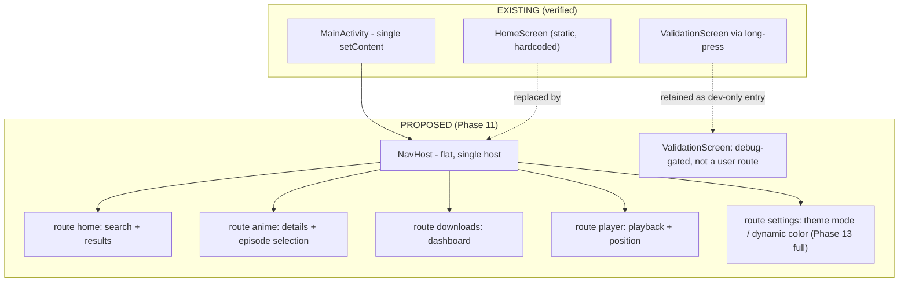
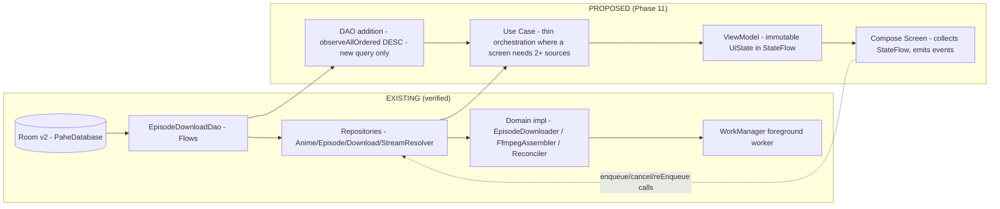
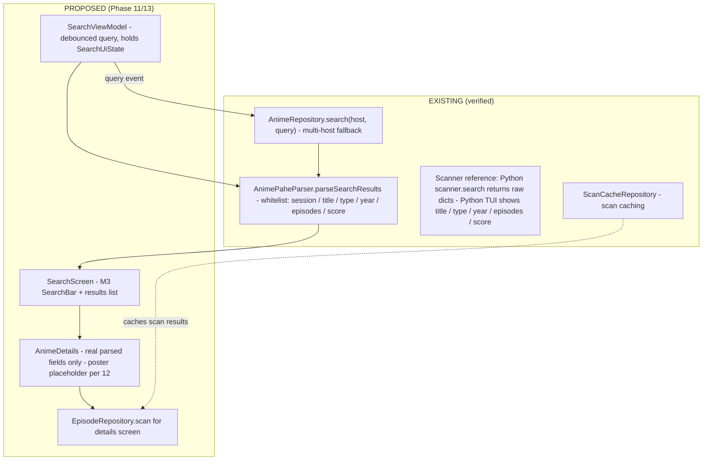
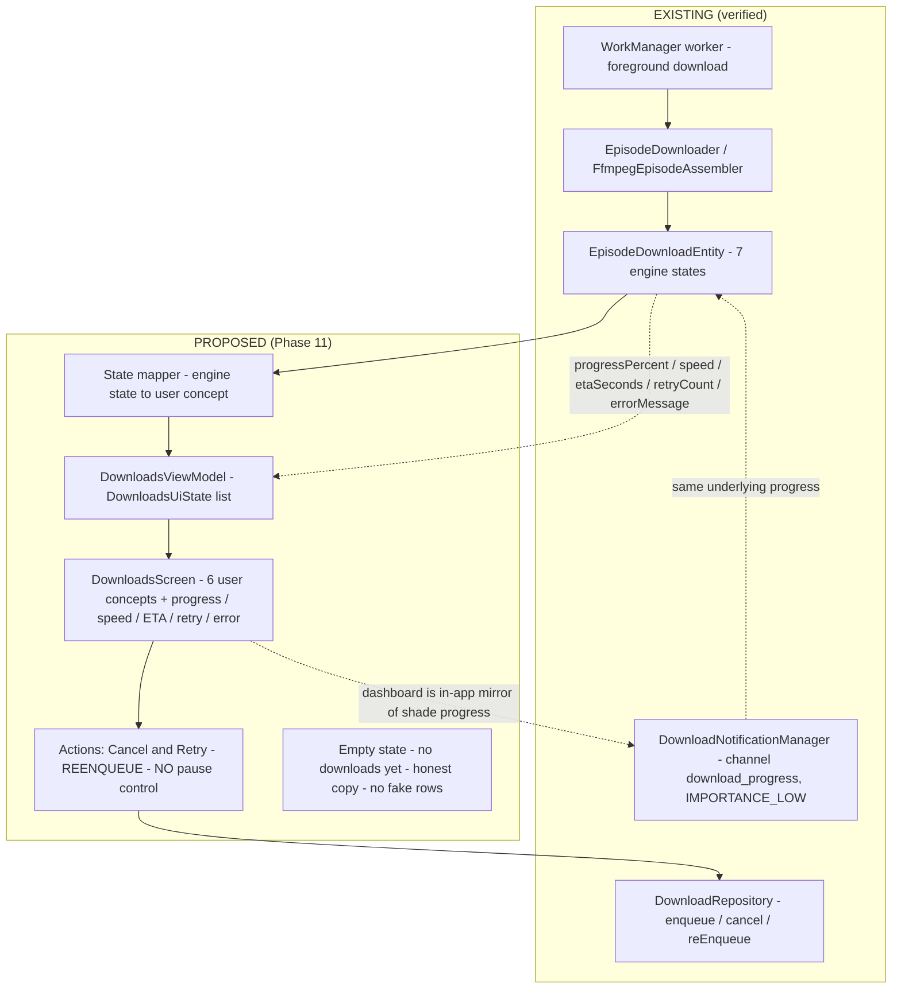
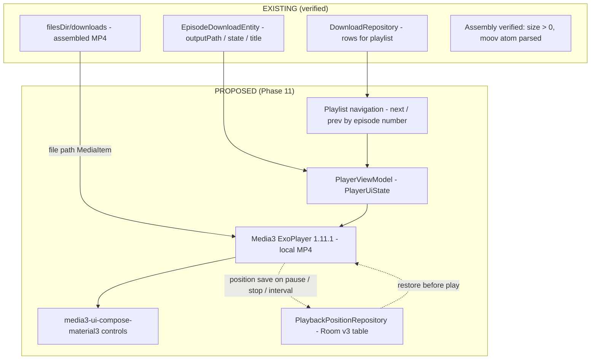
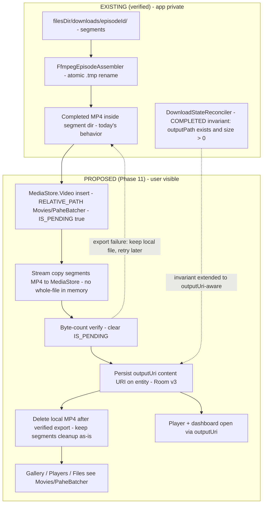
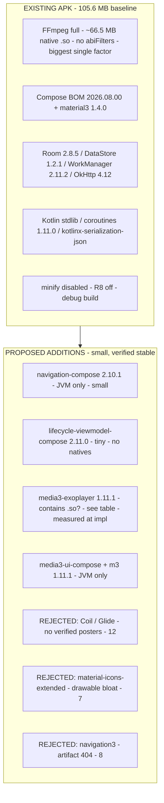

# PHASE11_ARCHITECTURE_V1.md — Material 3 UI Foundation, Navigation, Playback & Storage Architecture

> ## ⛔ SUPERSEDED BY `PHASE11_ARCHITECTURE_V2.md` (2026-09-23)
>
> V1 is retained as a **historical draft only** and is **NOT authoritative**. The authoritative Phase 11 architecture is **V2**. The following V1 claims are **explicitly superseded / false — do not implement from V1 on these points**:
>
> 1. **Navigation 3 "artifact 404" rationale (§8, §27 table/M7, §34 Decision-48 summary) — FALSE.** The `androidx.navigation3` group **resolves on Google Maven (HTTP 200)**, with stable `navigation3-runtime`/`navigation3-ui` through **1.1.7** (verified 2026-09-23). V2 §10.6/§32 re-rejects Navigation 3 on factual grounds (navigation-compose 2.10.1 sufficiency, stability policy) — never the 404 reason.
> 2. **Speed/ETA "from entity fields" (§13 row content, §14 `DOWNLOADING` mapping) — MISLEADING.** `DownloadWorker` hardcodes `downloadedBytes = 0`, `speed = 0`, `etaSeconds = 0` on every progress write (verified). V2 §16.1 defines the nullable non-authoritative contract (never render `0 B/s`/`0:00`; no percentage when total unknown).
> 3. **`media3-exoplayer` "contains native codec `.so`s / Native binaries? Yes" (§29 table) — INACCURATE.** The 1.11.1 AAR is 1,703,377 bytes / 173 entries / **0 `.so` files** (verified 2026-09-23). V2 §22.3/§32 corrects this.
> 4. **Export ordering "verify → clear IS_PENDING → persist outputUri" (§22 diagram / §25) — SUPERSEDED** by V2 §27/§30: persist `outputUri` **before** clearing `IS_PENDING`, deterministic duplicate lookup, reconciliation, injected `ContentResolver`, process-kill matrix.
> 5. **"completion/error higher[-importance] channel" stated as existing (§16) — NOT EXISTING.** One `IMPORTANCE_LOW` channel (`download_progress`) serves progress, completion, and failure today (verified). A higher-importance channel is **PROPOSED only** (V2 §20).
> 6. **`media3-ui-compose` as a direct dependency (§17, §27 table) — SUPERSEDED**: the `media3-ui-compose-material3:1.11.1` POM already depends on `media3-ui-compose` (verified 2026-09-23). Direct deps are exactly `media3-exoplayer` + `media3-ui-compose-material3` (V2 §22.1/§32).
>
> All other V1 architecture carries forward into V2 unless listed above.
>
> **Note on status lines (added 2026-09-25, Phase 11L):** the body statements "Phase 11 status remains ARCHITECTURE / READY FOR IMPLEMENTATION", "not implemented", "No claim of Phase 11 completion", and the superseded-by line's "no production, Gradle, test, or resource code has been changed for Phase 11" are **pre-implementation snapshots (2026-09-23)** — historical, not current status. Phase 11 was subsequently implemented and **passed** its final independent tester gate (Phase 11K, 2026-09-25). Current status of record: V2's Status header, `PARITY.md` (Phase 11 Completion Status), `ROADMAP.md` (Phase 11 COMPLETE).

**Phase**: 11 — Media3 Playback & UI Foundation
**Status**: ~~ARCHITECTURE / READY FOR IMPLEMENTATION~~ — **SUPERSEDED** (see banner; V2 is authoritative)
**Superseded by**: `PHASE11_ARCHITECTURE_V2.md` — design document only — *no production, Gradle, test, or resource code has been changed for Phase 11*
**Date**: 2026-09-23
**Authority**: `SPEC.md` (Android requirements) · `AGENTS.md` (§17 dependency verification, §12 download engine, §13 lifecycle, §16 blockers) · `DECISIONS.md` Decisions 41–51 · `ROADMAP.md` Phase 11 · `LIMITATIONS.md` · `PARITY.md` · Python reference `<python-ref-3.7.0>` (behavioral truth; the `<python-ref-3.5.2>` path cited when this document was authored no longer exists — the local reference is 3.7.0 as of 2026-10-12; the intermediate 3.6.0 reference is superseded)

> **Document discipline.** Everything marked **PROPOSED** below is architecture awaiting implementation. Every **EXISTING** element was verified in this repository on 2026-09-23. Nothing in this document claims Phase 11 functionality works. Version pins were verified against official Google/Maven sources on 2026-09-23 (cited inline).

---

## Table of Contents

1. Purpose and Scope
2. Current State (Verified Inventory)
3. Design Principles
4. Material 3 Theme Foundation
5. Theme Persistence
6. Dynamic Color Recommendation
7. Typography, Shapes, Icons
8. Navigation Architecture
9. Screen Inventory
10. UI State Architecture
11. Search Architecture
12. Poster Strategy
13. Downloads User-Concept UI
14. Download State Mapping
15. Downloads Entry-Point Gap
16. Notification Permission Architecture
17. Media3 Version and Module Policy
18. Player Architecture
19. Player Lifecycle
20. Playback Sources
21. Quality and Audio Selection
22. Completed-Video Storage Architecture
23. Private Working Data
24. Room Schema Evolution (v2 → v3)
25. Export Lifecycle and Failure Handling
26. ValidationScreen Policy
27. Dependency Plan and APK Size
28. Future App-Size Phase Design
29. DI and Composition Wiring
30. Loading, Empty, and Error States
31. Testing Strategy for Phase 11
32. Risks and Open Items
33. Non-Goals
34. Decision Records

---

## 1. Purpose and Scope

This document defines the architecture for Phase 11 and the UI foundation layers that Phases 12–13 build upon:

* Material 3 "outer-space" design system (dark default; Dark / Light / System modes; persistence).
* Flat single-`NavHost` navigation.
* Search, downloads, player, storage, and Media3 subsystem architectures (Room → Repository → Use Case → ViewModel → Compose UI layering per `AGENTS.md` §4).
* Completed-video storage outside `Android/data` (MediaStore design) with app-private working data.
* A size-aware dependency plan (every proposed dependency: rationale, size impact, native binaries, avoidability).

**Scope boundary:** design and version verification only. Phase 12–16 work, all production code, all Gradle changes, all test changes, and all Git operations are excluded. Phase 11 status remains **ARCHITECTURE / READY FOR IMPLEMENTATION** until implementation slices are built, tested, and verified.

---

## 2. Current State (Verified Inventory)

**EXISTING (verified 2026-09-23):**

| Area | Verified fact |
|---|---|
| Entry | `MainActivity` hosts a static `HomeScreen`; long-press opens `ValidationScreen` (KDoc: dev-only) |
| Theme | `ui/theme/Theme.kt`: `dynamicColor = true` default, blue Material3 schemes — **no dark-default outer-space theme exists** |
| XML theme | `themes.xml` uses a Light parent; **no `values-night/` directory exists** |
| Nav | No `navigation-compose` / `navigation3` dependency; no `NavHost` |
| ViewModels | **None exist.** No production caller of `AnimeRepository`, `EpisodeRepository`, `ScanCacheRepository`, `StreamResolverImpl`, `DownloadRepository` |
| Media3 | No `media3-*` dependency; no player classes |
| Image libs | No Coil/Glide/Picasso; `res/drawable` = 4 vector drawables |
| Room | `PaheDatabase` **v2**, 4 entities (incl. `EpisodeDownloadEntity` with `outputPath`, no `outputUri`); schemas 1+2 exported |
| DataStore | `AppConfig`: `preferencesDataStore("pahebatcher_settings")`, `appContextFlow`, `KEY_*` list — **no theme key** |
| Download engine | Full stack exists: `DownloadRepository` (enqueue/resolveComplete/cancel/reEnqueue/enqueueWorker/cancelWorker), WorkManager foreground worker, `EpisodeDownloader`, `FfmpegEpisodeAssembler`, `DownloadStateReconciler`, `DownloadNotificationManager` |
| States | `QUEUED / RESOLVING / DOWNLOADING / ASSEMBLING / COMPLETED / FAILED / CANCELLED`; `STATE_PAUSED` removed (no pause); **`ASSEMBLING` is never written by production code** (LIMITATIONS §15) |
| Permissions | Manifest: `INTERNET`, `FOREGROUND_SERVICE(_DATA_SYNC)`, `POST_NOTIFICATIONS` — **never requested at runtime** |
| Toolchain | AGP 9.4.1 · Kotlin 2.4.20 · Gradle 9.7.1 · JDK 25 · compileSdk/targetSdk 37 · minSdk 32 · Compose BOM 2026.08.00 · material3 1.4.0 · Room 2.8.5 · DataStore 1.2.1 · WorkManager 2.11.2 · OkHttp 4.12 · ffmpegkit 8.1.7 **full** · `isMinifyEnabled = false` · no `abiFilters` · serialization plugin applied |
| Baselines | Unit 393/393 · lint 0 errors / 12 warnings · instrumentation 96/93 (3 pre-existing FFmpeg filename failures) · debug APK **105,607,965 bytes** (2026-09-23) · x86_64 API 36 emulator validated · arm64 runtime deferred · Kwik externally blocked |

---

## 3. Design Principles

1. **Material 3 is mandatory** (SPEC): all screens use Material 3 components and `MaterialTheme` color/typography/shape systems. No custom framework, no Material 2.
2. **Outer-space identity**: a deliberate dark "deep-space" palette is the brand default; light mode is a first-class "moonlight" counterpart, not an afterthought.
3. **Dark by default**: the app opens dark regardless of a light system setting unless the user selects **System**.
4. **User concepts, not engine states**: UI speaks *queued / downloading / assembling / completed / failed / cancelled* — never `RESOLVING`, never "pause".
5. **No fake anything** (`AGENTS.md` §5): screens render only real parsed/Room data; empty states say so honestly; poster art only from verified sources.
6. **Size-aware dependencies** (`AGENTS.md` §17): every addition justified with rationale, size impact, native-binary impact, and an avoidability assessment.
7. **Lifecycle realism** (`AGENTS.md` §13): nothing assumes the Activity or process survives; player and UI state are reconstructible from persistence.

---

## 4. Material 3 Theme Foundation

**PROPOSED.**

* `Theme.kt` becomes `PaheBatcherTheme(themeMode, dynamicColor, content)` driven by an explicit mode enum `ThemeMode { SYSTEM, DARK, LIGHT }`, **default = DARK** (replacing `isSystemInDarkTheme()` as the default source of truth).
* **Dark (default) — outer-space palette** (values are the design target; exact `Color` literals finalized at implementation):
  * Surfaces: near-black void `#05070D` → raised surfaces `#0B1020` / `#121A31` (layered like orbital depth).
  * Primary: nebula violet `#8B7CF6`; Secondary: cyan accent `#4FD6E0`; Tertiary: solar amber `#FFB65C`.
  * On-surface text: starlight `#E8ECF8`; muted text: `#97A0BE`.
  * Outline/dividers: `#232B45`.
* **Light — moonlight palette**: paper-white `#F6F7FC` surfaces, same violet/cyan accents darkened for contrast, ink `#111527` text. Light mode is *off by default* but fully supported.
* **System bars**: edge-to-edge with `enableEdgeToEdge`; status/navigation bar colors derive from the selected scheme so the "space" background is continuous.
* Component mapping: `Scaffold`, `TopAppBar`, `NavigationBar`, `Card`, `FilterChip`, `LinearProgressIndicator`, `AlertDialog` — all Material 3 defaults, restyled only via color scheme.
* `values/themes.xml` gains a `values-night/` counterpart and a dark parent so the pre-Compose window (splash/window background) matches the dark default instead of flashing Light.

**Why dark default:** SPEC's outer-space theme is dark-native; a light-default window then dark-content swap produces a flash on every cold start. System mode remains available for users who want OS-following behavior.

---

## 5. Theme Persistence

**PROPOSED — extends the EXISTING DataStore, no new storage mechanism.**

* New keys on the existing `AppConfig` preferences DataStore (`pahebatcher_settings`):
  * `KEY_THEME_MODE` — `stringPreferencesKey`, values `system | dark | light`, **default `dark`**.
  * `KEY_DYNAMIC_COLOR` — `booleanPreferencesKey`, **default `false`** (see §6).
* Exposed as `themeSettings: Flow<ThemeSettings>` alongside the existing `appContextFlow`; `MainActivity` collects it (lifecycle-aware) and passes values into `PaheBatcherTheme`.
* Defaults are code defaults — a fresh install is dark with zero reads/writes required; migration from pre-existing installs is a no-op (absent keys → defaults).
* **No second persistence system** (no separate SharedPreferences, no EncryptedSharedPreferences): one DataStore file, consistent with Decision 9 (persistent state design).

---

## 6. Dynamic Color Recommendation

**Recommendation: OFF by default; user-toggleable later (Settings is Phase 13).**

| Option | Verdict | Reasoning |
|---|---|---|
| Dynamic color ON everywhere | Rejected | Material You extracts wallpaper hues and replaces the curated palette — the app would stop being "outer-space" (often becoming beige/olive), violating the SPEC theme identity |
| Dynamic color OFF, fixed palettes | **Recommended (default)** | Guarantees the SPEC-mandated look; deterministic screenshots for review; zero wallpaper-dependent variance in tests |
| OFF by default + Settings toggle | **Recommended end-state** | Respects user choice; toggle persisted in `KEY_DYNAMIC_COLOR`; available minSdk 32 ≥ Android 12, so `dynamicColor` support is technically valid on all supported devices |

This deliberately **inverts the current `dynamicColor = true` default** in `Theme.kt` (EXISTING) at implementation time.

---

## 7. Typography, Shapes, Icons

**PROPOSED.**

* **Typography**: Material 3 default type scale with minor overrides (display for screen titles with a subtle "starfield" letter-spacing; body/label unchanged for readability). No custom font files in v1 — fonts are an APK-size cost with no functional gain.
* **Shapes**: medium corner radius family (12–16 dp cards, 24 dp sheets) — soft, modern, consistent with Material 3.
* **Icons**: reuse the Material 3 built-in icon set (ships inside `compose-material3`/`material-icons-core` already in the graph — **no new dependency**). Existing 4 vector drawables remain. **No `material-icons-extended`**: it is a large drawable-only artifact with real APK cost and must be justified per-icon if ever needed (§27).
* **Posters/placeholders**: vector placeholder art from existing drawables — no bitmap assets (§12).

---

## 8. Navigation Architecture

**PROPOSED — flat single `NavHost` on EXISTING single-Activity shell.**

* **One `NavHost`, flat route list, type-safe routes** via the already-applied Kotlin serialization plugin (no string-route typos).
* Route arguments: `anime(session)`, `player(episodeId)` — IDs only; screens re-read full state from Room/repositories (no object passing, survives process death).
* Back behavior: standard predictive-back via Navigation Compose; system back from player returns to origin screen.
* `ValidationScreen` is **not** a user-facing route: entry remains the existing long-press, additionally gated by `BuildConfig.DEBUG` at implementation so release builds cannot reach it (§26).
* **Rejected — `androidx.navigation3`:** artifact lookup on Google Maven returned 404 (2026-09-23); cannot satisfy `AGENTS.md` §17 (must verify the dependency exists at a stable version). Navigation Compose is the sanctioned stable line (§27).

---

## 9. Screen Inventory

**PROPOSED** (phasing per `ROADMAP.md`):

| Screen | Route | Content source | Phase |
|---|---|---|---|
| Home / Search | `home` | `AnimeRepository.search()` results (§11) | 11 (foundation), 13 (full flow) |
| Anime details + episode selection | `anime(session)` | `EpisodeRepository.scan()`, `EpisodeRangeParser`, `QualitySelector`/`AudioSelector` | 13 |
| Downloads dashboard | `downloads` | `EpisodeDownloadDao` Flows (§13) | 11 |
| Player | `player(episodeId)` | Room + Media3 (§18) | 11 |
| Settings (theme etc.) | `settings` | `AppConfig` DataStore | 13 (theme keys ship in 11; toggle UI in 13) |
| Validation (dev) | *(debug-gated entry)* | existing dev screen | 11 (gate only) |

Each screen: `Screen` composable (stateless, takes UiState + callbacks) + `ViewModel` (produces UiState) — testable without Android plumbing.

---

## 10. UI State Architecture

**PROPOSED ViewModels/UI over EXISTING Room/Repository layers** (AGENTS §4 layering: UI → ViewModel → Use Case → Repository → Domain → engine):

* **Immutable UiState**: one `data class` per screen (`SearchUiState`, `DownloadsUiState`, `PlayerUiState`, …), exposed as `StateFlow`, collected with `lifecycle-runtime-compose`'s `collectAsStateWithLifecycle`.
* ViewModels are **stateless wrt persistence**: they call repositories; Room remains the source of truth (`AGENTS.md` §9). Process death → rebuild UiState from Room.
* **New DAO query (query-only, no schema change)**: downloads dashboard needs an ordered observe-all (e.g. `ORDER BY updatedAt DESC, id DESC`); `AGENTS.md` says UI state is not authoritative — this reads the authoritative table.
* No polling: DAO `Flow`s push updates; the engine's 5000 ms `ProgressTracker` throttle bounds update rate naturally.

---

## 11. Search Architecture

**PROPOSED UI over EXISTING repository/parser:**

* Flow: user input → ViewModel (debounce ~300–400 ms, single in-flight job, cancels superseded queries) → `AnimeRepository.search()` → parse whitelist → `SearchUiState { query, loading, results, error }`.
* **Fields rendered = fields actually parsed** (session/title/type/year/episodes/score) — identical to what the Python TUI displays (Python truth). **No poster field is parsed today** (§12).
* Multi-host fallback and session establishment reuse the EXISTING repository + `CloudflareSessionProvider` — the UI never performs HTTP directly (AGENTS §4).
* Errors surface honestly: network failure / Cloudflare / empty query → distinct UiState branches with retry affordance (§30).
* Search's *download-enqueue* continuation is **Phase 13** (§15) — Phase 11 ships the foundation screens, not the complete flow.

---

## 12. Poster Strategy

**Facts (verified):** `parseSearchResults` whitelists **no poster/image field**; Python's search table renders **no poster column**; the live API could not be reached (network-blocked), so **poster availability is unverified**.

**Rules (PROPOSED):**

1. **Posters only from real parsed data. Never invent, construct, or guess poster URLs** (no URL pattern guessing, no `session`-derived paths, no placeholder domains). A poster URL may enter the UI only after a real API response is captured showing the field, the parser whitelist is extended deliberately, and the value round-trips in a test.
2. Until verified: **vector placeholder** slots (title-initial monogram over the existing vector art) in search results and details. This is honest empty-state design, not fake content — it does not imply data exists.
3. **No general-purpose image library in Phase 11.** Coil/Glide are rejected for now: with zero verified poster URLs they'd add a dependency, cache layer, and APK cost for pixels that cannot legally be sourced (AGENTS §17 justification test fails). If/when posters are verified, re-evaluate: recommendation at that point would be **Coil** (Compose-native, small, OkHttp-compatible) — decision reopened then, measured against APK baseline (§27).
4. If posters ship later: bounded memory/disk cache (`AGENTS.md` §12 bounded resources), disk cache capped, and **no log emission of URLs/cookies** (§10 rules).

---

## 13. Downloads User-Concept UI

**PROPOSED dashboard over EXISTING engine** — the UI speaks **user concepts only**:

* **Vocabulary (mandatory):** `queued`, `downloading`, `assembling`, `completed`, `failed`, `cancelled` — six chips/labels, Material 3 styled.
* Row content: episode title, episode number, user concept chip, `progressPercent()`, speed, ETA, retry count (when > 0), `errorMessage` (when failed).
* **No pause control anywhere** — `STATE_PAUSED` was deliberately removed in Phase 10; the engine has no pause. Offering one would be a fake/disabled control (AGENTS §5).
* Actions: **Cancel** → `DownloadRepository.cancel`; **Retry** → `reEnqueue` (also for `FAILED`/`CANCELLED` rows); **Play** appears only for `COMPLETED` rows (§18/§22). Enqueue/start stays Phase 13 (§15).
* Updates arrive via DAO `Flow` (§10) — no polling, no view-model timers.

---

## 14. Download State Mapping

**PROPOSED mapping table (engine → user concept):**

| Room `state` (EXISTING) | User concept | UI notes |
|---|---|---|
| `QUEUED` | **queued** | Position/progress 0 |
| `RESOLVING` | **queued** (sub-label "preparing link") | Engine-internal pre-download; Python analog: dashboard *waiting* bucket; never shown as its own concept |
| `DOWNLOADING` | **downloading** | progress %, speed, ETA from entity fields |
| `ASSEMBLING` | **assembling** | **Honesty note:** production never writes this state today (LIMITATIONS §15); the mapper still handles it so no state is unrepresentable if/when assembly progress is wired. UI must not animate fake assembly progress — show indeterminate styling only if the state genuinely appears |
| `COMPLETED` | **completed** | Play action enabled; export status reflected (§22/§25) |
| `FAILED` | **failed** | `errorMessage` + Retry |
| `CANCELLED` | **cancelled** | Retry available |

Python reference parity: Python's dashboard shows *waiting / downloading / remuxing / done / fail / retry* (`ui/dashboard.py`) — the six Android concepts are the same user mental model with `RESOLVING` folded into *queued* and `retry` represented as an action + counter rather than a state.

---

## 15. Downloads Entry-Point Gap

**Scope note (accurately documented, unchanged):** the pipeline *search → details → select episodes → enqueue download* has **no production entry point** — no production code calls `DownloadRepository.enqueue` (§2). Therefore:

* Phases 11–12 establish the **UI foundation** (theme, navigation, dashboard observability, player) — a user can *see and manage* downloads but cannot yet *start* one from search.
* The **search → download entry point remains Phase 13** (ROADMAP scope note at Phase 10 exit and Summary, both clarified in this update).
* The downloads dashboard must handle the **empty state** gracefully with honest copy ("No downloads yet") — never seeded/fake rows (AGENTS §5).
* No documentation may describe the APK as a fully usable downloader until Phase 13 lands the entry point.

---

## 16. Notification Permission Architecture

**PROPOSED (designed, not implemented):**

* **FACT:** `POST_NOTIFICATIONS` is declared in the manifest (targetSdk 37) but **never requested at runtime**; Phase 10 instrumentation grants it explicitly via `Phase10TestSupport`. On API 32 (minSdk) no prompt exists; the runtime request applies **API 33+** (`Build.VERSION.SDK_INT >= 33` gate).
* **Strategy — first-download enqueue:**
  1. The first time a user enqueues a download (i.e., the Phase 13 entry point fires), the app shows a **rationale UI** (M3 dialog: "Get progress & completion notifications") *before* the system prompt.
  2. On consent → `ActivityResultContracts.RequestPermission(POST_NOTIFICATIONS)`; result recorded to `AppConfig` (`KEY_NOTIF_PERMISSION_ASKED`, asked-once flag so we never nag repeatedly).
  3. If **granted**: foreground-worker progress + completion notifications appear as today (`download_progress` channel, `IMPORTANCE_LOW` progress; completion/error higher).
  4. If **denied**: downloads proceed identically — WorkManager/foreground service is independent of shade visibility; the **in-app dashboard (§13) is the guaranteed progress surface**, and Settings (Phase 13) offers a re-request/deep-link to system settings. No feature is gated behind permission.
* **Why enqueue-time, not launch-time:** requesting notifications before the user has any reason to receive one produces denials (Android UX guidance); the enqueue moment is the user's demonstrated need.
* Permission state read via `ContextCompat.checkSelfPermission`; no permission → no crash paths (existing notification manager already tolerates this).
* This document does **not** implement the request; tests later must grant/deny explicitly as Phase 10 tests do.

---

## 17. Media3 Version and Module Policy

**Verified 2026-09-23** against official sources: `developer.android.com/jetpack/androidx/releases/media3` and Google Maven metadata (`maven.google.com`) — `media3-exoplayer`, `media3-ui-compose`, `media3-ui-compose-material3` (and `media3-exoplayer-hls`, `media3-session`) all report stable release **1.11.1** (`<release>1.11.1</release>`, lastUpdated 20260911).

| Module | Version | Decision | Rationale |
|---|---|---|---|
| `androidx.media3:media3-exoplayer` | **1.11.1 stable** | **CHOSEN (v1)** | ExoPlayer core: MediaItem, position tracking, error/retry surface — required by SPEC playback |
| `androidx.media3:media3-ui-compose` | **1.11.1 stable** | **CHOSEN (v1)** | Compose-native player UI (Compose BOM 2026.08.00 stack) |
| `androidx.media3:media3-ui-compose-material3` | **1.11.1 stable** | **CHOSEN (v1)** | Material 3 controls matching our design system (§4) |
| `androidx.media3:media3-exoplayer-hls` | 1.11.1 stable | **DEFERRED** | HLS input needs a reachable stream; Kwik/HLS source is **externally blocked** (LIMITATIONS) — activating the module before a reachable source would be unverifiable. Pinned at 1.11.1 for activation with **identical version** |
| `androidx.media3:media3-session` | 1.11.1 stable | **DEFERRED** | v1 is foreground-only playback (§19): no background audio, no lock-screen transport → session service not yet justified. Activate at 1.11.1 if background playback is scoped later |

**Policies (`AGENTS.md` §17):**

* **All Media3 modules identical version 1.11.1** — never mixed versions (Media3's BOM-style consistency requirement).
* **Stable only** — no alpha/beta/RC; the sole "newest" metadata hit on other libraries this cycle was an alpha (lifecycle 2.12.0-alpha03) which was rejected (§27).
* No downgrade of any existing infrastructure component is required to adopt 1.11.1 (compatible with Gradle 9.7.1 / AGP 9.4.1 / Kotlin 2.4.20 / compileSdk 37 / minSdk 32 — Media3 1.11.1's minSdk ≤ 32 confirmed via official release notes metadata).
* First real playback verification happens against a **local completed MP4** (produced by the EXISTING Phase 9/10 pipeline) — genuinely testable today, unlike blocked Kwik HLS (§20, §32).

---

## 18. Player Architecture

**PROPOSED player over EXISTING storage/Room:**

* `PlayerViewModel` owns the ExoPlayer instance (created in `onCleared`-paired release); screen receives player + controls via `media3-ui-compose-material3`.
* **MediaItem source = file path of the EXISTING assembled MP4** (`outputPath`), post-assembly checks already guaranteed playability (size > 0, `moov` atom — Phase 9 invariant).
* Controls (M3): play/pause, seek slider, position/duration, retry-on-error, back. No fake buffering indicators when data is local — indeterminate UI only during genuine prepare.
* Playlist: sibling `COMPLETED` episodes of the same session ordered by episode number → next/prev (Python parity: `stream.py` playlist `n/p` behavior).
* Position persistence: `PlaybackPositionRepository` (§19/§24).
* UI never touches ExoPlayer directly from the composable — ViewModel mediates (AGENTS §4: UI does not perform engine work).

---

## 19. Player Lifecycle

**PROPOSED — foreground-only v1 (deliberate scope):**

* **Instance owner:** ViewModel scoped to the player route's nav entry → survives rotation (Activity recreation) without re-preparing; released on route exit / ViewModel clear (never leak `Player` — bounded resources, AGENTS §12).
* **Foreground-only:** playback **pauses when the app backgrounds** (`ON_STOP` → `player.pause()`); v1 provides **no** background audio, no media-style notification, no PiP. This is why `media3-session` is deferred (§17). Honest tradeoff: Python/mpv plays in a terminal window that is naturally foreground; Android background playback would require a session + service + permission surface beyond v1.
* **Process death:** player state is disposable; **position survives** via Room (§24) — on cold start into `player(id)`, restore saved position before `play()`.
* **Position save triggers:** periodic (e.g. every 5 s while playing), on pause, on stop, on route exit — written to Room, never only to memory (`AGENTS.md` §9: reconstruct after process death).
* Network audio? None in v1 (local file only) — no wake-lock, no streaming socket held in background (AGENTS §13: avoid unnecessary wake locks).

---

## 20. Playback Sources

| Source | Status | Design |
|---|---|---|
| **Local assembled MP4** (`filesDir/downloads/...`) | **v1 primary — verified feasible today** | Phase 9/10 produce verified files on emulator; real end-to-end playback testable now |
| **Exported user-library MP4** (`content://` MediaStore URI, §22) | v1 secondary once export lands in Phase 11 storage slice | Player prefers `outputUri` when present (survives local export cleanup), falls back to `outputPath` |
| **HLS (Kwik) streaming** | **Externally blocked** (LIMITATIONS: kwik.cx Cloudflare WAF) | Architecture prepared: `media3-exoplayer-hls` pinned at 1.11.1 (§17); activation + live verification blocked by the external dependency, not by Android. ROADMAP's "HLS playback works" exit criterion therefore cannot be honestly verified until either a reachable source exists or local-HLS fixtures are used — **recorded as an open item (§32), not claimed complete** |

No fabricated stream URLs ever reach the player (AGENTS §5, §10).

---

## 21. Quality and Audio Selection

**PROPOSED, mapped onto EXISTING selectors:**

* **Download-time selection** (already implemented): `QualitySelector` + `AudioSelector` operate on parsed play-page streams — this is where quality/audio is *decided* for downloads (Phase 13 entry point wires it to UI chips).
* **In-player selection (v1):** local MP4 is a single fixed rendition — there is nothing to switch; the player shows metadata (quality label captured at enqueue) rather than a *disabled-looking* selector (AGENTS §5: no disguised-dead controls).
* **For future HLS (deferred §17):** Media3 `TrackSelectionParameters` will map to `TrackSelection`-equivalent controls (PARITY §11 rows `TrackSelection` 🔄 remain 🔄 until implemented).
* Python parity reference: `stream.py:run_stream` quality/audio prompts (`q`/`a`) — Android equivalent lands with Phase 13 UI for downloads and with HLS activation for streaming.

---

## 22. Completed-Video Storage Architecture

**Requirement:** completed videos must be user-visible **outside `Android/data`**; private working data stays app-private.

**Options evaluated:**

| Option | Verdict | Reasoning |
|---|---|---|
| A. `getExternalFilesDir()` (`Android/data/...`) | **REJECTED** | Violates the requirement outright: on Android 11+ other apps (gallery/file managers) cannot access `Android/data`; videos would be invisible to the user — recreates today's problem in external clothing |
| B. `MediaStore.Downloads` → `Download/PaheBatcher/` | Viable but not chosen | Legally accessible without permission, but videos belong in the video library; a Movies-app wouldn't index `Download/` as media |
| C. **`MediaStore.Video` → `Movies/PaheBatcher/`** | **CHOSEN** | The Android-native home for videos: appears in Gallery/Players/file managers; scoped-storage insert of own files needs **no runtime permission** on minSdk 32; stable `content://` URI survives path quirks; matches SPEC's "MediaStore or another Android-appropriate mechanism" |
| D. SAF user-chosen directory | **Deferred** | Matches Python's `output_dir` user setting and LIMITATIONS §5's SAF note, but requires picker UX + persisted URI permissions — belongs to the Settings phase (13); design keeps an `exportTarget` seam for it |

**Design decisions:**

1. **Working data stays EXACTLY where it is** — `filesDir/downloads/{episodeId}/` (segments, `.tmp`, concat state) remains app-private; Decision 40's output-preserving cleanup rules are untouched until after verified export.
2. **Export = streaming copy** (bounded buffers, never whole file in memory — AGENTS §12; LIMITATIONS §7).
3. **`IS_PENDING = true` during write** so partially-written files are invisible to other apps; cleared only after byte-count verification → *incomplete exports can never masquerade as completed videos* (mirrors "segment writes atomic" discipline, AGENTS §12).
4. **No runtime storage permission** needed (scoped storage own-file insert; minSdk 32).
5. **Filename collisions:** MediaStore uniquifies display names on request (`IS_PENDING` + `RELATIVE_PATH`); export keeps `FileNameGenerator.episodeFileName()` output as the display name.
6. **Ordering guarantee:** local file is deleted **only after** verified export (byte-count match + URI resolvable) — never before (Decision 40's lesson, forward-applied).

---

## 23. Private Working Data

**UNCHANGED + one extension:**

* Segments, `.tmp`, concat inputs, resolution scratch: **app-private `filesDir`** — never exported, never user-visible (Python parity: cache dir vs output dir separation; Decision 34/40).
* Existing selective cleanup (`.ts`/`.tmp`/`conc*` removal, MP4 preservation) is retained; the **only** deletion of the MP4 is post-export verification (§22).
* Crash mid-export → `IS_PENDING` row may be orphaned in MediaStore: export routine sweeps its own pending rows on next run (delete stale pending rows belonging to our `RELATIVE_PATH`), preventing phantom/garbage gallery entries.
* No secrets/cookies/tokens are written to any storage surface; nothing logs cookies or auth headers (AGENTS §10).

---

## 24. Room Schema Evolution (v2 → v3)

**PROPOSED migration (breaking at implementation time, additive otherwise):**

| Change | Purpose |
|---|---|
| `EpisodeDownloadEntity.outputUri TEXT NULL` | Persist the MediaStore `content://` URI after verified export (§22) |
| **New entity** `PlaybackPositionEntity (episodeId PK, positionMs, durationMs, updatedAt)` | Position persistence across rotation/process death (§19) — an Android-native extension (Python has no equivalent; PARITY §11.2 marks this 📱) |
| Schema version **2 → 3**, exported `3.json` | Auto + explicit migration: `ALTER TABLE … ADD COLUMN outputUri NULL` + `CREATE TABLE playback_position …` — both trivially additive, tested with `MigrationTestHelper` |

**Reconciler invariant extension (interacts with `DownloadStateReconciler`, EXISTING):**

* Today: `COMPLETED` ⇔ `outputPath` exists && size > 0 (plus the ASSEMBLING branch using `computeExpectedOutput()`).
* After v3: validity = **(`outputUri` present ∧ URI resolves ∧ size > 0) ∨ (`outputUri` absent ∧ today's `outputPath` rule)**. Pre-export rows keep working unchanged; post-export rows are judged by their MediaStore URI. An exported-then-user-deleted video → reconciler reports the row as **failed ("file missing")** rather than silently completed — honest state, retry affordance in dashboard.
* `outputPath` column is **kept** (not dropped) as the local/pre-export source-of-truth and the reconciler's fallback — no destructive migration.

---

## 25. Export Lifecycle and Failure Handling

**PROPOSED state additions around `COMPLETED` (presentation-level, not new engine states):** the dashboard derives an `exportState ∈ {not_exported, exporting, exported, export_failed}` from `outputUri` + in-flight flags — **without** touching the 7 engine states (keeps Phase 10 invariants intact).

| Failure | Handling |
|---|---|
| Insufficient storage at export | MediaStore write fails → local MP4 **kept**, `export_failed` shown with retry; never delete unverified local copy |
| Process death mid-export | `IS_PENDING` row orphaned → swept on next run; local file still present → export retried (idempotent: re-insert or resume via URI) |
| Byte-count mismatch | Treated as failure → pending row deleted → retry; user never sees partial file |
| User renames/moves file in another app | We persist `content://` URI (not path) → player/dashboard keep working (URI is rename-tolerant for moves within MediaStore) |
| User deletes file | Reconciler → `failed` + "file missing" (§24); local already gone → Retry re-downloads (existing `reEnqueue` path) |
| Concurrent exports of different episodes | Bounded: export runs under the existing worker's sequential per-episode completion path; **no unbounded coroutines** (AGENTS §12) |
| Export of a legacy pre-v3 row | `outputUri NULL` → export-on-demand or leave local (invariant handles both, §24) |

---

## 26. ValidationScreen Policy

**EXISTING screen, PROPOSED gating:**

* Remains **development-only** (its KDoc already declares this): not registered as a NavHost route; reachable only via the existing long-press, **additionally gated by `BuildConfig.DEBUG`** so release builds cannot reach it.
* No user-facing entry, no deep link, no settings row.
* Phase 11 does not modify its contents (validation logic is the tester domain; this phase only defines the gate).

---

## 27. Dependency Plan and APK Size

**Baseline (measured 2026-09-23): debug APK = 105,607,965 bytes (~105.6 MB); FFmpeg (`ffmpegkit-full` 8.1.7, no `abiFilters`) accounts for ~66.5 MB of it.** Every dependency below was version-verified on 2026-09-23 against Google Maven / official Android docs.

**Every proposed dependency — rationale / size / native binaries / avoidability:**

| Dependency | Version (verified 2026-09-23) | Rationale | Size impact | Native binaries? | Avoidable? |
|---|---|---|---|---|---|
| `androidx.navigation:navigation-compose` | **2.10.1 stable** (Google Maven `latest.release` 2.10.1, lastUpdated 20260909) | Single-Activity type-safe nav, predictive back, nav-scoped ViewModels — required for multi-screen Phase 11/13 | Small (JVM/Compose classes only; AAR measured at implementation against baseline) | **No** | Not reasonably — hand-rolled backstack loses predictive-back/state-restoration and re-implements a sanctioned library |
| `androidx.lifecycle:lifecycle-viewmodel-compose` | **2.11.0 stable** (metadata `<release>` is **2.12.0-alpha03 — alpha REJECTED per §17**; 2.11.0 matches project lifecycle line 2.11.0) | `viewModel()` composable integration for the ViewModel layer (§10) | Very small | **No** | Technically yes (manual `ViewModelProvider` factory), but the manual path is boilerplate + error-prone; keep |
| `androidx.lifecycle:lifecycle-runtime-compose` | **2.11.0 stable** (already present transitively — verified in resolved lint model) | `collectAsStateWithLifecycle` — lifecycle-correct Flow collection | **No new size** (already in APK) | **No** | Already unavoidable; declaring explicitly is documentation only |
| `androidx.media3:media3-exoplayer` | **1.11.1 stable** | Playback engine mandated by SPEC | **Largest planned addition** — AAR + packaged native codec `.so`s; exact delta measured via APK analyzer at implementation and reported against the 105.6 MB baseline | **Yes** (Media3 ships native libraries) | Avoidable only by abandoning SPEC playback (MediaPlayer fallback is inferior: no Compose integration, weak error/position APIs) |
| `androidx.media3:media3-ui-compose` | **1.11.1 stable** | Compose player UI | Small (JVM) | No (inherits exoplayer transitively) | Partially — custom controls possible but re-implements seek/gesture/accessibility logic; not recommended |
| `androidx.media3:media3-ui-compose-material3` | **1.11.1 stable** | M3-styled controls per §4 | Small (JVM) | No | Same as above |
| `media3-exoplayer-hls` / `media3-session` | 1.11.1 stable | Deferred (§17) | — (not in v1 graph) | (Yes, exoplayer-hls native) | Deferred = size deferred too |
| ~~Coil / Glide~~ | — | **REJECTED** (§12): zero verified poster URLs | — saved | — | Yes — and is being avoided |
| ~~`material-icons-extended`~~ | — | **REJECTED** (§7): per-icon cost across many densities | — saved | — | Yes — and is being avoided |
| ~~`androidx.navigation3`~~ | — | **REJECTED** (§8): artifact 404, cannot be version-verified | — | — | Yes |

**Measurement rule:** after the first Phase 11 build, the APK analyzer delta (per dependency) is recorded in `DECISIONS.md`; any addition exceeding expectations triggers a §17 re-review before it ships.

---

## 28. Future App-Size Phase Design

**Designed now, implemented later (a dedicated size-reduction phase — not part of Phase 11):**

1. **R8/minify**: today `isMinifyEnabled = false` (debug baseline). Enable minification + resource shrinking for **release** builds; debug stays unminified for readable tests. Expected: meaningful shrink of the Compose/AndroidX/Kotlin surface (real % measured then, not guessed).
2. **ABI filtering**: `abiFilters` (or App Bundle per-ABI delivery) so a device install carries only its ABI — with FFmpeg's multi-ABI `.so`s being the dominant win.
3. **FFmpeg variant audit**: `ffmpegkit-full` vs `ffmpegkit-min`/`ffmpegkit-aac` — determine the minimal codec set actually required by Phase 9 assembly (remux `-c copy` may not need full codecs); up to tens of MB at stake. Decision 11's "full" choice is re-examined there with tests, not silently changed.
4. **Dependency re-audit**: rerun the §27 table after all phases; drop anything unused (e.g., `okhttp-logging` outside debug).
5. **Baseline Profile / startup**: size-neutral or slightly positive — improves launch, offered as optional.
6. **Success metric**: report new APK size vs the recorded **105,607,965-byte** baseline; only measured numbers go into docs.

Nothing in item 1–6 may be executed opportunistically during Phase 11 (phase discipline, AGENTS §6).

---

## 29. DI and Composition Wiring

* **Manual DI retained** (no Hilt/Koin): `PaheBatcherApplication` already owns WorkManager init + reconciler startup — it becomes the composition root holding an `AppContainer` (Room, DataStore, repositories, use cases).
* ViewModels obtain collaborators via a small `ViewModelProvider.Factory` keyed to the container; nav-scoped instances where lifecycle matters (player).
* No service locator leaks into composables — screens receive state + lambdas only (testability).
* Rationale: Hilt would add KSP processing, runtime, and APK surface for a container that currently fits one file (§27 avoidability test).

---

## 30. Loading, Empty, and Error States

**PROPOSED standard trio per screen (Material 3):**

* **Loading**: M3 `CircularProgressIndicator` (search/details) or skeleton rows; download progress is *data-driven* (§13), never simulated.
* **Empty**: honest copy — search: "Search animepahe by title"; downloads: "No downloads yet" (§15); **never** seeded demo content (AGENTS §5).
* **Error**: message + Retry action bound to the real failing call (`AnimeRepository` errors, download `errorMessage`); Cloudflare/session problems surface as their own message (Phase 5 detector exists).
* Offline: OkHttp failures → "No connection" branch; no infinite spinners (bounded waits, AGENTS §13).

---

## 31. Testing Strategy for Phase 11

*(Applies when Phase 11 is implemented; nothing below has been executed.)*

1. **Theme**: unit tests for `ThemeSettings` defaults (dark default, missing-key migration), `themeMode` round-trip in DataStore; screenshot-level assertions via Compose semantics where practical.
2. **Navigation**: route construction tests (type-safe args), debug-gate test proving release path can't reach ValidationScreen.
3. **ViewModels**: `SearchViewModel`/`DownloadsViewModel`/`PlayerViewModel` against fake repositories — UiState transitions, cancellation of superseded searches, no-pause invariant (assert UI exposes cancel/retry only).
4. **State mapper**: all 7 engine states → 6 user concepts table-driven (incl. `RESOLVING`→queued, `ASSEMBLING`→assembling).
5. **Room v3**: `MigrationTestHelper` v2→v3 (`outputUri` + position table); reconciler invariant both branches (local vs exported vs user-deleted).
6. **Storage (instrumentation, emulator)**: export happy path (`Movies/PaheBatcher` visible via MediaStore query), insufficient-space failure keeps local file, orphaned `IS_PENDING` sweep, byte-count mismatch retry, process-kill mid-export resume.
7. **Player (instrumentation)**: play a **real Phase 9-assembled MP4** on emulator; position restored after simulated process death; pause-on-background; release on route exit (no leaked player).
8. **Permission**: API 33+ request flow with grant/deny both recorded to DataStore; API 32 no-op.
9. **Regression**: full existing baselines must stay green — unit **393/393**, lint **0 errors / 12 warnings** (no new suppressions), instrumentation **96/93** (3 pre-existing FFmpeg filename failures remain out of scope, PARITY §10.2).

---

## 32. Risks and Open Items

| # | Risk / open item | Status | Mitigation direction |
|---|---|---|---|
| 1 | **Poster availability unverified** (live API blocked) | Open — external | Ship vector placeholders (§12); never invent URLs |
| 2 | **HLS playback blocked by kwik.cx WAF** — ROADMAP "HLS playback works" exit criterion cannot be live-verified | Open — external | v1 verifies local-MP4 playback; `media3-exoplayer-hls` pinned 1.11.1 for activation; local-HLS fixtures possible; criterion honestly **not claimed** |
| 3 | **arm64 runtime validation deferred** (LIMITATIONS §3) | Open | Playback tested on x86_64 API 36 emulator; arm64 device pass scheduled |
| 4 | **`media3-exoplayer` native `.so` size** unmeasured until first build | Measured at implementation | APK-analyzer delta vs 105.6 MB baseline (§27) |
| 5 | **`ASSEMBLING` never written** — mapper handles it, but no production trigger exists | Known (LIMITATIONS §15) | UI shows it only if genuinely present; no fake progress |
| 6 | **First-run theme flash** from Light XML theme | Fixed by design | `values-night/` + dark window background (§4) |
| 7 | Notification denial → no shade progress | Handled | Dashboard guaranteed (§16) |
| 8 | Export race with reconciler during storage slice | Handled | Invariant extension + pending sweep (§24/§25) |

---

## 33. Non-Goals

* No production/Gradle/test/resource changes from this document (architecture phase only).
* No Phase 12–16 implementation (sessions/watchlist, full search→download entry, notifications phase, full test suite, parity audit).
* No background/lock-screen playback (§19), no PiP, no casting.
* No pause downloads, no fake progress, no seeded content, no invented poster URLs.
* No dependency additions until Phase 11 implementation is explicitly commissioned; even then only the §27 table, at verified versions.
* No Git operations.
* **No claim of Phase 11 completion** — status is ARCHITECTURE / READY FOR IMPLEMENTATION.

---

## 34. Decision Records

Full entries appended to `DECISIONS.md` (all marked *architecture-only — not implemented*):

| Decision | Subject | Summary |
|---|---|---|
| **41** | Material 3 outer-space theme | M3 mandatory; dark default; Dark/Light/System modes; `values-night` added; palette spec §4 |
| **42** | Theme persistence | Existing `pahebatcher_settings` DataStore keys `KEY_THEME_MODE`/`KEY_DYNAMIC_COLOR`; defaults in code; no new storage |
| **43** | Dynamic color | OFF by default (identity preservation), user-toggleable later; inverts current `dynamicColor = true` |
| **44** | Poster strategy | Real parsed data only, never invented URLs; vector placeholders now; Coil/Glide rejected until posters verified |
| **45** | Completed-video storage | `MediaStore.Video` `Movies/PaheBatcher/` outside `Android/data`; app-private working data retained; `IS_PENDING` verified writes; SAF deferred to Settings phase |
| **46** | Media3 1.11.1 | Verified stable 2026-09-23 (official docs + Google Maven); chosen: exoplayer, ui-compose, ui-compose-material3; deferred: exoplayer-hls, media3-session; all-same-version, stable-only policy |
| **47** | Player lifecycle | Foreground-only v1, ViewModel-owned player, pause-on-background, position persisted to Room v3 |
| **48** | Navigation | `navigation-compose` 2.10.1 stable (verified); flat single NavHost; type-safe routes; `navigation3` rejected (404) |
| **49** | UI-state architecture | Immutable UiState `StateFlow` over Room→Repository→UseCase→ViewModel; manual DI retained; DAO gains ordered observe-all query |
| **50** | Size-aware dependency policy | Every dependency justified (§27 table); icon-extended/image libs rejected; future App-Size phase designed (§28); APK baseline 105,607,965 bytes recorded |
| **51** | Downloads UI vocabulary | Six user concepts only; no pause; `RESOLVING`→queued; entry-point gap stays Phase 13; ValidationScreen debug-gated; POST_NOTIFICATIONS request designed for first-enqueue (API 33+) |

**Related doc updates made with this architecture:** `ROADMAP.md` Phase 11 status → ARCHITECTURE / READY FOR IMPLEMENTATION (+ Phase 13 scope-note clarifications), `LIMITATIONS.md` §5 storage-strategy note, `PARITY.md` minimal storage/playback notes.

---

*End of PHASE11_ARCHITECTURE_V1.md — Phase 11 status: ARCHITECTURE / READY FOR IMPLEMENTATION.*
